# 🏆 CẨM NANG TOÀN DIỆN KTPMUD HACK MARATHON 2026 — TRACK 2 (TRACK B)
> **Đề tài:** Vườn Toán Lớp 3 — Thêm dạng bài *"Ước lượng trước khi tính đúng"*  
> **Mã đề:** `KTPMUD-BKT-2026-PILOT` | **Slug nộp bài:** `hoang_mai_toan`  
> **Áp dụng cho:** Bài kiểm tra 1 (Checkpoint 1 - Tuần 10) & Bài kiểm tra 2 (Demo/Viva - Tuần 15)  
> **Thời gian:** 04/11/2026 – 21/11/2026 (18 ngày lịch)  
> **Nhóm thực hiện:** Lớp 173820 — Nhóm 04 (3 thành viên: Bùi Tiến Đạt, Võ Tấn Đạt, Nguyễn Minh Quang)

---

## 📌 MỤC LỤC
1. [Phương châm đánh giá cốt lõi & Mục tiêu](#1-phương-châm-đánh-giá-cốt-lõi--mục-tiêu)
2. [Lịch trình & Các mốc nộp bài quan trọng (Milestones)](#2-lịch-trình--các-mốc-nộp-bài-quan-trọng-milestones)
3. [Luật thi, Quy định chung & Chính sách AI](#3-luật-thi-quy-định-chung--chính-sách-ai)
4. [Đặc tả kỹ thuật Track 2 (Track B: Vườn Toán Lớp 3)](#4-đặc-tả-kỹ-thuật-track-2-track-b-vườn-toán-lớp-3)
5. [12 Tiêu chí Acceptance Criteria bắt buộc (B-01 đến B-12)](#5-12-tiêu-chí-acceptance-criteria-bắt-buộc-b-01-đến-b-12)
6. [Rubric chấm điểm (100 điểm) & Điều kiện giới hạn điểm](#6-rubric-chấm-điểm-100-điểm--điều-kiện-giới-hạn-điểm)
7. [Cấu trúc hồ sơ nộp bài & Quy chuẩn thư mục](#7-cấu-trúc-hồ-sơ-nộp-bài--quy-chuẩn-thư-mục)
8. [Quy trình thực hiện từ đầu đến cuối (Step-by-Step Action Plan)](#8-quy-trình-thực-hiện-từ-đầu-đến-cuối-step-by-step-action-plan)
9. [Chiến lược thiết kế & Gợi mở giải pháp cho Track B](#9-chiến-lược-thiết-kế--gợi-mở-giải-pháp-cho-track-b)

---

## 1. Phương châm đánh giá cốt lõi & Mục tiêu

### 1.1. Phương châm cốt lõi
> [!IMPORTANT]
> **ƯU TIÊN PHÂN TÍCH & THIẾT KẾ HƠN SẢN PHẨM MVP HOÀN CHỈNH!**  
> - Một MVP chạy tốt nhưng dựa trên phân tích hời hợt / thiết kế tùy tiện sẽ bị **điểm thấp hơn** một phân tích / thiết kế chặt chẽ dù MVP còn hạn chế (miễn đạt điều kiện tối thiểu chạy được).
> - Nhóm **bắt buộc phải đọc** tài liệu kiến trúc chuẩn `docs/architecture-reference.md` trong starter repo **TRƯỚC KHI** đọc mã nguồn để nắm rõ hệ thống hiện có, tập trung thời gian vào chất lượng phân tích yêu cầu (`REQUIREMENTS.md`) và quyết định thiết kế mở rộng (`DECISIONS.md`).

### 1.2. Mục tiêu đánh giá môn học
1. Đọc và hiểu một codebase brownfield và API contract có sẵn.
2. Chuyển hóa yêu cầu nghiệp vụ thành **Acceptance Criteria** và **Test tự động**.
3. Xây dựng một **Vertical Slice** chạy end-to-end mượt mà.
4. Sử dụng Git, Pull Request, Branching và CI (GitHub Actions) có kiểm soát.
5. Bảo vệ an toàn dữ liệu, không làm lộ secret/PII, giữ vững ranh giới an toàn.
6. Sử dụng AI có trách nhiệm và có **truy vết kiểm chứng** (`AI_USE.md`), không phó thác hoàn toàn cho AI.
7. Tự tin giải thích kiến trúc và lý do đưa ra các quyết định thiết kế độc lập (không phụ thuộc AI) trong buổi vấn đáp.
8. Bàn giao sản phẩm sạch sẽ, tài liệu rõ ràng để khóa sau có thể tiếp tục phát triển (Handoff).

---

## 2. Lịch trình & Các mốc nộp bài quan trọng (Milestones)

Cuộc thi diễn ra trong **18 ngày lịch** (tính cả thứ Bảy và Chủ nhật), bắt đầu từ ngày Kickoff **04/11/2026**:

```mermaid
flowchart LR
    M0["M0: Kickoff (04/11)\nNhận đề, Fork repo"] --> M1["M1: Understand (05-08/11)\nReqs, Tests, ADR"]
    M1 --> CP1["Checkpoint 1 (08/11)\nDuyệt Scope / BKT 1"]
    CP1 --> M2["M2: Build (09-15/11)\nVertical Slice chạy được"]
    M2 --> CP2["Checkpoint 2 (15/11)\nDemo nội bộ 5 phút"]
    CP2 --> M3["M3: Harden (16-19/11)\nTest, CI, Bảo mật, Handoff"]
    M3 --> Freeze["Code Freeze (23:59 19/11)\nRelease tag & Final Commit"]
    Freeze --> M4["M4: Submit (20/11)\nTạo PR vào ktpmud-project"]
    M4 --> Viva["Demo & Vấn đáp (21/11)\nThuyết trình 7p + Q&A 8p / BKT 2"]
```



| Mốc | Thời gian | Đầu ra cụ thể | Ý nghĩa đối với môn học |
|:---|:---|:---|:---|
| **Chuẩn bị** | 01–03/11/2026 | Đọc đề thi, starter README, chính sách AI và quy định dữ liệu | Chuẩn bị tư tưởng & kiến thức |
| **M0 — Kickoff** | **04/11/2026 (Thứ Tư - Hôm nay)** | - Đăng ký chọn **Track 2 (Track B)**.<br>- Đăng ký alias/mã nhóm với GV/TA.<br>- Fork repo starter và checkout đúng tag `bkt-2026-v1`. | Khởi động cuộc thi |
| **M1 — Understand** | 05/11 – 08/11/2026 | - Phân tích tài liệu `docs/architecture-reference.md`.<br>- Hoàn thiện `REQUIREMENTS.md` kèm bảng Acceptance Criteria.<br>- Lập kế hoạch kiểm thử.<br>- Viết bản ADR đầu tiên trong `DECISIONS.md`. | Định hình giải pháp kỹ thuật |
| **Checkpoint 1** | **Cuối ngày 08/11/2026** | **TA duyệt Scope** (không duyệt giải pháp chi tiết). | **Bài kiểm tra 1 (Tuần 10)** |
| **M2 — Build** | 09/11 – 15/11/2026 | - Cài đặt vertical slice chạy được end-to-end.<br>- Pass toàn bộ public unit test và logic tính toán. | Xây dựng chức năng lõi |
| **Checkpoint 2** | **Cuối ngày 15/11/2026** | **Demo nội bộ 5 phút** với TA/GV để nhận phản hồi chỉnh sửa. | Đánh giá tiến độ giữa kỳ |
| **M3 — Harden** | 16/11 – 19/11/2026 | - Viết đầy đủ Unit & Integration Tests (bao phủ normal, boundary, invalid).<br>- Cấu hình GitHub Actions CI chạy tự động.<br>- Rà soát bảo mật/quyền riêng tư (`SECURITY_PRIVACY_CHECKLIST.md`).<br>- Hoàn thiện tài liệu bàn giao handoff. | Tôi luyện & Hoàn thiện |
| **Code Freeze** | **23:59 ngày 19/11/2026** | **Đóng băng mã nguồn tuyệt đối**: Gắn tag release `bkt-2026-<ma-nhom>-rc1` và chốt Commit Hash cuối cùng. Sau giờ này không được sửa code. | Chốt phiên bản nộp |
| **M4 — Submit** | **20/11/2026 (Thứ Sáu)** | Mở Pull Request vào repo `fossbk-spec/ktpmud-project`, kiểm tra CI xanh. | Hoàn tất nộp bài chính thức |
| **Demo & Viva** | **21/11/2026 (Thứ Bảy)** | Thuyết trình/Demo live tối đa **7 phút** + Vấn đáp ngẫu nhiên từng thành viên tối đa **8 phút**. | **Bài kiểm tra 2 (Tuần 15)** |

> [!WARNING]
> Kỳ thi chạy **song song với đồ án môn học (PBL)** ở giai đoạn nước rút. Phạm vi BKT chỉ gói gọn trong **1 module / 1 dạng bài** nhằm đảm bảo nhóm có thể hoàn thành tốt trong 18 ngày. Cần phân công công việc cụ thể ngay từ M0.

---

## 3. Luật thi, Quy định chung & Chính sách AI

### 3.1. Những điều ĐƯỢC PHÉP ✅
- Dùng AI (ChatGPT, Claude, Gemini, Copilot...) để hỗ trợ giải thích code, gợi ý test cases, refactor, viết tài liệu và debug.
- Dùng thư viện mã nguồn mở có license tương thích và khai báo rõ ràng trong `package.json`.
- Tham khảo tài liệu KTPMUD, slide bài giảng và tài liệu kỹ thuật có sẵn trong repo starter.
- Trao đổi, đặt câu hỏi làm rõ đề trên kênh GitHub Issues chung: `fossbk-spec/ktpmud-project`.

### 3.2. Những điều TUYỆT ĐỐI CẤM ❌ (Vi phạm = 0 điểm hoặc dừng chấm)
1. **Dữ liệu thật:** Không dùng dữ liệu thật của học sinh, giáo viên hay trường học. Toàn bộ phải là dữ liệu giả lập (synthetic).
2. **Production/Secret:** Không kết nối với CSDL thật hoặc môi trường production. **Tuyệt đối không commit token, API key, mật khẩu thật hoặc file `.env` chứa bí mật**.
3. **LLM Runtime:** **Cấm dùng LLM để sinh đáp án hoặc chấm điểm lúc runtime**; logic đúng/sai và tính điểm phải tất định (deterministic) bằng code trên server.
4. **Gian lận:** Không sao chép code của nhóm khác, không thuê ngoài.
5. **Vấn đáp:** **Cấm dùng AI trong lúc vấn đáp/demo trực tiếp** (kể cả khi được giảng viên yêu cầu live-fix bug tại chỗ).
6. **Agent tự trị:** Không để AI Agent tự động merge code, tự tạo release mà không có con người review và chịu trách nhiệm.

### 3.3. Chính sách Nhật ký AI (`AI_USE.md`)
Bắt buộc nộp tệp `AI_USE.md` trong thư mục `artifacts/`. Cấu trúc bảng tối thiểu:
| Trường | Mô tả yêu cầu |
|:---|:---|
| **Công cụ / Model** | Tên mô hình (vd: Claude 3.5 Sonnet, GPT-4o, GitHub Copilot) |
| **Mục đích** | Tác vụ AI đã thực hiện (vd: gợi ý edge cases cho phép chia, viết nháp test suite) |
| **Phạm vi** | Tên file / module / commit hash cụ thể liên quan |
| **Kiểm chứng** | Cách thức nhóm kiểm tra lại (test tự động, peer review, chạy thử nghiệm) |
| **Quyết định của nhóm** | Giữ nguyên, chỉnh sửa lại hay loại bỏ đề xuất của AI; nêu rõ lý do |
| **Người chịu trách nhiệm** | Mã sinh viên / thành viên trực tiếp review và chấp thuận |

---

## 4. Đặc tả kỹ thuật Track 2 (Track B: Vườn Toán Lớp 3)

### 4.1. Thông tin Starter Repository
- **Repo nguồn:** `fossbk-spec/ktpmud-bkt-vuontoan-starter`
- **Tag cố định:** `bkt-2026-v1` (Commit hash: `aca3ea934fadc02251c761443405546c7bc02fc7`)
- **Công nghệ nền tảng (Stack):**
  - Backend: Node.js 18+, Express framework.
  - CSDL: SQLite thông qua thư viện `better-sqlite3` (chạy đồng bộ, truy vấn SQL thuần `db.prepare(...)`, không dùng ORM).
  - Frontend: HTML5, CSS Tailwind (bản tĩnh dựng sẵn `tailwind.build.css`), Vanilla JavaScript thuần (gọi `fetch()`, tự cập nhật DOM, không framework SPA).
- **Đặc tả chính thức duy nhất:** `docs/architecture-reference.md` trong repo starter.

### 4.2. Bài toán Brownfield Extension cần giải quyết
- **Nhiệm vụ:** Thêm một dạng bài luyện tập mới: **"Ước lượng kết quả trước khi tính đúng"** trên các phép toán nhân và chia hiện có của chương trình lớp 3.
- **Quy trình tương tác của học sinh:**
  1. Học sinh đọc đề bài phép tính (ví dụ: `48 : 6` hoặc `7 × 8`).
  2. Học sinh phải **đưa ra ước lượng hoặc một khoảng giá trị hợp lý** trước (ví dụ: khoảng 50–60, hoặc dự đoán chữ số hàng chục).
  3. Sau khi ước lượng, học sinh mới chuyển sang bước thực hiện phép tính chính xác.
  4. Hệ thống phản hồi 2 lớp thông tin độc lập:
     - Đánh giá xem **ước lượng có hợp lý hay không**.
     - Đánh giá xem **kết quả tính toán cuối cùng có chính xác hay không**.

### 4.3. Ranh giới kiến trúc hiện tại & Điểm then chốt cần mở rộng
Theo `docs/architecture-reference.md`:
1. **Kiến trúc dữ liệu hiện tại:**
   - Bảng `questions` hiện chỉ hỗ trợ 4 `type`: `multiple-choice`, `input`, `compare`, `paint`.
   - Cột `correct_answer` đang lưu chuỗi chính xác.
   - Luồng chấm điểm tại `server/api.js` (`POST /api/submissions`) hiện so sánh chuỗi bằng nhau tuyệt đối:
     ```js
     const ok = given === String(q.correct_answer).trim().toLowerCase();
     ```
   - **Chưa có cơ chế biểu diễn khoảng/range hoặc chấm ước lượng gần đúng.**
2. **Khu vực CẤM SỬA (Acceptance Criteria B-07):**
   - Không được sửa file `server/auth.js` (cơ chế session/cookie).
   - Không sửa các route `/api/auth/*`, `/api/teacher/*`, `/api/admin/*`.
   - Không sửa danh sách tài khoản mẫu hay kịch bản deployment.
3. **Khu vực ĐƯỢC PHÉP và CẦN MỞ RỘNG:**
   - Mở rộng bảng `questions` / thêm `type` câu hỏi mới (ví dụ `type = 'estimate'`).
   - Cập nhật logic chấm điểm tại `POST /api/submissions` trong `server/api.js`.
   - Mở rộng giao diện hiển thị câu hỏi và thu thập câu trả lời tại `public/assets/js/pages/exercise.js` (hoặc `lesson.html`).
   - Thêm 12 câu hỏi mẫu synthetic vào `data/seed.json`.

---

## 5. 12 Tiêu chí Acceptance Criteria bắt buộc (B-01 đến B-12)

| ID | Tên tiêu chí | Yêu cầu kỹ thuật chi tiết để vượt qua |
|:---:|:---|:---|
| **B-01** | **Tích hợp luồng học có sẵn** | Dạng bài mới phải truy cập được trực tiếp từ menu / bài học có sẵn (qua `lesson.html` hoặc trang bài tập), **không làm một trang HTML demo tách rời**. |
| **B-02** | **Bộ fixture câu hỏi mẫu** | Bổ sung tối thiểu **12 câu hỏi synthetic** có thể tái lập được (lưu trong `data/seed.json` hoặc database seeder). |
| **B-03** | **Thuật toán ước lượng tất định** | Quy tắc tạo bài và chấm điểm ước lượng phải được đặc tả toán học rõ ràng, chạy bằng code tất định (deterministic), không ngẫu nhiên thất thường và kiểm thử tự động được. |
| **B-04** | **Bảo mật đáp án phía Server** | API `GET /api/question-sets/:id/questions` **tuyệt đối không được trả về đáp án đúng** hoặc khoảng đúng cho client trước khi nộp bài. |
| **B-05** | **Lưu trữ trạng thái bền vững** | Server chấm điểm và lưu kết quả vào bảng `attempts` và `progress`. Khi học sinh bấm **F5 (Reload trang)**, điểm số và tiến độ đã lưu không bị mất. |
| **B-06** | **Phản hồi 2 tầng (Feedback UX)** | Giao diện phải hiển thị rõ 2 trạng thái đánh giá riêng biệt: (1) *"Ước lượng hợp lý / chưa hợp lý"* và (2) *"Kết quả tính chính xác / chưa chính xác"*. |
| **B-07** | **Tuân thủ ranh giới bảo mật** | **Cấm sửa** `server/auth.js`, cấu hình session, tài khoản mẫu hay kịch bản deployment. |
| **B-08** | **Bộ kiểm thử tự động toàn diện** | Có unit test bao phủ đầy đủ các ca: Normal (dữ liệu chuẩn), Boundary (ngưỡng biên ước lượng), Invalid input (chuỗi rỗng, chữ, số âm) và Logic chấm điểm. |
| **B-09** | **Bổ sung script `npm test`** | Starter repo ban đầu chưa có test. Nhóm phải tự thiết lập test runner (ví dụ Jest hoặc Mocha/Chai), cấu hình lệnh `npm test` trong `package.json` và đảm bảo **test pass 100% từ clean checkout**. |
| **B-10** | **Cấu hình CI tự động** | Bổ sung workflow GitHub Actions (`.github/workflows/ci.yml`) tự động chạy `npm ci` và `npm test` trên mỗi Pull Request. |
| **B-11** | **An toàn dữ liệu & Bí mật** | Không commit PII, secret, API key. Chỉ dùng tài khoản mẫu (`hocsinh01`..`99`, `giaovien01`). |
| **B-12** | **Khả năng tiếp cận & Trải nghiệm** | Giao diện hỗ trợ điều khiển bằng bàn phím (phím Tab, Enter) cho luồng làm bài chính; thông báo lỗi bằng tiếng Việt rõ ràng, sư phạm, phù hợp với học sinh lớp 3. |

---

## 6. Rubric chấm điểm (100 điểm) & Điều kiện giới hạn điểm

### 6.1. Bảng phân bổ điểm chi tiết

```
TỔNG ĐIỂM: 100 ĐIỂM
├── CORE RUBRIC (80 ĐIỂM - DÙNG CHUNG)
│   ├── Phân tích yêu cầu, Scope & Acceptance Criteria  : 14 điểm (REQUIREMENTS.md)
│   ├── Kiến trúc & Quyết định thiết kế giải pháp      : 18 điểm (DECISIONS.md / ADR)  <-- TRỌNG SỐ LỚN NHẤT!
│   ├── MVP end-to-end chạy được                      : 12 điểm (Clean run, demo)
│   ├── Thiết kế Test tự động & CI                    : 13 điểm (Test suite, Edge cases, Actions)
│   ├── An toàn bảo mật, Quyền riêng tư & AI boundary :  8 điểm (Checklist, scan secret)
│   ├── Khả năng bảo trì & Bàn giao (Handoff)         :  5 điểm (README, Code clarity)
│   └── Demo và Vấn đáp cá nhân                       : 10 điểm (Hiểu sâu, giải thích VÌ SAO)
└── TRACK-SPECIFIC RUBRIC (20 ĐIỂM - DÀNH RIÊNG CHO TRACK B)
    ├── Tính đúng đắn sư phạm & Chấm điểm tất định   :  8 điểm
    ├── Tích hợp chuẩn xác vào luồng Brownfield/DB    :  7 điểm
    └── UX / Accessibility & Phản hồi cho học sinh     :  5 điểm
```

### 6.2. Điều kiện giới hạn điểm (Các cửa chặn tử thần)
> [!CAUTION]
> Dù bài làm có đẹp đến đâu, nếu vi phạm các điều kiện sau sẽ bị hạ trần điểm lập tức:
> - **Không có MVP chạy được:** Điểm tối đa không vượt quá **49/100** (Trượt BKT).
> - **Không có Test tự động hoặc không có CI:** Điểm tối đa không vượt quá **59/100**.
> - **Thiếu `AI_USE.md` sau hạn nhắc nhở:** Điểm tối đa không vượt quá **70/100**.
> - **Để lộ Secret/PII hoặc cố tình kết nối Production:** **DỪNG CHẤM NGAY LẬP TỨC**, lập biên bản sự cố.
> - **Thành viên không trả lời được câu hỏi vấn đáp:** Bị trừ điểm cá nhân tương ứng (điểm thành viên có thể lệch điểm nhóm).

---

## 7. Cấu trúc hồ sơ nộp bài & Quy chuẩn thư mục

Bài thi nộp qua Pull Request vào repository: **`fossbk-spec/ktpmud-project`**.

### 7.1. Slug nộp bài chuẩn cho Track 2
- **Slug quy định:** `hoang_mai_toan`
- **Tên thư mục nộp:** `submissions/hoang_mai_toan_<ma_nhom>/` (ví dụ: `submissions/hoang_mai_toan_173820_n04/`)
- **Tên branch nộp:** `submit/hoang_mai_toan-173820_n04`

### 7.2. Cây thư mục nộp bài bắt buộc
Dựa trên mẫu `submissions/_TEMPLATE_BKT_VUONTOAN/`:

```
submissions/hoang_mai_toan_173820_n04/
├── submission.json              # Thông tin nhóm, mã đề, thành viên (MSSV)
├── source-ref.json              # Liên kết fork repo, commit SHA, release tag, CI URL
├── README.md                    # Hướng dẫn cài đặt, chạy và test từ clean checkout
├── artifacts/
│   ├── REQUIREMENTS.md          # Phân tích yêu cầu, ma trận truy vết, acceptance criteria
│   ├── DECISIONS.md             # Nhật ký quyết định kiến trúc (ADRs) & giải trình
│   ├── TEST_REPORT.md           # Báo cáo kết quả kiểm thử, coverage, boundary cases
│   ├── SECURITY_PRIVACY_CHECKLIST.md # Rà soát an toàn dữ liệu, secret, PII
│   ├── AI_USE.md                # Nhật ký sử dụng AI có kiểm chứng
│   └── CONTRIBUTIONS.md         # Bảng phân công công việc, ánh xạ commit & review
└── slides/
    └── slide_thuyet_trinh.pdf   # Slide thuyết trình phục vụ buổi demo 7 phút
```

### 7.3. Nội dung 2 tệp JSON cấu hình bắt buộc
1. **`submission.json`**:
```json
{
  "case_study_slug": "hoang_mai_toan",
  "case_study_id": "KTPMUD-BKT-2026-PILOT",
  "group_code": "173820_n04",
  "members": ["202414018", "202414021", "20233605"],
  "scenario": "khong_ap_dung",
  "submitted_at": "2026-11-20"
}
```
*(Lưu ý: Trường `members` chỉ ghi danh sách MSSV, tuyệt đối không ghi họ tên có dấu).*

2. **`source-ref.json`**:
```json
{
  "starter_repo": "https://github.com/fossbk-spec/ktpmud-bkt-vuontoan-starter",
  "starter_commit": "aca3ea934fadc02251c761443405546c7bc02fc7",
  "fork_url": "https://github.com/<tai-khoan-nhom>/ktpmud-bkt-vuontoan-starter",
  "final_commit": "<sha_commit_sau_freeze_23h59_ngay_19_11>",
  "release_tag": "bkt-2026-173820_n04-rc1",
  "ci_run_url": "https://github.com/<tai-khoan-nhom>/ktpmud-bkt-vuontoan-starter/actions/runs/<id>"
}
```
*(Lưu ý: Tất cả các trường đều bắt buộc điền đúng link thật, không được để placeholder).*

---

## 8. Quy trình thực hiện từ đầu đến cuối (Step-by-Step Action Plan)

### GIAI ĐOẠN 1: KHỞI TẠO & PHÂN TÍCH (04/11 – 08/11/2026) ➔ CHECKPOINT 1
- [ ] **Bước 1 (Hôm nay 04/11):** 
  - Một thành viên đại diện fork repo `fossbk-spec/ktpmud-bkt-vuontoan-starter` về GitHub cá nhân/tổ chức của nhóm.
  - Thêm các thành viên còn lại vào làm Collaborator.
  - Clone repo về máy cục bộ, kiểm tra commit gốc (`aca3ea93...`) ứng với tag `bkt-2026-v1`.
  - Chạy thử nghiệm: `npm install` ➔ `npm start`, đăng nhập thử `hocsinh01` / `123456`, xem các bài tập hiện tại.
- [ ] **Bước 2 (05/11):**
  - Đọc kỹ `docs/architecture-reference.md`.
  - Phân tích luồng dữ liệu của `exercise.js` và `server/api.js`.
  - Họp nhóm chốt giải pháp sư phạm cho dạng bài "Ước lượng trước khi tính đúng" (xem gợi ý ở Mục 9).
- [ ] **Bước 3 (06–07/11):**
  - Soạn thảo `artifacts/REQUIREMENTS.md`: Bám sát 12 Acceptance Criteria (B-01 đến B-12).
  - Soạn thảo `artifacts/DECISIONS.md` (ADR-01): Quyết định về mở rộng schema CSDL (cách lưu trữ khoảng ước lượng) và thuật toán chấm điểm trên server.
  - Lập ma trận kiểm thử (danh sách các ca test cần viết).
- [ ] **Bước 4 (08/11 - Checkpoint 1):**
  - Gửi bản Scope & Requirements cho TA duyệt qua kênh quy định của lớp.
  - Nhận dấu duyệt Scope Gate (Hoàn thành Bài kiểm tra 1).

### GIAI ĐOẠN 2: PHÁT TRIỂN & TEST NỘI BỘ (09/11 – 15/11/2026) ➔ CHECKPOINT 2
- [ ] **Bước 5 (09–11/11 - Backend & Database):**
  - Mở rộng bảng `questions` hoặc thêm bảng phụ trong `server/db.js` để hỗ trợ dạng câu hỏi ước lượng.
  - Thêm 12 câu hỏi synthetic chuẩn vào `data/seed.json` (phép nhân/chia lớp 3).
  - Cập nhật logic chấm điểm tại `server/api.js` (xử lý riêng cho type mới, tính điểm 2 tầng: ước lượng & kết quả).
- [ ] **Bước 6 (11–13/11 - Frontend & UX):**
  - Cập nhật `public/assets/js/pages/exercise.js`: Thêm UI nhập ước lượng trước, sau đó mới cho nhập kết quả đúng.
  - Hiển thị phản hồi trực quan 2 tầng (B-06).
  - Kiểm tra phím bấm: Điều khiển bằng bàn phím (Tab, Enter) không cần chuột (B-12).
- [ ] **Bước 7 (14–15/11 - Test Framework):**
  - Cài đặt thư viện test (khuyến nghị dùng `jest` hoặc `supertest`).
  - Viết Unit Tests cho thuật toán chấm điểm (Normal, Boundary, Invalid inputs).
  - Viết Integration Tests kiểm tra endpoint `/api/submissions` và xác nhận refresh trang không mất trạng thái.
  - Thêm script `"test": "jest"` vào `package.json`. Đảm bảo lệnh `npm test` chạy thành công 100%.
- [ ] **Bước 8 (15/11 - Checkpoint 2):**
  - Demo nhanh 5 phút với TA/GV. Lắng nghe góp ý về UX và tính sư phạm để tinh chỉnh.

### GIAI ĐOẠN 3: TÔI LUYỆN, ĐÓNG BĂNG & NỘP BÀI (16/11 – 20/11/2026) ➔ SUBMISSION
- [ ] **Bước 9 (16–17/11 - CI & Security):**
  - Tạo file workflow `.github/workflows/ci.yml` trong repo của nhóm: Tự động chạy `npm ci` và `npm test` mỗi khi push/PR.
  - Chạy quét bảo mật: Đảm bảo không có file `.env`, mật khẩu thật hay token nào bị commit.
  - Hoàn thiện `SECURITY_PRIVACY_CHECKLIST.md`.
- [ ] **Bước 10 (18/11 - Hồ sơ tài liệu):**
  - Hoàn thiện `AI_USE.md` (ghi nhật ký chi tiết các lần dùng AI hỗ trợ).
  - Hoàn thiện `CONTRIBUTIONS.md` (phân công rõ ràng công việc của từng thành viên kèm link commit).
  - Cập nhật `README.md` chính của repo: Hướng dẫn clean checkout, cài đặt và chạy test trong 3 lệnh.
  - Chuẩn bị slide thuyết trình (`slides/slide_thuyet_trinh.pdf`, tối đa 7 phút demo).
- [ ] **Bước 11 (Trước 23:59 ngày 19/11 - CODE FREEZE):**
  - Kiểm tra toàn bộ code lần cuối trên clean clone.
  - Gắn tag git release chính thức:
    ```bash
    git tag bkt-2026-173820_n04-rc1
    git push origin bkt-2026-173820_n04-rc1
    ```
  - Lấy mã `final_commit` SHA (40 ký tự).
- [ ] **Bước 12 (Ngày 20/11 - NỘP BÀI QUA PULL REQUEST):**
  - Fork repo nộp bài: `fossbk-spec/ktpmud-project`.
  - Tạo branch mới: `submit/hoang_mai_toan-173820_n04`.
  - Copy thư mục `_TEMPLATE_BKT_VUONTOAN` thành `submissions/hoang_mai_toan_173820_n04/`.
  - Điền đầy đủ dữ liệu vào `submission.json` và `source-ref.json`.
  - Copy toàn bộ các file markdown vào thư mục `artifacts/` và file slide vào `slides/`.
  - Commit và Push lên fork của nhóm.
  - Mở **Pull Request** vào nhánh `main` của `fossbk-spec/ktpmud-project`.
  - Theo dõi GitHub Actions của repo nộp bài cho đến khi có **dấu tích xanh (CI Pass)**.

### GIAI ĐOẠN 4: DEMO & VẤN ĐÁP CÁ NHÂN (21/11/2026) ➔ CHECKPOINT 2
- [ ] **Bước 13 (Ngày 21/11):**
  - Cả nhóm có mặt đầy đủ.
  - Demo trực tiếp chức năng trong 7 phút: Trình diễn luồng học sinh làm bài, nhập ước lượng, xem feedback, F5 kiểm tra lưu DB.
  - Vấn đáp 8 phút: Từng thành viên trả lời độc lập các câu hỏi của giảng viên xoay quanh:
    + *Tại sao lại chọn cấu trúc DB / schema này?*
    + *Thuật toán ước lượng xử lý thế nào ở các ca biên?*
    + *Quyết định kỹ thuật nào là do nhóm tự nghĩ ra, phần nào do AI gợi ý?*
    + *Sẵn sàng sửa một lỗi nhỏ hoặc chạy lại một ca test trực tiếp trên máy không dùng AI.*

---

## 9. Chiến lược thiết kế & Gợi mở giải pháp cho Track B

Để đạt **điểm tuyệt đối (18 điểm Kiến trúc + 8 điểm Sư phạm)**, nhóm cần chuẩn bị kỹ các phương án thiết kế sau:

### 9.1. Định nghĩa Sư phạm: Thế nào là "Ước lượng hợp lý" trong Toán lớp 3?
Học sinh lớp 3 học các phép nhân/chia trong phạm vi 1.000. Có 2 cách ước lượng phổ biến trong chương trình:
1. **Làm tròn số đến hàng chục gần nhất:**
   - Ví dụ: `48 : 6` ➔ Làm tròn 48 thành 50, ước lượng kết quả khoảng `8` đến `9`.
   - Ví dụ: `29 × 3` ➔ Làm tròn 29 thành 30 ➔ Ước lượng `30 × 3 = 90`. Kết quả chính xác là `87` (nằm rất sát 90).
2. **Ước lượng theo khoảng giá trị (Range bounding):**
   - Học sinh chọn hoặc nhập khoảng giá trị: ví dụ kết quả nằm trong khoảng `[80, 100]`.
   - Hoặc dự đoán chữ số hàng chục: kết quả có 2 chữ số, hàng chục là `8`.

> [!TIP]
> **Khuyến nghị thiết kế:**
> - Cho phép học sinh nhập 2 trường thông tin:
>   - **Trường 1 (Ước lượng):** Nhập một số tròn chục dự đoán (hoặc chọn 1 khoảng giá trị từ dropdown/radio hoặc nhập khoảng `[Min, Max]`).
>   - **Trường 2 (Tính đúng):** Nhập kết quả chính xác sau khi đã tính nhẩm/đặt tính ra giấy.
> - **Quy tắc chấm ước lượng (Deterministic Scoring):**
>   - Một ước lượng được coi là "hợp lý" nếu sai số so với kết quả đúng không vượt quá $\pm 15\%$ (hoặc sai lệch không quá 1 đơn vị tròn chục).
>   - Quy tắc này phải được code cứng bằng hàm toán học trên server (ví dụ: `Math.abs(estimated - actual) <= threshold`), có tài liệu giải trình rõ trong `DECISIONS.md`.

### 9.2. Thiết kế Schema CSDL mở rộng
Trong `server/db.js`, có thể mở rộng theo cách ít xâm lấn nhất (Non-breaking change):
- Giữ nguyên các cột cũ của bảng `questions`.
- Thêm `type = 'estimate'` vào danh mục câu hỏi.
- Ở cột `correct_answer`, lưu JSON dạng chuỗi biểu diễn cả 2 thành phần:
  ```json
  {
    "exact": 87,
    "estimate_min": 80,
    "estimate_max": 100,
    "explanation": "Làm tròn 29 thành 30, ước lượng 30 × 3 = 90"
  }
  ```
- Hoặc bổ sung thêm một cột phụ `estimate_range` trong bảng `questions`.
- Khi API `/api/question-sets/:id/questions` gửi câu hỏi về client, **hãy bóc tách bỏ trường `correct_answer`** để thỏa mãn tiêu chí B-04.

### 9.3. Phân bổ công việc trong nhóm 3 thành viên
- **Bùi Tiến Đạt (BA & Tester):**
  - Chịu trách nhiệm viết `REQUIREMENTS.md`, bảng tiêu chí nghiệm thu Acceptance Criteria.
  - Thiết kế bộ 12 câu hỏi mẫu sư phạm lớp 3 chuẩn xác.
  - Viết bộ Test tự động (Unit & Integration tests) và tài liệu `TEST_REPORT.md`.
- **Võ Tấn Đạt (Backend & Kiến trúc):**
  - Phụ trách sửa `server/db.js`, `server/api.js`, cài đặt thuật toán chấm điểm 2 tầng.
  - Viết `DECISIONS.md` (ADR kiến trúc), kiểm soát `SECURITY_PRIVACY_CHECKLIST.md`.
  - Cấu hình CI GitHub Actions và đóng gói hồ sơ nộp PR.
- **Nguyễn Minh Quang (Frontend & UX):**
  - Phụ trách giao diện làm bài tại `exercise.js` / `lesson.html`.
  - Thiết kế UI nhập ước lượng và hiển thị 2 tầng phản hồi (B-06).
  - Tối ưu điều hướng bằng phím (Accessibility B-12) và làm Slide thuyết trình demo.

---
*Tài liệu được tổng hợp trực tiếp từ Đề thi chính thức v1.0.2, starter codebase `fossbk-spec/ktpmud-bkt-vuontoan-starter` và tài liệu kiến trúc chuẩn môn KTPMUD.*
