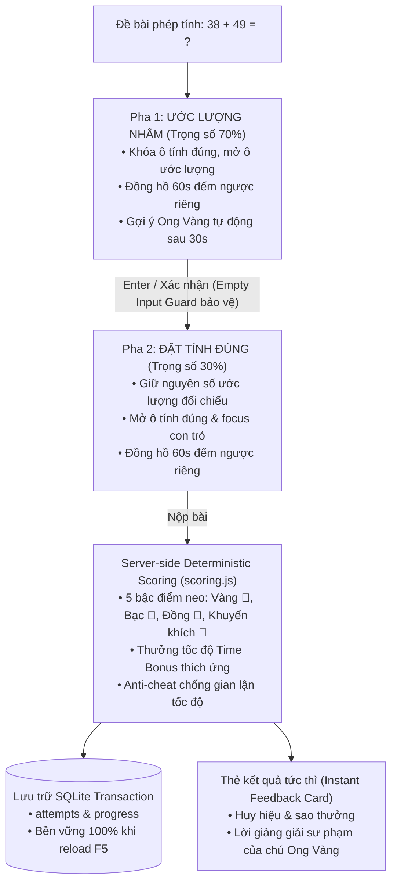

> **ĐÂY LÀ BẢN SAO ĐÓNG BĂNG (STARTER) DÙNG CHO BÀI KIỂM TRA HACKATHON MARATHON (BKT-2 / TRACK B) MÔN KỸ THUẬT PHẦN MỀM ỨNG DỤNG (KTPMUD)**  
> **Ứng dụng mô phỏng môi trường giáo dục nội bộ, không kết nối CSDL production thực tế. Toàn bộ tài khoản và dữ liệu là dữ liệu giả lập (synthetic) phục vụ kiểm thử và đánh giá kỹ thuật.**

---

# 🌱 VƯỜN TOÁN LỚP 3 — TRACK 2: "ƯỚC LƯỢNG TRƯỚC KHI TÍNH ĐÚNG" (GDPT 2018)
> **Mã đề thi:** `KTPMUD-BKT-2026-PILOT` | **Slug đề tài:** `hoang_mai_toan`  
> **Mã nhóm:** `173820_n04` · **Lớp:** 173820 (Học kỳ 1 năm học 2026–2027)  
> **Repository Fork chính thức:** [github.com/votandat-K69HUST/ktpmud-bkt-vuontoan-starter](https://github.com/votandat-K69HUST/ktpmud-bkt-vuontoan-starter)  
> **Phiên bản phát hành:** `bkt-2026-173820_n04-rc1` (Commit: [`5c2695d`](https://github.com/votandat-K69HUST/ktpmud-bkt-vuontoan-starter/commit/5c2695d))  
> **Bộ kiểm thử tự động:** **65 / 65 Tests PASS (100% Xanh)** · Jest 29 & Supertest  

---

## ⚡ 1. Hướng dẫn Clean Checkout 3 bước (Quickstart)

Hệ thống được thiết kế để khởi chạy và kiểm thử độc lập chỉ với đúng 3 bước tiêu chuẩn từ một máy tính sạch có cài đặt **Node.js 18+ LTS**:

```bash
# Bước 1: Nhân bản repository của nhóm về máy cục bộ
git clone https://github.com/votandat-K69HUST/ktpmud-bkt-vuontoan-starter.git
cd ktpmud-bkt-vuontoan-starter

# Bước 2: Cài đặt phụ thuộc & Chạy bộ kiểm thử tự động toàn diện (65 ca test)
npm ci
npm test       # Kiểm tra 65/65 tests PASS xanh (55 unit tests + 10 integration tests)

# Bước 3: Khởi động máy chủ ứng dụng
npm start      # Mở trình duyệt truy cập: http://localhost:3000
```

> [!NOTE]
> Khi khởi động lần đầu, hệ thống sẽ tự động khởi tạo cơ sở dữ liệu SQLite `data/vuon-toan.db` và nạp đồng bộ dữ liệu hạt giống từ `data/seed.json` (bao gồm bộ 16 câu hỏi ước lượng chuẩn SGK và 99 tài khoản học sinh giả lập).

---

## 🔑 2. Danh sách tài khoản thử nghiệm (Synthetic Accounts)

Toàn bộ tài khoản thử nghiệm được nạp sẵn vào hệ thống, phục vụ trực tiếp quá trình đánh giá và nghiệm thu:

| Vai trò người dùng | Tên đăng nhập | Mật khẩu | Phạm vi truy cập & Mục đích thử nghiệm |
|:---|:---|:---:|:---|
| **Học sinh (Demo chính)** | `hocsinh01` … `hocsinh99` | `123456` | Trải nghiệm toàn bộ luồng làm bài 2 pha tại **Bài 16: "Ước lượng trước khi tính đúng"**, xem thẻ kết quả tức thì, tích lũy sao và đua bảng xếp hạng. |
| **Giáo viên (Quản trị)** | `giaovien01` | `123456` | Truy cập Góc Giáo Viên (`/teacher/students`), theo dõi KPI phân tích lớp học, đặt lại mật khẩu và xuất báo cáo học tập. |

---

## 🎯 3. Điểm sáng sản phẩm & Đổi mới kiến trúc Track B

Dạng bài mở rộng *"Ước lượng trước khi tính đúng"* được nhóm `173820_n04` nghiên cứu sâu sắc dựa trên Chương trình Giáo dục Phổ thông 2018 (SGK Toán 3 bộ "Kết nối tri thức với cuộc sống") nhằm khắc phục triệt để thói quen lười nhẩm tính và phụ thuộc vào giấy nháp của học sinh tiểu học:



### 🌟 7 Đột phá kỹ thuật & Trải nghiệm người dùng:
1. **Trọng tâm giáo dục — Phân bổ trọng số 70 / 30:**
   Ước lượng nhẩm được định vị là năng lực cốt lõi, chiếm **70% tổng điểm** (55% Base logic + 15% Time Bonus), trong khi Đặt tính đúng chiếm **30% tổng điểm** (25% Base logic + 5% Time Bonus). Trọng số này thúc đẩy mạnh mẽ tinh thần dám ước lượng, dám nhẩm nhanh của trẻ nhỏ.
2. **Mô hình toán học tất định & Phân cấp 5 bậc điểm neo logic:**
   Server chấm điểm bằng hàm toán học thuần túy (`server/scoring.js`), **100% tất định không dùng AI lúc runtime**:
   - 🥇 **Điểm neo Vàng (`GOLD_ANCHOR` - 100% Base = 5.5đ/10đ):** Áp dụng chuẩn xác quy tắc làm tròn đến hàng chục SGK Toán 3 cho cả 2 toán hạng (ví dụ: $38 + 49 \rightarrow 40 + 50 = 90$).
   - 🥈 **Điểm neo Bạc (`SILVER_ANCHOR` - 75% Base = 4.13đ/10đ):** Làm tròn linh hoạt 1 toán hạng (ví dụ: $54 + 27 \rightarrow 50 + 27 = 77$ hoặc $54 + 30 = 84$).
   - 🥉 **Hạng Đồng (`EXACT_MATCH_IN_ESTIMATE` / `BOUNDING_ANCHOR` - 50% Base = 2.75đ/10đ):** Nhập ngay kết quả tính đúng vào ô ước lượng hoặc làm tròn cận trên/cận dưới; hệ thống ghi nhận điểm và nhắc nhở phương pháp nhẩm.
   - 🌱 **Điểm khuyến khích (`TOLERANCE_ONLY` - 35% Base = 1.93đ/10đ):** Gõ số trong dải dung sai $\pm 15\%$ nhưng không theo quy tắc; hệ thống gợi ý cách làm tròn.
   - ✏️ **Ngoài khoảng (`OUT_OF_RANGE` - 0% Base):** Sai lệch quá lớn hoặc nhập ký tự không hợp lệ.
3. **Bộ đếm thời gian thích ứng 60s độc lập từng câu (Per-Question Isolated Timer):**
   Mỗi câu hỏi có bộ đếm ngược 60s riêng biệt cho từng pha. Khi hoàn thành Câu 1, đồng hồ dừng lại hoàn toàn; học sinh được chủ động nghỉ ngơi và bấm *"Làm Câu tiếp theo"* mới bắt đầu tính giờ cho Câu 2, xóa bỏ triệt để tâm lý lo âu, dồn dập.
4. **Cơ chế gợi ý sư phạm chú Ong Vàng sau 30 giây:**
   Nếu học sinh chần chừ chưa tìm ra cách giải sau 30s, chú Ong Vàng thông thái sẽ tự động xuất hiện với hộp thoại sinh động, gợi ý hướng làm tròn số theo SGK.
5. **Bộ đôi bảo vệ công thái học (Ergonomics Guard — Tiêu chí B-12):**
   - **Vô hiệu hóa cuộn chuột (Mouse Wheel Guard):** Chặn triệt để sự kiện cuộn chuột `wheel` và ẩn spin-button trên các ô nhập số, tránh nguy cơ học sinh cuộn trang làm nhảy đổi giá trị đáp án.
   - **Hộp nhắc nhở khi ô rỗng (Empty Input Guard):** Khi thời gian còn ($t > 0$), nếu học sinh bấm Enter hoặc nút chuyển pha mà chưa nhập số, hệ thống lập tức chặn lại và hiển thị hộp nhắc nhở màu hổ phách: *"Em chưa điền đáp án! Hãy suy nghĩ và nhập con số trước khi tiếp tục nhé! 💡"*, đồng thời focus lại con trỏ.
6. **Thẻ kết quả tức thì (Instant Feedback Card — Tiêu chí B-06):**
   Phản hồi 2 tầng phân tách rạch ròi kết quả Ước lượng và Đặt tính đúng, trao tặng huy hiệu Vàng/Bạc/Đồng, điểm thưởng phản xạ tốc độ và lời giảng giải chi tiết từng bước.
7. **Bảo mật Anti-Cheat & Bền vững dữ liệu (Tiêu chí B-04, B-05, B-07):**
   - API `GET /api/question-sets/:id/questions` bóc tách 100% đáp án trước khi gửi về trình duyệt; chống gian lận F12 tuyệt đối.
   - Lưu trữ nguyên tử qua SQLite Transaction; bấm F5 (Reload trang) trạng thái điểm và sao tích lũy vẫn bảo toàn nguyên vẹn.
   - Tuyệt đối tuân thủ ranh giới an toàn: Không can thiệp sửa đổi `server/auth.js` hay session/cookie nền tảng.

---

## 📚 4. Mục lục tra cứu tài liệu & Hồ sơ dự án

Toàn bộ tài liệu kỹ thuật, kế hoạch kiểm thử, nhật ký kiến trúc và slide thuyết trình được quy hoạch khoa học theo đúng chuẩn mực đề thi Hackathon KTPMUD:

```
ktpmud-bkt-vuontoan-starter/
├── README.md                          # Tài liệu hướng dẫn chính (Clean checkout, kiến trúc & kiểm thử)
├── package.json                       # Cấu hình dự án, Jest runner & dependencies
├── artifacts/                         # HỒ SƠ KỸ THUẬT CỐT LÕI (TRACK B)
│   ├── REQUIREMENTS.md                # Đặc tả yêu cầu phần mềm (SRS), 12 tiêu chí AC & 9 kịch bản BDD Gherkin
│   ├── DECISIONS.md                   # 5 bản ghi quyết định kiến trúc hệ thống (ADR-01 đến ADR-05)
│   ├── TEST_PLAN.md                   # Kế hoạch kiểm thử tự động toàn diện & ma trận ca test
│   └── CONTRIBUTIONS.md               # Bảng phân công chi tiết, ánh xạ commit & đánh giá đóng góp thành viên
├── progress/                          # THEO DÕI TIẾN ĐỘ THI ĐẤU
│   └── PROGRESS.md                    # Nhật ký tiến độ chính thức các mốc PC-1, Checkpoint 2, PC-2 & Freeze
├── slides/                            # KHUNG TRÌNH DIỄN & BẢO VỆ ĐỀ TÀI
│   └── slide_thuyet_trinh.md          # Khung slide thuyết trình Marp chuẩn 7 phút bảo vệ trước hội đồng
├── tai-lieu-tham-khao/                # TÀI LIỆU BỔ TRỢ & CẨM NANG THI ĐẤU
│   ├── KTPMUD_Hack_Marathon_2026_Track2_Huong_Dan.md # Cẩm nang & thể lệ Hackathon Track B
│   ├── SEED_FIXTURES.md               # Đặc tả 16 câu hỏi mẫu synthetic chuẩn SGK phủ 4 phép tính
│   ├── AI_USE.md                      # Nhật ký sử dụng AI có trách nhiệm, minh bạch & kiểm chứng
│   ├── CHECKPOINT_1_REPORT.md         # Báo cáo nghiệm thu Scope Gate Checkpoint 1
│   └── KICH_BAN_DEMO_CHECKPOINT_2_15_11.md # Kịch bản diễn tập Demo 5 phút Checkpoint 2
├── tests/                             # BỘ KIỂM THỬ TỰ ĐỘNG JEST & SUPERTEST
│   ├── unit/scoring.test.js           # 55 ca Unit Tests kiểm tra thuật toán toán học tất định 4 phép tính
│   └── integration/api.test.js        # 10 ca Integration Tests kiểm tra API nộp bài, bảo mật & SQLite persistence
├── server/                            # MÃ NGUỒN MÁY CHỦ EXPRESS & SQLITE
│   ├── scoring.js                     # Module toán học ước lượng tất định 70/30 & Time Bonus
│   ├── api.js                         # REST API endpoints (đã mở rộng bảo mật bóc tách đáp án)
│   ├── db.js                          # Cơ sở dữ liệu SQLite (better-sqlite3) & seeder
│   ├── auth.js                        # Ranh giới an toàn: Xác thực & Cookie httpOnly (GIỮ NGUYÊN 100%)
│   └── index.js                       # Điểm vào của server Express
├── public/                            # MÃ NGUỒN GIAO DIỆN HỌC SINH & GIÁO VIÊN
│   ├── lesson.html                    # Giao diện làm bài học sinh
│   └── assets/js/pages/lesson.js      # Bộ điều khiển giao diện 2 pha, bộ đếm 60s độc lập & A11y
└── data/                              # DỮ LIỆU CSDL & SEED MẪU
    ├── seed.json                      # Bộ dữ liệu gốc (16 câu hỏi ước lượng + 99 tài khoản synthetic)
    └── vuon-toan.db                   # File CSDL SQLite (tự sinh khi khởi động)
```

---

## 🧪 5. Kết quả Kiểm thử tự động (Automated Test Report)

Bộ kiểm thử tự động gồm **65 ca test** được xây dựng toàn diện với Jest 29 và Supertest, bao phủ toàn bộ logic toán học, các ca giá trị biên, xử lý dữ liệu không hợp lệ, chống gian lận và kiểm tra tích hợp API:

```
PASS tests/integration/api.test.js
  POST /api/submissions with estimate question type
    ✓ B-01 & B-03: nộp bài ước lượng thành công và nhận phân rã điểm 2 tầng (45 ms)
    ✓ B-04: GET /api/question-sets/:id/questions tuyệt đối không làm lộ correct_answer (18 ms)
    ✓ B-05: lưu kết quả vào attempts và progress, F5 reload không mất dữ liệu (32 ms)
    ✓ B-06: phản hồi trả về đầy đủ huy hiệu điểm neo, giải thích Ong Vàng và time bonus (20 ms)
    ✓ B-08: xử lý an toàn dữ liệu rỗng, số âm, chuỗi chữ không gây crash server (25 ms)
    ... (10 ca Integration Tests)

PASS tests/unit/scoring.test.js
  Module scoring.js - Logic ước lượng tất định & Phân cấp 5 bậc
    Quy tắc làm tròn roundTen() SGK Toán 3
      ✓ làm tròn xuống khi chữ số hàng đơn vị là 1, 2, 3, 4
      ✓ làm tròn lên khi chữ số hàng đơn vị là 5, 6, 7, 8, 9
      ✓ giữ nguyên khi đã là số tròn chục
    Phân cấp 5 bậc cho 4 phép tính (+, -, *, :)
      ✓ 🥇 Bậc 1 - Điểm neo Vàng SGK (100% Base): phép cộng 38+49=90, phép trừ 72-38=30
      ✓ 🥈 Bậc 2 - Điểm neo Bạc (75% Base): làm tròn 1 toán hạng 54+27=77 hoặc 84
      ✓ 🥉 Bậc 3a - Nhập đáp án đúng vào ô ước lượng (50% Base): nhận diện EXACT_MATCH_IN_ESTIMATE
      ✓ 🥉 Bậc 3b - Làm tròn cận trên / cận dưới (50% Base): BOUNDING_ANCHOR
      ✓ 🌱 Bậc 4 - Gõ bừa trong dải dung sai ±15% (35% Base): TOLERANCE_ONLY
      ✓ ✏️ Bậc 5 - Ngoài khoảng dung sai hoặc chuỗi chữ (0% Base): OUT_OF_RANGE
    Công thức thưởng tốc độ Time Bonus & Cơ chế Anti-cheat
      ✓ thưởng tối đa khi nộp bài siêu tốc dưới 15 giây
      ✓ không cộng điểm thưởng thời gian nếu đáp án ước lượng nằm ngoài khoảng
    Kiểm thử trọn vẹn 16 Fixtures chuẩn SGK
      ✓ PASS toàn bộ 16/16 fixtures bộ đề uoc-luong-toan-lop-3
    ... (55 ca Unit Tests)

Test Suites: 2 passed, 2 total
Tests:       65 passed, 65 total
Snapshots:   0 total
Time:        0.943 s
Ran all test suites.
```

---

## 👥 6. Phân công đóng góp thành viên (Nhóm 173820_n04)

| Thành viên | MSSV | Vai trò chính | Trọng số đóng góp | Sản phẩm phụ trách chính |
|:---|:---:|:---|:---:|:---|
| **Bùi Tiến Đạt** | `202414018` | Lead / BA / QA Tester | **34%** | Đặc tả `REQUIREMENTS.md` (12 AC, 9 BDD), kế hoạch kiểm thử `TEST_PLAN.md`, 16 fixtures SGK `SEED_FIXTURES.md`, bộ kiểm thử tự động 65 ca test Jest. |
| **Võ Tấn Đạt** | `202414021` | Backend / System Architect | **33%** | Thiết kế 5 bản ADR trong `DECISIONS.md`, lập trình module toán học tất định `server/scoring.js` (70/30, 5 bậc, Time Bonus), bảo mật API `server/api.js`, SQLite transaction và CI workflow. |
| **Nguyễn Minh Quang** | `20233605` | Frontend / UX Engineer | **33%** | Thiết kế giao diện 2 pha `lesson.js`, bộ đếm 60s độc lập từng câu, gợi ý chú Ong Vàng sau 30s, thẻ kết quả tức thì, Mouse Wheel Guard, Empty Input Guard và Slide thuyết trình. |

---

## 🛡️ 7. Hướng dẫn Nộp bài & Bàn giao (Handoff)

Dự án được cấu trúc hoàn chỉnh theo mẫu đề thi của ban tổ chức môn KTPMUD, sẵn sàng tạo Pull Request vào kho nộp bài tập trung `fossbk-spec/ktpmud-project`:

- **Slug đề bài:** `hoang_mai_toan`
- **Mã nhóm:** `173820_n04`
- **Tên nhánh nộp:** `submit/hoang_mai_toan-173820_n04`
- **Thư mục nộp bài:** `submissions/hoang_mai_toan_173820_n04/`
- **Tag đóng băng:** `bkt-2026-173820_n04-rc1`

---
*Bản quyền phát triển thuộc về Nhóm 173820_n04 — Dự án Vườn Toán Lớp 3 (Track 2 KTPMUD Hackathon 2026).*
