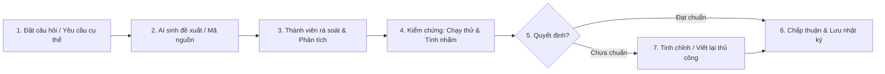

# 🤖 NHẬT KÝ SỬ DỤNG TRÍ TUỆ NHÂN TẠO (AI USE LOG)
> **Dự án:** Vườn Toán Lớp 3 — Track 2 (Track B: Thêm dạng bài *"Ước lượng trước khi tính đúng"*)  
> **Mã đề:** `KTPMUD-BKT-2026-PILOT` | **Mã nhóm:** `173820_n04`  
> **Thành viên:** Bùi Tiến Đạt (202414018), Võ Tấn Đạt (202414021), Nguyễn Minh Quang (20233605)  
> **Chính sách áp dụng:** Tuân thủ 100% Mục 3 (Luật thi, Quy định chung & Chính sách AI)  

---

## 1. Tuyên bố tuân thủ nguyên tắc sử dụng AI có trách nhiệm

Nhóm 04 (Lớp 173820) cam kết:
1. **Không dùng LLM lúc runtime:** Toàn bộ thuật toán chấm điểm và ước lượng chạy bằng code tất định (deterministic) thuần trên Node.js server, không gọi API AI để sinh đáp án hoặc chấm bài lúc học sinh nộp bài.
2. **Không để lộ bí mật/dữ liệu:** Không gửi bất kỳ dữ liệu nhạy cảm hay bí mật hệ thống nào lên mô hình AI.
3. **Mọi đề xuất từ AI đều có con người kiểm chứng:** Thành viên nhóm chịu trách nhiệm rà soát toán học sư phạm, đọc hiểu từng dòng mã nguồn, tự tay chạy test và chịu trách nhiệm độc lập trong buổi vấn đáp trực tiếp.

---

## 2. Bảng truy vết và nhật ký sử dụng AI chi tiết

| Công cụ / Model | Mục đích | Phạm vi (File / Module / Commit) | Cách thức nhóm kiểm chứng | Quyết định của nhóm | Thành viên chịu trách nhiệm |
|:---|:---|:---|:---|:---|:---|
| **Gemini 3.8 Flash** | Hỗ trợ giải thích và bóc tách cấu trúc 12 tiêu chí Acceptance Criteria từ đề thi `Huong_Dan.md` | `artifacts/REQUIREMENTS.md` | Đọc đối chiếu từng tiêu chí với tài liệu kiến trúc chuẩn `docs/architecture-reference.md` và mã nguồn starter gốc | Chấp thuận cấu trúc, bổ sung thêm các kịch bản BDD Gherkin chi tiết | Bùi Tiến Đạt (BA/Tester) |
| **Gemini 3.8 Flash** | Gợi ý mô hình toán học cho thuật toán ước lượng tất định (sai số $\le 15\%$ và điểm neo hàng chục) | `artifacts/DECISIONS.md` (ADR-01) | Thử nghiệm tính toán thủ công trên giấy với 12 phép toán lớp 3; đối chiếu SGK Toán 3 Kết nối tri thức | Tinh chỉnh lại ngưỡng: thêm cận biên tuyệt đối tối thiểu $\Delta_{min} = \max(2, \lceil 0.15 \times A \rceil)$ để không phạt oan phép chia số nhỏ | Võ Tấn Đạt (Backend/Arch) |
| **Gemini 3.8 Flash** | Đánh giá 3 phương án mở rộng Schema SQLite cho bảng `questions` (thêm cột vs lưu JSON trong `correct_answer`) | `artifacts/DECISIONS.md` (ADR-02) | Phân tích tính tương thích ngược với 4 type câu hỏi có sẵn và kiểm tra hàm seeder trong `server/db.js` | Chọn Phương án B (lưu JSON trong `correct_answer`) vì không làm thay đổi cấu trúc bảng, an toàn tuyệt đối với DB cũ | Võ Tấn Đạt (Backend/Arch) |
| **Gemini 3.8 Flash** | Tư vấn thiết kế tương tác người dùng 2 tầng (Phased interaction) và khả năng tiếp cận bằng phím | `artifacts/DECISIONS.md` (ADR-04) | Thử nghiệm hành vi gõ phím Tab/Enter trên HTML và CSS Tailwind thuần | Giữ nguyên đề xuất giao diện 2 pha (Ước lượng trước, Tính đúng sau), thêm viền focus trực quan cho trẻ lớp 3 | Nguyễn Minh Quang (Frontend/UX) |
| **Gemini 3.8 Flash** | Gợi ý danh mục 12 câu hỏi mẫu synthetic phù hợp với tâm lý học và trình độ học sinh lớp 3 | `artifacts/SEED_FIXTURES.md` / `data/seed.json` | Kiểm tra lại từng phép nhân/chia đảm bảo nằm trong phạm vi 1.000, không có số dư phức tạp | Chấp thuận 12 câu, bổ sung lời giải thích sư phạm chi tiết cho từng câu | Bùi Tiến Đạt (BA/Tester) |
| **Windows Package Manager (winget)** | Cài đặt và cấu hình môi trường Node.js 20 LTS cục bộ | Môi trường hệ điều hành máy trạm | Chạy `node -v` (v20.20.2), `npm -v` (10.8.2), chạy `npm install` và test `server/db.js` | Môi trường hoạt động ổn định, nạp DB thành công | Võ Tấn Đạt (Backend/Arch) |

---

## 3. Quy trình xác nhận của nhóm trước mỗi lần áp dụng AI

*Nhật ký này sẽ tiếp tục được cập nhật liên tục qua các giai đoạn M2 (Build) và M3 (Harden) cho đến khi chốt Code Freeze.*
