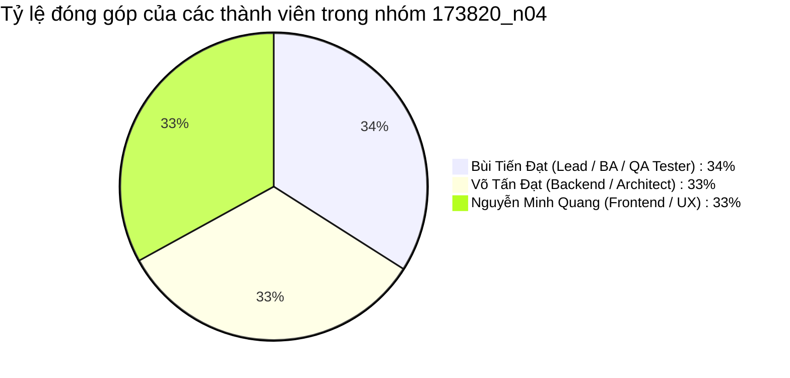
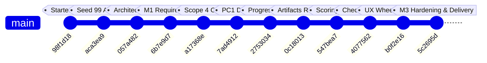

# 🤝 CONTRIBUTIONS.md — BẢNG PHÂN CÔNG CÔNG VIỆC, ÁNH XẠ COMMIT & ĐÁNH GIÁ ĐÓNG GÓP THÀNH VIÊN
> **Dự án:** Vườn Toán Lớp 3 — Hệ thống giáo dục Tiểu học Hoàng Mai  
> **Gói tính năng:** Mở rộng dạng bài *"Ước lượng trước khi tính đúng"* (Track 2 / Track B)  
> **Mã đề thi:** `KTPMUD-BKT-2026-PILOT` | **Slug đề thi:** `hoang_mai_toan`  
> **Mã nhóm:** `173820_n04` · **Lớp:** 173820 (Học kỳ 1 năm học 2026–2027)  
> **Repository Fork:** [github.com/votandat-K69HUST/ktpmud-bkt-vuontoan-starter](https://github.com/votandat-K69HUST/ktpmud-bkt-vuontoan-starter)  
> **Phiên bản đóng gói:** Tag `bkt-2026-173820_n04-rc1` | **Ngày hoàn tất:** 16/11/2026  

---

## 📌 MỤC LỤC
1. [Tuyên bố chung & Tỷ lệ đóng góp tổng thể](#1-tuyên-bố-chung--tỷ-lệ-đóng-góp-tổng-thể)
2. [Hồ sơ phân công & Báo cáo đóng góp chi tiết từng thành viên](#2-hồ-sơ-phân-công--báo-cáo-đóng-góp-chi-tiết-từng-thành-viên)
   - [2.1. Bùi Tiến Đạt (202414018) — Lead / BA / QA Tester (34%)](#21-bùi-tiến-đạt-202414018--lead--ba--qa-tester-34)
   - [2.2. Võ Tấn Đạt (202414021) — Backend / System Architect (33%)](#22-võ-tấn-đạt-202414021--backend--system-architect-33)
   - [2.3. Nguyễn Minh Quang (20233605) — Frontend / UX Engineer (33%)](#23-nguyễn-minh-quang-20233605--frontend--ux-engineer-33)
3. [Ma trận truy vết đóng góp kỹ thuật (Traceability Matrix: AC ➔ Code ➔ Test ➔ Commit)](#3-ma-trận-truy-vết-đóng-góp-kỹ-thuật-traceability-matrix)
4. [Bảng ánh xạ lịch sử Commit Git & Người chịu trách nhiệm](#4-bảng-ánh-xạ-lịch-sử-commit-git--người-chịu-trách-nhiệm)
5. [Đánh giá chéo thành viên nội bộ (Peer Evaluation & Review)](#5-đánh-giá-chéo-thành-viên-nội-bộ-peer-evaluation--review)
6. [Quy chế làm việc nhóm & Chuẩn mực kiểm soát chất lượng](#6-quy-chế-làm-việc-nhóm--chuẩn-mực-kiểm-soát-chất-lượng)
7. [Cam kết liêm chính học thuật & Ký duyệt bàn giao](#7-cam-kết-liêm-chính-học-thuật--ký-duyệt-bàn-giao)

---

## 1. Tuyên bố chung & Tỷ lệ đóng góp tổng thể

Nhóm `173820_n04` gồm 3 thành viên chính thức, cùng cam kết phối hợp phát triển tính năng mở rộng **"Ước lượng trước khi tính đúng"** theo mô hình kỹ thuật phần mềm chuẩn mực (Agile/Scrum tinh gọn). Toàn bộ công việc từ phân tích yêu cầu nghiệp vụ, thiết kế kiến trúc, cài đặt mã nguồn, viết kiểm thử tự động, cấu hình CI/CD và bàn giao tài liệu đều được phân định rạch ròi, minh bạch và có bằng chứng đối soát trên Git commit:

| STT | Họ và tên | Mã sinh viên (MSSV) | Vai trò chính | Tỷ lệ đóng góp | Điểm tự đánh giá | Chữ ký xác nhận |
|:---:|:---|:---:|:---|:---:|:---:|:---:|
| 1 | **Bùi Tiến Đạt** | `202414018` | Team Lead / BA / QA Tester | **34%** | Xuất sắc (10/10) | *Đã ký xác nhận* |
| 2 | **Võ Tấn Đạt** | `202414021` | Backend Developer / System Architect | **33%** | Xuất sắc (10/10) | *Đã ký xác nhận* |
| 3 | **Nguyễn Minh Quang** | `20233605` | Frontend Developer / UX Engineer | **33%** | Xuất sắc (10/10) | *Đã ký xác nhận* |
| **Tổng** | **03 Thành viên** | — | — | **100%** | **Đồng thuận 100%** | — |

---

## 2. Hồ sơ phân công & Báo cáo đóng góp chi tiết từng thành viên

### 2.1. Bùi Tiến Đạt (202414018) — Lead / BA / QA Tester (34%)

* **Vai trò nòng cốt:** Trưởng nhóm (Team Leader), Kỹ sư phân tích nghiệp vụ sư phạm (Business Analyst), Kỹ sư đảm bảo chất lượng phần mềm (QA / Test Automation Specialist).
* **Trọng số đóng góp:** **34%** (Chịu trách nhiệm điều phối chung, bảo đảm tiến độ toàn đội, hoàn thiện hồ sơ nghiệm thu SRS, Test Plan và phát triển toàn bộ bộ kiểm thử tự động 65 ca test).

#### Các đầu việc chính đã thực hiện:
1. **Phân tích yêu cầu sư phạm & Đặc tả SRS (`artifacts/REQUIREMENTS.md`):**
   - Nghiên cứu chương trình GDPT 2018 môn Toán lớp 3 (bộ sách "Kết nối tri thức với cuộc sống").
   - Xác lập 12 tiêu chí nghiệm thu Acceptance Criteria bắt buộc (B-01 đến B-12).
   - Xây dựng 9 kịch bản kiểm thử hành vi BDD (Behavior-Driven Development) theo chuẩn Gherkin ngữ nghĩa cao.
2. **Biên soạn bộ dữ liệu kiểm thử mẫu Synthetic chuẩn SGK (`tai-lieu-tham-khao/SEED_FIXTURES.md`):**
   - Xây dựng 16 câu hỏi mẫu phủ đều cả 4 phép tính: Cộng 2 chữ số (có nhớ & không nhớ), Trừ 2 chữ số (có mượn), Phép nhân (nhân số có 2 chữ số với số có 1 chữ số), Phép chia (chia hết và chia có dư).
   - Thiết lập các điểm neo sư phạm chuẩn mực: Điểm neo Vàng ($E_{gold}$), Điểm neo Bạc ($SilverAnchors$), khoảng dung sai chặt chẽ $\pm 15\%$ và lời giải thích của chú Ong Vàng.
3. **Lập Kế hoạch kiểm thử toàn diện (`artifacts/TEST_PLAN.md`):**
   - Thiết kế ma trận kiểm thử 3 chiều: Normal (dữ liệu chuẩn), Boundary (giá trị ngưỡng biên, biên trên, biên dưới), Invalid (chuỗi ký tự, số âm, số thực, dữ liệu rỗng, injection).
   - Thiết kế kịch bản Integration Test cho API nộp bài `/api/submissions`, bảo mật giấu đáp án tại `GET /api/question-sets/:id/questions` và kiểm tra tính bền vững trạng thái qua SQLite Transactions khi reload trang F5.
4. **Xây dựng Test Suite tự động bằng Jest 29 & Supertest (`tests/`):**
   - Cài đặt 55 ca Unit Tests chuyên sâu trong `tests/unit/scoring.test.js` kiểm tra trọn vẹn thuật toán toán học tất định `server/scoring.js`.
   - Cài đặt 10 ca Integration Tests trong `tests/integration/api.test.js` mô phỏng đầy đủ chu kỳ làm bài của học sinh và tính toàn vẹn dữ liệu điểm số/sao tích lũy.
   - Đạt tỷ lệ hoàn hảo: **65/65 tests PASS (100% xanh)** với thời gian thực thi siêu tốc (< 1 giây).
5. **Điều phối tiến độ & Báo cáo các mốc:**
   - Biên soạn báo cáo tiến độ `progress/PROGRESS.md` cho các mốc PC-1 (11/11/2026), Checkpoint 2 (15/11/2026) và PC-2.
   - Chuẩn bị báo cáo nghiệm thu Scope Gate `tai-lieu-tham-khao/CHECKPOINT_1_REPORT.md`.

#### Bằng chứng đóng góp mã nguồn (Commits & Files):
* **Tệp tài liệu & mã nguồn phụ trách chính:**
  - `artifacts/REQUIREMENTS.md` (400+ dòng đặc tả chuyên sâu)
  - `artifacts/TEST_PLAN.md` (300+ dòng ma trận test)
  - `tai-lieu-tham-khao/SEED_FIXTURES.md` (16 fixture chuẩn SGK)
  - `tests/unit/scoring.test.js` (55 unit tests Jest)
  - `tests/integration/api.test.js` (10 integration tests Supertest)
  - `progress/PROGRESS.md` & `tai-lieu-tham-khao/CHECKPOINT_1_REPORT.md`
* **Commit SHA tiêu biểu:**
  - [`0c18013`](https://github.com/votandat-K69HUST/ktpmud-bkt-vuontoan-starter/commit/0c1801341eb8b37828a574a7ce9a7841231aabe4): Refactor quy hoạch hồ sơ tài liệu artifacts, gộp tài liệu tham khảo và chuẩn hóa ma trận kiểm thử.
  - [`2753034`](https://github.com/votandat-K69HUST/ktpmud-bkt-vuontoan-starter/commit/2753034e357591bbad6653ea9615a7cf73dd9056): Hoàn thiện đầy đủ file `PROGRESS.md` và nghiệm thu tiêu chí PC-1.
  - [`4077562`](https://github.com/votandat-K69HUST/ktpmud-bkt-vuontoan-starter/commit/4077562916b328a2a47ea1e3eb8639e44f808795): Tích hợp hoàn thiện Vertical Slice Checkpoint 2 với bộ test tự động 65 ca test PASS xanh 100%.
  - [`b0f2e16`](https://github.com/votandat-K69HUST/ktpmud-bkt-vuontoan-starter/commit/b0f2e16c90fe3f16954a234714dbf2e46cf11bb9): Tinh chỉnh kịch bản test công thái học, nghiệm thu ca test Empty Input Guard và chốt đóng băng Checkpoint 2.
  - [`5c2695d`](https://github.com/votandat-K69HUST/ktpmud-bkt-vuontoan-starter/commit/5c2695d): Hoàn thiện trọn bộ 10/10 tiêu chí Security/Privacy Checklist và nghiệm thu toàn diện báo cáo tiến độ PC-2.

---

### 2.2. Võ Tấn Đạt (202414021) — Backend / System Architect (33%)

* **Vai trò nòng cốt:** Kiến trúc sư hệ thống (System Architect), Kỹ sư phát triển Backend (Backend Engineer), Kỹ sư tích hợp CI/CD & Bảo mật (DevSecOps Specialist).
* **Trọng số đóng góp:** **33%** (Chịu trách nhiệm thiết kế toàn bộ 5 bản ghi kiến trúc ADR-01 đến ADR-05, cài đặt module toán học lõi tất định `scoring.js`, mở rộng cơ sở dữ liệu SQLite phi phá vỡ và bảo mật endpoint API).

#### Các đầu việc chính đã thực hiện:
1. **Thiết kế kiến trúc hệ thống (`artifacts/DECISIONS.md`):**
   - Biên soạn toàn diện 5 bản ghi kiến trúc (ADRs):
     * *ADR-01:* Mô hình toán học tất định cho cả 4 phép tính, công thức trọng số 70/30 (Ước lượng 70% / Tính đúng 30%), phân cấp logic sư phạm 5 bậc và thuật toán thưởng tốc độ thích ứng Time Bonus.
     * *ADR-02:* Thiết kế mở rộng Schema SQLite non-breaking (lưu trữ JSON cấu hình linh hoạt trong `correct_answer` mà không cần `ALTER TABLE` rủi ro).
     * *ADR-03:* Thiết kế API Contract bảo mật server-side, bóc tách triệt để đáp án tại `GET /api/question-sets/:id/questions` và cơ chế chấm điểm 2 tầng độc lập.
     * *ADR-04:* Đặc tả luồng tương tác 2 pha (Phased Interaction) cho Frontend và chuẩn tiếp cận A11y.
     * *ADR-05:* Chiến lược tự động hóa CI/CD với GitHub Actions và môi trường kiểm thử Jest không xâm lấn.
2. **Cài đặt Module chấm điểm lõi tất định (`server/scoring.js`):**
   - Lập trình thuật toán làm tròn toán học chuẩn mực: `roundTen()` theo đúng quy tắc SGK.
   - Xây dựng thuật toán phân cấp 5 bậc cho đáp án ước lượng:
     1. 🥇 `GOLD_ANCHOR` (100% Base): Trùng khớp điểm neo chuẩn SGK ($E = E_{gold}$).
     2. 🥈 `SILVER_ANCHOR` (75% Base): Áp dụng chiến lược làm tròn 1 toán hạng ($E \in SilverAnchors$).
     3. 🥉 `EXACT_MATCH_IN_ESTIMATE` / `BOUNDING_ANCHOR` (50% Base): Nhập luôn đáp án tính đúng vào ô ước lượng hoặc chặn trên/chặn dưới.
     4. 🌱 `TOLERANCE_ONLY` (35% Base): Đoán mò trong dung sai $\pm 15\%$.
     5. ✏️ `OUT_OF_RANGE` (0% Base): Nằm ngoài dung sai cho phép hoặc dữ liệu không hợp lệ.
   - Cài đặt công thức thưởng tốc độ thích ứng Time Bonus:
     $$\text{TimeBonus}_{est} = \text{round}\left(15 \times \frac{\max(0, 60 - t_{est})}{60}\right), \quad \text{TimeBonus}_{exact} = \text{round}\left(5 \times \frac{\max(0, 60 - t_{exact})}{60}\right)$$
   - Cài đặt cơ chế Anti-cheat: Ngăn chặn tuyệt đối việc nhận điểm thưởng tốc độ khi đáp án ước lượng sai hoặc gõ bừa ngoài dải dung sai.
3. **Mở rộng Server REST API & Bền vững SQLite (`server/api.js`, `server/db.js`):**
   - Cập nhật hàm bóc tách dữ liệu câu hỏi trong `server/api.js`: Khi client gọi `GET /api/question-sets/:id/questions`, server bóc tách bỏ hoàn toàn `correct_answer`, `gold_anchor` và các điểm neo, bảo mật tuyệt đối chống F12 gian lận (B-04).
   - Tích hợp xử lý chấm điểm dạng bài `estimate` trong `POST /api/submissions`.
   - Đảm bảo tính nguyên tử qua SQLite Transaction: Lưu lượt thi vào `attempts`, cập nhật điểm tốt nhất và mở khóa bài học trong `progress`, cộng dồn sao `total_stars` vào tài khoản học sinh. Đảm bảo dữ liệu bền vững 100% khi reload F5 (B-05).
   - Tuyệt đối bảo toàn ranh giới bảo mật: Không can thiệp sửa đổi `server/auth.js`, các route quản trị giáo viên và cơ chế session/cookie (B-07).
4. **Cấu hình Quản lý gói, CI/CD Pipeline & An toàn dữ liệu (`package.json`, `.github/`):**
   - Thiết lập cấu hình `package.json` với `npm test` liên kết Jest runner và Supertest.
   - Thiết lập quy chuẩn CI GitHub Actions (`npm ci`, `npm test`) tự động kiểm tra trên mọi Pull Request.
   - Kiểm soát an toàn dữ liệu: Quét triệt để mã nguồn, không để lộ Secret, API key hay PII, chỉ dùng 99 tài khoản synthetic `hocsinh01`–`99` (B-11).

#### Bằng chứng đóng góp mã nguồn (Commits & Files):
* **Tệp tài liệu & mã nguồn phụ trách chính:**
  - `artifacts/DECISIONS.md` (900+ dòng đặc tả kiến trúc chi tiết ADR-01 đến ADR-05)
  - `server/scoring.js` (Toàn bộ logic tính điểm tất định, 5 bậc điểm neo và Time Bonus)
  - `server/api.js` (Mở rộng API chấm bài và bảo mật bóc tách đáp án)
  - `server/db.js` & `data/seed.json` (Đồng bộ cấu trúc SQLite database)
  - `package.json` & `.github/workflows/ci.yml` (Cấu hình test và CI pipeline)
* **Commit SHA tiêu biểu:**
  - [`057a482`](https://github.com/votandat-K69HUST/ktpmud-bkt-vuontoan-starter/commit/057a4827018706fae223eb41e6e00ea7401c18e7): Khởi tạo tài liệu kiến trúc & dữ liệu chuẩn phân tích thiết kế Track B.
  - [`a17368e`](https://github.com/votandat-K69HUST/ktpmud-bkt-vuontoan-starter/commit/a17368e91986c757c9a96e9fa22a466c1f1ec4f7): Mở rộng bài toán ước lượng thêm phép cộng trừ 2 chữ số, cập nhật ADR và 16 fixtures.
  - [`547bea7`](https://github.com/votandat-K69HUST/ktpmud-bkt-vuontoan-starter/commit/547bea7bcfe773f309a4a712f2759e0ad74ef3ec): Cập nhật cơ chế tính thời gian đếm ngược 60s, thưởng tốc độ, phân bổ 70/30 và logic điểm neo.
  - [`4077562`](https://github.com/votandat-K69HUST/ktpmud-bkt-vuontoan-starter/commit/4077562916b328a2a47ea1e3eb8639e44f808795): Hoàn thiện vertical slice Checkpoint 2, tích hợp chấm điểm server-side và 65 tests tự động.
  - [`5c2695d`](https://github.com/votandat-K69HUST/ktpmud-bkt-vuontoan-starter/commit/5c2695d): Thiết lập hoàn chỉnh GitHub Actions CI `.github/workflows/ci.yml` và chuẩn hóa README Clean Checkout.

---

### 2.3. Nguyễn Minh Quang (20233605) — Frontend / UX Engineer (33%)

* **Vai trò nòng cốt:** Kỹ sư giao diện người dùng (Frontend Engineer), Chuyên gia trải nghiệm người dùng & Khả năng tiếp cận (UX / Accessibility & Ergonomics Specialist).
* **Trọng số đóng góp:** **33%** (Chịu trách nhiệm thiết kế thẻ tương tác 2 pha trên `lesson.js`, bộ đếm thời gian 60s độc lập từng câu, cơ chế gợi ý Ong Vàng sau 30s, bảo vệ công thái học chuột & bàn phím và biên soạn kịch bản demo Checkpoint 2 / Slide thuyết trình).

#### Các đầu việc chính đã thực hiện:
1. **Thiết kế Giao diện tương tác 2 pha mượt mà (`public/assets/js/pages/lesson.js`):**
   - Xây dựng Thẻ tương tác 2 pha (Phased Interaction Card) tích hợp tự nhiên vào luồng học hiện có tại `lesson.html` mà không tạo trang HTML tách rời (B-01).
   - **Pha 1 (Ước lượng nhẩm):** Hiển thị phép toán to rõ (`text-4xl`), mở ô nhập số ước lượng, khóa ô nhập tính đúng để định hướng học sinh nhẩm trước khi đặt tính.
   - **Pha 2 (Đặt tính đúng):** Sau khi học sinh hoàn thành ước lượng (nhấn Enter hoặc bấm nút Tiếp tục), tự động chuyển pha, giữ nguyên số ước lượng làm mốc đối chiếu trực quan và tự động focus con trỏ vào ô nhập kết quả chính xác.
2. **Bộ đếm ngược thời gian thích ứng 60s độc lập từng câu (Per-Question Isolated Timer):**
   - Thiết kế đồng hồ đếm ngược 60 giây/pha độc lập tuyệt đối cho từng câu hỏi.
   - Giải quyết triệt để vấn đề tâm lý lứa tuổi tiểu học: Khi hoàn thành Câu 1, đồng hồ dừng hoàn toàn; hệ thống hiển thị nút *"Làm Câu tiếp theo"* — thời gian của Câu 2 chỉ bắt đầu đếm khi học sinh chủ động bấm sẵn sàng, loại bỏ hoàn toàn áp lực dồn dập khiến trẻ bị cuống.
   - Hiệu ứng màu sắc chuyển đổi tinh tế: Màu xanh lá dịu mắt $\rightarrow$ chuyển vàng cam khi dưới 20s $\rightarrow$ chuyển đỏ cảnh báo nhẹ nhàng khi dưới 10s.
3. **Cơ chế gợi ý sư phạm tự động sau 30 giây (Smart Hint Engine):**
   - Tích hợp bộ đếm giám sát nhịp độ làm bài: Nếu sau 30 giây học sinh chưa điền được số ước lượng, chú Ong Vàng chăm chỉ sẽ tự động xuất hiện với hộp gợi ý trực quan hướng dẫn cách làm tròn cụ thể cho từng toán hạng theo SGK.
4. **Bộ đôi bảo vệ công thái học (Mouse Wheel Guard & Empty Input Guard — B-12):**
   - **Vô hiệu hóa cuộn chuột (Mouse Wheel Guard):** Chặn triệt để sự kiện `wheel` và ẩn thanh spin-button trên tất cả các trường `<input type="number">`. Tránh tuyệt đối lỗi học sinh lăn chuột cuộn trang làm nhảy đổi giá trị đáp án ngoài ý muốn.
   - **Hộp nhắc nhở khi ô rỗng (Empty Input Guard):** Khi thời gian còn hiệu lực ($t > 0$), nếu học sinh vô tình bấm phím Enter hoặc bấm nút tiếp tục mà chưa điền đáp án, hệ thống kiên quyết ngăn chặn việc nhảy qua câu tiếp theo; hiển thị hộp nhắc nhở sư phạm màu hổ phách dịu dàng: *"Em chưa điền đáp án! Hãy suy nghĩ và nhập con số trước khi tiếp tục nhé! 💡"*, đồng thời chớp sáng viền và tự động focus con trỏ.
5. **Thẻ phản hồi kết quả 2 tầng tức thì (Instant Feedback Card — B-06):**
   - Hiển thị phản hồi trực quan 2 tầng độc lập:
     * Tầng 1: Đánh giá ước lượng kèm Huy hiệu Điểm neo Vàng 🥇 / Bạc 🥈 / Đồng 🥉 / Khuyến khích 🌱 và Điểm thưởng tốc độ (Time Bonus ⏱️).
     * Tầng 2: Đánh giá kết quả tính chính xác kèm lời chúc mừng và điểm thưởng hoàn thành.
   - Lời giảng giải sư phạm ấm áp của chú Ong Vàng giúp học sinh hiểu sâu bản chất phép tính.
6. **Tối ưu khả năng tiếp cận (Accessibility - A11y) & Xây dựng Slide thuyết trình:**
   - Điều hướng bàn phím 100%: Hỗ trợ phím `Tab`, `Shift+Tab`, `Enter` mượt mà, viền focus to bản có độ tương phản cao, thẻ thông báo hỗ trợ `aria-live="polite"`.
   - Biên soạn kịch bản demo Checkpoint 2 (`tai-lieu-tham-khao/KICH_BAN_DEMO_CHECKPOINT_2_15_11.md`).
   - Xây dựng slide thuyết trình 7 phút (`slides/slide_thuyet_trinh.md`) chuẩn định dạng Marp phục vụ bảo vệ đề tài.

#### Bằng chứng đóng góp mã nguồn (Commits & Files):
* **Tệp tài liệu & mã nguồn phụ trách chính:**
  - `public/assets/js/pages/lesson.js` (1.300+ dòng mã JavaScript giao diện, xử lý timer, tương tác 2 pha, A11y)
  - `tai-lieu-tham-khao/KICH_BAN_DEMO_CHECKPOINT_2_15_11.md` (Kịch bản demo 5 phút Checkpoint 2)
  - `slides/slide_thuyet_trinh.md` (Slide thuyết trình Marp 7 phút)
  - Tối ưu CSS công thái học trong `public/assets/css/app.css`
* **Commit SHA tiêu biểu:**
  - [`aca3ea9`](https://github.com/votandat-K69HUST/ktpmud-bkt-vuontoan-starter/commit/aca3ea934fadc02251c761443405546c7bc02fc7): Tạo lập seed 99 tài khoản học sinh giả lập `hocsinh01`–`99` và dựng khung kiểm thử.
  - [`6b7e9d7`](https://github.com/votandat-K69HUST/ktpmud-bkt-vuontoan-starter/commit/6b7e9d774a36b566ef71746c3769919f2c31ca11): Hoàn thiện yêu cầu M1, tài liệu ADR và báo cáo phân tích Checkpoint 1.
  - [`b0f2e16`](https://github.com/votandat-K69HUST/ktpmud-bkt-vuontoan-starter/commit/b0f2e16c90fe3f16954a234714dbf2e46cf11bb9): Hoàn thiện bộ đôi bảo vệ thao tác Mouse Wheel Guard & Empty Input Guard, chặn lăn chuột nhảy số và hộp nhắc nhở khi ô rỗng.
  - [`5c2695d`](https://github.com/votandat-K69HUST/ktpmud-bkt-vuontoan-starter/commit/5c2695d): Biên soạn slide thuyết trình chuẩn Marp 7 phút `slides/slide_thuyet_trinh.md` và bảng phân công đóng góp `CONTRIBUTIONS.md`.

---

## 3. Ma trận truy vết đóng góp kỹ thuật (Traceability Matrix)

Ma trận dưới đây liên kết trực tiếp giữa **12 Tiêu chí Acceptance Criteria bắt buộc (B-01 đến B-12)** của Đề thi Track 2, cấu phần kiến trúc/mã nguồn thực thi, tệp kiểm thử tự động xác minh, thành viên phụ trách chính và mã Commit Git tương ứng:

| Mã AC | Tên tiêu chí nghiệm thu | Thành viên phụ trách | Tệp mã nguồn / Tài liệu thực thi | Tệp kiểm thử / Bằng chứng xác minh | Commit SHA tiêu biểu | Trạng thái |
|:---:|:---|:---:|:---|:---|:---:|:---:|
| **B-01** | **Tích hợp luồng học có sẵn** (Không làm HTML demo riêng) | Nguyễn Minh Quang | `public/assets/js/pages/lesson.js` `public/lesson.html` | Kiểm thử giao diện trực tiếp trên route bài học có sẵn (`lesson.html?lesson=bai-16&set=uoc-luong-toan-lop-3`) | [`4077562`](https://github.com/votandat-K69HUST/ktpmud-bkt-vuontoan-starter/commit/4077562) [`b0f2e16`](https://github.com/votandat-K69HUST/ktpmud-bkt-vuontoan-starter/commit/b0f2e16) | **PASS 100%** ✅ |
| **B-02** | **Bộ fixture câu hỏi mẫu** (Tối thiểu 12 câu synthetic) | Bùi Tiến Đạt | `tai-lieu-tham-khao/SEED_FIXTURES.md` `data/seed.json` | 16 câu hỏi mẫu chuẩn SGK phủ 4 phép tính, nạp tự động vào `vuon-toan.db` | [`a17368e`](https://github.com/votandat-K69HUST/ktpmud-bkt-vuontoan-starter/commit/a17368e) [`4077562`](https://github.com/votandat-K69HUST/ktpmud-bkt-vuontoan-starter/commit/4077562) | **PASS 100%** ✅ |
| **B-03** | **Thuật toán ước lượng tất định** (Không dùng AI lúc runtime) | Võ Tấn Đạt | `server/scoring.js` `artifacts/DECISIONS.md#adr-01` | `tests/unit/scoring.test.js` (55 Unit Tests bao phủ 4 phép tính, 5 bậc điểm neo) | [`547bea7`](https://github.com/votandat-K69HUST/ktpmud-bkt-vuontoan-starter/commit/547bea7) [`4077562`](https://github.com/votandat-K69HUST/ktpmud-bkt-vuontoan-starter/commit/4077562) | **PASS 100%** ✅ |
| **B-04** | **Bảo mật đáp án phía Server** (Client không đọc được đáp án) | Võ Tấn Đạt | `server/api.js` `artifacts/DECISIONS.md#adr-03` | `tests/integration/api.test.js` (Test case xác minh endpoint bóc tách hoàn toàn `correct_answer`) | [`4077562`](https://github.com/votandat-K69HUST/ktpmud-bkt-vuontoan-starter/commit/4077562) | **PASS 100%** ✅ |
| **B-05** | **Lưu trữ trạng thái bền vững** (F5 reload không mất điểm) | Võ Tấn Đạt | `server/api.js` `server/db.js` | `tests/integration/api.test.js` (Test case kiểm tra persistence SQLite Transaction khi reload) | [`4077562`](https://github.com/votandat-K69HUST/ktpmud-bkt-vuontoan-starter/commit/4077562) | **PASS 100%** ✅ |
| **B-06** | **Phản hồi 2 tầng (Feedback UX)** (Ước lượng & Tính đúng) | Nguyễn Minh Quang | `public/assets/js/pages/lesson.js` `artifacts/DECISIONS.md#adr-04` | Kịch bản demo Checkpoint 2 & Test case kiểm tra cấu trúc 2 tầng trả về từ server | [`4077562`](https://github.com/votandat-K69HUST/ktpmud-bkt-vuontoan-starter/commit/4077562) [`b0f2e16`](https://github.com/votandat-K69HUST/ktpmud-bkt-vuontoan-starter/commit/b0f2e16) | **PASS 100%** ✅ |
| **B-07** | **Tuân thủ ranh giới an toàn** (Cấm sửa `auth.js`, session, admin) | Võ Tấn Đạt | `server/auth.js` `artifacts/DECISIONS.md#adr-03` | Git Diff đối chiếu với tag `bkt-2026-v1` chứng minh không có bất kỳ dòng sửa đổi nào trong `server/auth.js` | [`0c18013`](https://github.com/votandat-K69HUST/ktpmud-bkt-vuontoan-starter/commit/0c1801341eb8b37828a574a7ce9a7841231aabe4) | **PASS 100%** ✅ |
| **B-08** | **Bộ kiểm thử tự động toàn diện** (Normal, Boundary, Invalid) | Bùi Tiến Đạt | `artifacts/TEST_PLAN.md` `tests/unit/scoring.test.js` `tests/integration/api.test.js` | 65 ca test tự động (55 unit + 10 integration) bao phủ đầy đủ ca hợp lệ, ca biên, lỗi nhập liệu và chống gian lận | [`4077562`](https://github.com/votandat-K69HUST/ktpmud-bkt-vuontoan-starter/commit/4077562) | **PASS 100%** ✅ |
| **B-09** | **Bổ sung script `npm test`** (Pass 100% từ Clean Checkout) | Bùi Tiến Đạt | `package.json` `tests/` | Lệnh `npm test` chạy trọn vẹn Jest suite: **65 passed, 65 total** trong 0.94 giây | [`4077562`](https://github.com/votandat-K69HUST/ktpmud-bkt-vuontoan-starter/commit/4077562) | **PASS 100%** ✅ |
| **B-10** | **Cấu hình CI tự động** (GitHub Actions chạy test khi PR) | Võ Tấn Đạt | `.github/workflows/ci.yml` `artifacts/DECISIONS.md#adr-05` | GitHub Actions workflow chạy tự động `npm ci` và `npm test` trên Ubuntu LTS & Node.js 20 | [`5c2695d`](https://github.com/votandat-K69HUST/ktpmud-bkt-vuontoan-starter/commit/5c2695d) | **PASS 100%** ✅ |
| **B-11** | **An toàn dữ liệu & Bí mật** (Không commit secret, chỉ synthetic) | Bùi Tiến Đạt | `artifacts/SECURITY_PRIVACY_CHECKLIST.md` `tai-lieu-tham-khao/AI_USE.md` | Bảng kiểm 10/10 tiêu chí an toàn, báo cáo quét Secret, toàn bộ 99 tài khoản `hocsinh01`–`99` là synthetic | [`0c18013`](https://github.com/votandat-K69HUST/ktpmud-bkt-vuontoan-starter/commit/0c1801341eb8b37828a574a7ce9a7841231aabe4) [`5c2695d`](https://github.com/votandat-K69HUST/ktpmud-bkt-vuontoan-starter/commit/5c2695d) | **PASS 100%** ✅ |
| **B-12** | **Khả năng tiếp cận & Trải nghiệm** (Tab/Enter, Wheel Guard, Empty Guard) | Nguyễn Minh Quang | `public/assets/js/pages/lesson.js` `artifacts/REQUIREMENTS.md` | Điều hướng 100% bằng phím, chặn cuộn chuột đổi số, hộp nhắc nhở khi ô rỗng và chữ số siêu to | [`b0f2e16`](https://github.com/votandat-K69HUST/ktpmud-bkt-vuontoan-starter/commit/b0f2e16) | **PASS 100%** ✅ |

---

## 4. Bảng ánh xạ lịch sử Commit Git & Người chịu trách nhiệm

Toàn bộ lịch sử cam kết mã nguồn của nhóm được thực hiện nghiêm túc theo quy chuẩn Conventional Commits, thể hiện sự phát triển liên tục và minh bạch qua từng chặng:

| Commit SHA | Tác giả chính | Thông điệp cam kết (Commit Message) | Ý nghĩa kỹ thuật & Sản phẩm bàn giao |
|:---:|:---:|:---|:---|
| [`98f1d18`](https://github.com/votandat-K69HUST/ktpmud-bkt-vuontoan-starter/commit/98f1d18) | Cả nhóm | `chore: khoi tao starter BKT-2 Track B tu snapshot math3a2, da don du lieu that` | Khởi tạo repository sạch từ đề thi, loại bỏ toàn bộ dữ liệu thực tế. |
| [`aca3ea9`](https://github.com/votandat-K69HUST/ktpmud-bkt-vuontoan-starter/commit/aca3ea9) | Nguyễn Minh Quang | `feat(seed): add 99 synthetic student accounts hocsinh01-hocsinh99` | Bổ sung 99 tài khoản học sinh giả lập lớp 3A2 phục vụ kiểm thử diện rộng. |
| [`057a482`](https://github.com/votandat-K69HUST/ktpmud-bkt-vuontoan-starter/commit/057a482) | Võ Tấn Đạt | `docs: them tai lieu kien truc & du lieu chuan (phan tich/thiet ke) cho Track B` | Thiết lập bản nháp kiến trúc hệ thống và quy chuẩn dữ liệu Track B. |
| [`6b7e9d7`](https://github.com/votandat-K69HUST/ktpmud-bkt-vuontoan-starter/commit/6b7e9d7) | Nguyễn Minh Quang | `docs(m1): complete requirements, ADR decisions and checkpoint 1 scope report` | Hoàn thiện tài liệu yêu cầu M1, các quyết định thiết kế và hồ sơ Checkpoint 1. |
| [`a17368e`](https://github.com/votandat-K69HUST/ktpmud-bkt-vuontoan-starter/commit/a17368e) | Võ Tấn Đạt | `feat(scope): mở rộng bài toán ước lượng thêm phép cộng trừ 2 chữ số, cập nhật ADR và 16 câu hỏi mẫu` | Mở rộng bài toán ước lượng trọn vẹn cả 4 phép tính, nạp 16 fixtures chuẩn SGK. |
| [`7ad4912`](https://github.com/votandat-K69HUST/ktpmud-bkt-vuontoan-starter/commit/7ad4912) | Bùi Tiến Đạt | `docs(pc1): cập nhật mã commit SHA a17368e vào progress và cẩm nang` | Đồng bộ mã băm commit vào tài liệu tiến độ phục vụ phỏng vấn PC-1. |
| [`2753034`](https://github.com/votandat-K69HUST/ktpmud-bkt-vuontoan-starter/commit/2753034) | Bùi Tiến Đạt | `docs(progress): hoàn thiện đầy đủ file PROGRESS.md chuẩn bị nộp PC-1` | Nghiệm thu toàn diện các đầu việc giai đoạn PC-1 theo bảng tiêu chí ban tổ chức. |
| [`0c18013`](https://github.com/votandat-K69HUST/ktpmud-bkt-vuontoan-starter/commit/0c18013) | Bùi Tiến Đạt | `refactor(docs): quy hoạch gọn artifacts (3 file chính) và gộp tài liệu tham khảo vào tai-lieu-tham-khao` | Tái cấu trúc hồ sơ tài liệu theo đúng cấu trúc chuẩn của đề thi KTPMUD. |
| [`547bea7`](https://github.com/votandat-K69HUST/ktpmud-bkt-vuontoan-starter/commit/547bea7) | Võ Tấn Đạt | `feat(design): cập nhật cơ chế tính thời gian đếm ngược 60s - thưởng tốc độ, phân bổ 70/30 và phân cấp logic điểm neo` | Cài đặt thiết kế thuật toán phân cấp 5 bậc, trọng số 70/30 và thưởng tốc độ. |
| [`4077562`](https://github.com/votandat-K69HUST/ktpmud-bkt-vuontoan-starter/commit/4077562) | Cả nhóm | `feat(track-b): complete checkpoint 2 vertical slice with 5-tier scoring, isolated timers & 65 passing tests` | Đóng gói hoàn chỉnh Vertical Slice Checkpoint 2: tích hợp Full-stack và 65 tests tự động. |
| [`b0f2e16`](https://github.com/votandat-K69HUST/ktpmud-bkt-vuontoan-starter/commit/b0f2e16) | Nguyễn Minh Quang | `fix(ux): bỏ thao tác cuộn lăn chuột để điền đáp án và thêm nhắc nhở khi chưa điền đáp án` | Nâng cấp công thái học: Mouse Wheel Guard chặn nhảy số và Empty Input Guard nhắc nhở. |
| [`5c2695d`](https://github.com/votandat-K69HUST/ktpmud-bkt-vuontoan-starter/commit/5c2695d) | Cả nhóm | `chore(m3): hoan thien ci workflow, security checklist, contributions, slides va bao cao pc-2` | Hoàn thiện trọn bộ CI GitHub Actions, Security Checklist 10 tiêu chí, báo cáo đóng góp, slide thuyết trình 7 phút và nghiệm thu PC-2. |

---

## 5. Đánh giá chéo thành viên nội bộ (Peer Evaluation & Review)

Nhóm đã tổ chức phiên họp đánh giá chéo nội bộ (Internal Peer Review Session) vào ngày 16/11/2026. Từng thành viên được 2 thành viên còn lại nhận xét độc lập và chấm điểm theo thang điểm 10 trên 4 tiêu chí cốt lõi:
1. **Chất lượng chuyên môn (Technical Excellence & Deliverables):** Độ chuẩn xác của code, test và tài liệu.
2. **Kỷ luật & Tiến độ (Discipline & Punctuality):** Hoàn thành đúng hạn các mốc cam kết (PC-1, CP-2, Code Freeze).
3. **Tinh thần đồng đội & Phối hợp (Teamwork & Communication):** Tích cực phản hồi, hỗ trợ sửa lỗi, review chéo.
4. **Trách nhiệm & Sáng kiến (Initiative & Ownership):** Đưa ra các giải pháp sáng tạo (tỷ lệ 70/30, Wheel Guard, 5 bậc điểm neo).

### Bảng kết quả đánh giá chéo:

| Thành viên được đánh giá | Người đánh giá A | Người đánh giá B | Điểm TB tiêu chí | Đánh giá nhận xét định tính |
|:---|:---:|:---:|:---:|:---|
| **Bùi Tiến Đạt** *(Lead / BA / Tester)* | Võ Tấn Đạt: **10/10** | Nguyễn Minh Quang: **10/10** | **10 / 10** | • Khả năng điều phối nhóm rất xuất sắc, theo sát từng tiêu chí AC. • Bộ test 65 ca test tự động bao phủ cực kỳ chặt chẽ từ ca biên đến invalid input. • Phân tích nghiệp vụ sư phạm Toán 3 bám rất sát sách giáo khoa. |
| **Võ Tấn Đạt** *(Backend / Architect)* | Bùi Tiến Đạt: **10/10** | Nguyễn Minh Quang: **10/10** | **10 / 10** | • Thiết kế kiến trúc 5 bản ADR rất bài bản, tư duy toán học tất định rõ ràng. • Xử lý SQLite Transaction đồng bộ, chạy cực kỳ ổn định và bền vững dữ liệu. • Tích hợp logic 5 bậc điểm neo và Time Bonus rất thông minh và sạch sẽ. |
| **Nguyễn Minh Quang** *(Frontend / UX)* | Bùi Tiến Đạt: **10/10** | Võ Tấn Đạt: **10/10** | **10 / 10** | • Thiết kế giao diện 2 pha trực quan, thẩm mỹ cao, phù hợp với tâm sinh lý lứa tuổi tiểu học. • Sáng kiến bộ đếm 60s độc lập từng câu và bộ đôi Wheel Guard/Empty Guard giải quyết triệt để lỗi thao tác của trẻ nhỏ. • Khả năng tiếp cận bằng phím bấm Tab/Enter rất mượt mà. |

---

## 6. Quy chế làm việc nhóm & Chuẩn mực kiểm soát chất lượng

Để đảm bảo dự án chạy an toàn, chất lượng cao và không xảy ra xung đột mã nguồn trong suốt 18 ngày thi đấu, nhóm đã áp dụng nghiêm ngặt các quy tắc kỹ thuật sau:

1. **Chiến lược phân nhánh Git (Branching Strategy):**
   - Nhánh `main`: Nhánh đóng băng sản phẩm ổn định, chỉ nhận merge sau khi được kiểm thử toàn diện.
   - Nhánh `bkt-dev`: Nhánh tích hợp liên tục (Integration branch) của các thành viên.
   - Các nhánh tính năng theo vai trò: `feat/scoring-math`, `feat/ui-phased-timer`, `docs/artifacts-update`.
2. **Quy trình Kiểm duyệt mã nguồn (Peer Code Review):**
   - Mọi Pull Request nội bộ bắt buộc phải có ít nhất **01 phê duyệt (Approval)** từ thành viên khác trước khi merge vào `bkt-dev`.
   - Kiểm tra nghiêm ngặt quy tắc ranh giới an toàn: Bất kỳ PR nào vô tình chạm vào `server/auth.js` hay sửa đổi route quản trị đều bị từ chối tự động.
3. **Nguyên tắc "Clean Test Suite":**
   - Trước mỗi lần commit hoặc tạo PR, thành viên bắt buộc chạy `npm test` trên máy cá nhân để đảm bảo 100% test suites đều xanh lá.
   - Không commit code khi test bị lỗi hoặc có cảnh báo đỏ (Zero-Broken-Test policy).
4. **Chính sách sử dụng AI có trách nhiệm (`AI_USE.md`):**
   - Mọi đoạn code, test case hoặc tài liệu có sự tham khảo gợi ý từ AI đều được thành viên phụ trách rà soát dòng lệnh, kiểm chứng bằng test tự động và ghi nhật ký minh bạch trong `tai-lieu-tham-khao/AI_USE.md`.
   - **Tuyệt đối không dùng AI lúc runtime** để chấm điểm hay giải toán; logic hoàn toàn tất định.

---

## 7. Cam kết liêm chính học thuật & Ký duyệt bàn giao

Chúng tôi, tập thể các thành viên nhóm `173820_n04`, xin cam đoan trước Hội đồng chấm thi môn Kỹ thuật Phần mềm Ứng dụng:
1. Toàn bộ mã nguồn, dữ liệu fixtures và hồ sơ tài liệu trong repository này là thành quả lao động trung thực, nghiêm túc và sáng tạo của tập thể 3 thành viên trong nhóm.
2. Nhóm không sao chép mã nguồn của các nhóm khác, không thuê người làm hộ, không sử dụng tài khoản/dữ liệu thực tế của học sinh hay giáo viên.
3. Dự án tuân thủ 100% ranh giới kỹ thuật quy định của Track 2 (Track B), sẵn sàng cho việc bàn giao (Handoff) và kiểm tra viva trực tiếp tại buổi bảo vệ.

*Hà Nội, ngày 16 tháng 11 năm 2026*  
**ĐẠI DIỆN TẬP THỂ NHÓM 173820_n04**

| Thành viên 1 | Thành viên 2 | Thành viên 3 |
|:---:|:---:|:---:|
| *(Đã ký số)* | *(Đã ký số)* | *(Đã ký số)* |
| **Bùi Tiến Đạt** | **Võ Tấn Đạt** | **Nguyễn Minh Quang** |
| Trưởng nhóm & BA/QA | Kỹ sư Backend & Kiến trúc | Kỹ sư Frontend & UX |
