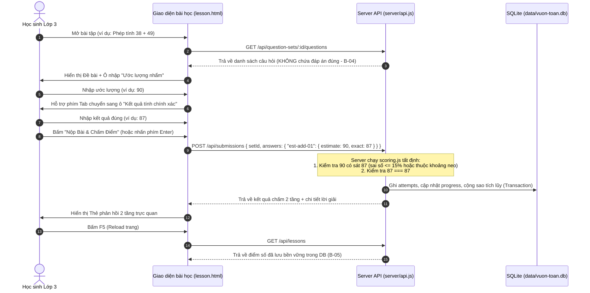

# 📋 TÀI LIỆU ĐẶC TẢ YÊU CẦU PHẦN MỀM (SOFTWARE REQUIREMENTS SPECIFICATION)
> **Dự án:** Vườn Toán Lớp 3 — Trường Tiểu học Hoàng Mai  
> **Gói tính năng:** Thêm dạng bài *"Ước lượng trước khi tính đúng"* (Track 2 / Track B)  
> **Mã đề thi:** `KTPMUD-BKT-2026-PILOT` | **Mã nhóm:** `173820_n04`  
> **Thành viên:** Bùi Tiến Đạt (BA/Tester), Võ Tấn Đạt (Backend/Arch), Nguyễn Minh Quang (Frontend/UX)  
> **Giai đoạn:** M1 — Hoàn thiện yêu cầu & chuẩn bị Checkpoint 1 (08/11/2026)  

---

## 1. Giới thiệu tổng quan & Bối cảnh Brownfield

### 1.1. Bối cảnh hệ thống hiện tại
Hệ thống *Vườn Toán Lớp 3* là một ứng dụng web giáo dục brownfield phục vụ học sinh tiểu học (lớp 3) thuộc Trường Tiểu học Hoàng Mai.
- **Kiến trúc công nghệ hiện hành:** Node.js (Express) + SQLite (`better-sqlite3`, truy vấn đồng bộ không dùng ORM cồng kềnh) + Frontend tĩnh HTML5 / TailwindCSS / Vanilla JavaScript module.
- **Dữ liệu hiện tại:** Bảng `questions` hiện tại chỉ hỗ trợ 4 dạng bài tập cơ bản:
  1. `multiple-choice`: Trắc nghiệm 4 lựa chọn (A, B, C, D).
  2. `input`: Điền kết quả số chính xác.
  3. `compare`: So sánh biểu thức với dấu `>`, `<`, `=`.
  4. `paint`: Tô màu theo giá trị tương ứng của phép tính.
- **Hạn chế của hệ thống cũ:**
  - Logic chấm điểm tại `server/api.js` (`POST /api/submissions`) hiện so sánh chuỗi tuyệt đối: `given === String(q.correct_answer).trim().toLowerCase()`.
  - Chưa hỗ trợ cơ chế câu hỏi đa bước (multi-step / phased interaction) giúp rèn luyện quy trình tư duy.
  - Chưa hỗ trợ chấm điểm gần đúng, ước lượng hoặc chặn khoảng (range-bounding).

### 1.2. Mục tiêu kinh doanh & Giá trị sư phạm của tính năng mới
Trong chương trình Giáo dục Phổ thông 2018 (Chương trình GDPT 2018) môn Toán cấp Tiểu học, đặc biệt là bộ sách giáo khoa chuẩn **"Kết nối tri thức với cuộc sống"**, kỹ năng **ước lượng kết quả (Estimation Skill)** và **làm tròn số (Rounding Skill)** đóng vai trò hạt nhân trong việc phát triển năng lực toán học:
- **Phát triển năng lực cảm nhận số (Number Sense):** Giúp học sinh nhanh chóng nắm bắt độ lớn của con số trước khi bắt tay vào các phép biến đổi hình thức.
- **Tự kiểm soát và phát hiện lỗi sai lớn (Error Detection & Self-Regulation):** Trong thực tế dạy học lớp 3, học sinh thường mắc các lỗi sai cơ bản như quên nhớ (trong phép cộng, phép trừ có nhớ), nhân nhầm hàng chục, hoặc ước lượng thương sai lệch quá xa trong phép chia. Khi có thói quen ước lượng nhẩm trước, nếu kết quả tính ra lệch xa so với con số ước lượng trong đầu, học sinh sẽ có phản xạ tự kiểm tra lại bài làm.
- **Đổi mới trọng tâm sư phạm — Ước lượng là năng lực cốt lõi (Tỷ lệ điểm 70 / 30):** Thay vì xem ước lượng là bước phụ phụ thuộc, hệ thống thiết kế **ƯỚC LƯỢNG LÀ TRỌNG TÂM CHIẾM 70% TỔNG ĐIỂM** (gồm 55% Điểm Logic nền tảng + 15% Điểm thưởng tốc độ Time Bonus), trong khi **ĐẶT TÍNH ĐÚNG CHIẾM 30% TỔNG ĐIỂM** (25% Điểm Logic + 5% Điểm thưởng tốc độ Time Bonus). Trọng số này thúc đẩy mạnh mẽ tinh thần dám làm tròn, dám nhẩm tính nhanh của học sinh tiểu học.
- **Bộ đếm thời gian thích ứng tối đa 60 giây mỗi pha (Adaptive Phase Countdown Timer):** Để rèn luyện phản xạ số học nhanh, mỗi pha làm bài (Pha 1: Ước lượng nhẩm; Pha 2: Đặt tính đúng) được trang bị bộ đếm ngược thời gian thích ứng tối đa 60 giây. Hoàn thành càng nhanh càng nhận được nhiều điểm thưởng tốc độ (Time Bonus). Khi hết 60 giây, hệ thống tự động khóa ô nhập và chuyển pha an toàn, không làm mất bài thi của học sinh.
- **Phân cấp logic sư phạm 5 bậc cho đáp án ước lượng:** Đánh giá chính xác chiều sâu tư duy của học sinh từ Điểm neo Vàng (100%), Điểm neo Bạc (75%), Nhập đáp án tính đúng vào ô ước lượng (50% + nhắc nhở sư phạm), Trong khoảng nhưng không theo quy tắc/gõ bừa (35% + gợi ý phương pháp), đến Ngoài khoảng (0%).
- **Mở rộng bài toán toàn diện:** Không chỉ dừng lại ở phép nhân và phép chia, tính năng mới được thiết kế mở rộng bao phủ cả **phép CỘNG** và **phép TRỪ** các số có 2 chữ số với nhau. Đây là nền tảng cốt lõi của môn Toán Lớp 3, giúp học sinh luyện tập trọn vẹn cả 4 phép tính cơ bản (Cộng, Trừ, Nhân, Chia).
- **Phản hồi 2 tầng độc lập (Two-Tier Feedback UX):** Học sinh nhận được phản hồi tách bạch:
  1. *Tầng 1 (Ước lượng):* Nhận xét độ hợp lý của con số ước lượng nhẩm, công nhận huy hiệu Điểm neo Vàng / Bạc, nhắc nhở nếu nhập trùng kết quả đúng, và cộng điểm thưởng tốc độ.
  2. *Tầng 2 (Tính đúng):* Đánh giá độ chính xác tuyệt đối của kết quả tính toán chi tiết kèm điểm thưởng thời gian.

### 1.3. Cơ sở khoa học & Đối chiếu chuẩn kiến thức kĩ năng Toán Lớp 3 (Bộ sách "Kết nối tri thức với cuộc sống")

Hệ thống được thiết kế dựa trên sự đối chiếu nghiêm ngặt với các chủ đề bài học trong SGK Toán 3 (Nhà xuất bản Giáo dục Việt Nam - Bộ Kết nối tri thức với cuộc sống):

#### A. Chủ đề phép cộng, trừ có nhớ và không nhớ trong phạm vi 100 và mở rộng đến 1.000
- **Phép cộng số có 2 chữ số (Chủ đề 1 & 2):** Học sinh thực hiện cộng từ phải sang trái (hàng đơn vị trước, hàng chục sau). Nếu tổng các chữ số ở hàng đơn vị lớn hơn hoặc bằng 10, học sinh phải nhớ 1 sang hàng chục.
- **Phép trừ số có 2 chữ số (Chủ đề 1 & 2):** Học sinh thực hiện trừ từ phải sang trái. Nếu chữ số hàng đơn vị của số bị trừ nhỏ hơn số trừ, học sinh mượn 1 chục (10 đơn vị) ở hàng chục để trừ, rồi nhớ 1 vào hàng chục của số trừ khi thực hiện trừ tiếp.
- **Phép nhân và phép chia (Chủ đề 3, 5, 8):** Nhân số có 2 chữ số với số có 1 chữ số; Chia số có 2, 3 chữ số cho số có 1 chữ số (chia hết và chia có dư).

#### B. Quy tắc làm tròn số đến hàng chục gần nhất (Toán 3 - Tập 2, Chủ đề 8: Làm quen với chữ số La Mã, Làm tròn số)
Quy tắc chuẩn sư phạm trong SGK Toán 3:
- Khi làm tròn số đến hàng chục, ta so sánh chữ số hàng đơn vị với 5:
  1. **Nếu chữ số hàng đơn vị là 1, 2, 3, 4 (nhỏ hơn 5):** Làm tròn **xuống** số tròn chục bé hơn liền kề (giữ nguyên chữ số hàng chục, thay chữ số hàng đơn vị bằng 0).
  2. **Nếu chữ số hàng đơn vị là 5, 6, 7, 8, 9 (từ 5 trở lên):** Làm tròn **lên** số tròn chục lớn hơn liền kề (tăng chữ số hàng chục thêm 1 đơn vị, thay chữ số hàng đơn vị bằng 0).

#### C. Kỹ năng ước lượng kết quả nhẩm nhanh trước khi đặt tính
Quy trình sư phạm 2 bước chuẩn hóa:
- **Bước 1 (Ước lượng nhẩm):** Học sinh áp dụng quy tắc làm tròn để đưa các số hạng, số bị trừ, số trừ, thừa số hoặc số bị chia về số tròn chục gần nhất; sau đó thực hiện phép tính nhẩm với các số tròn chục này để đưa ra con số ước lượng $E$.
- **Bước 2 (Đặt tính và tính đúng):** Học sinh thực hiện đặt tính theo cột dọc ra giấy nháp để tính ra kết quả chính xác $A$.
- **Bước 3 (Đối chiếu sư phạm):** Học sinh so sánh kết quả tính đúng $A$ với con số ước lượng $E$. Nếu sai lệch bất thường, học sinh lập tức rà soát lại bước đặt tính xem có bị quên nhớ hay nhầm bảng cửu chương hay không.

#### D. Bảng ví dụ phân tích sư phạm chi tiết

| Mạch kiến thức | Ví dụ bài toán | Phân tích làm tròn & Điểm neo ($E_{anchor}$) | Kết quả đúng ($A$) | Ý nghĩa sư phạm & Phòng tránh lỗi sai |
|:---|:---:|:---|:---:|:---|
| **Phép cộng 2 chữ số (Cả hai số làm tròn lên)** | **$38 + 49$** | • $38$ (hàng đơn vị là 8 $\ge 5$) $\rightarrow$ làm tròn lên **$40$**<br/>• $49$ (hàng đơn vị là 9 $\ge 5$) $\rightarrow$ làm tròn lên **$50$**<br/>$\Rightarrow E_{anchor} = 40 + 50 = \mathbf{90}$ | **$87$** | Học sinh hay quên nhớ sẽ ra $77$ (3+4=7 và 8+9=17 nhưng quên nhớ). Nhờ ước lượng là 90, học sinh thấy 77 quá nhỏ và sẽ nhận ra lỗi quên nhớ ngay. |
| **Phép cộng 2 chữ số (Một số lên, một số xuống)** | **$54 + 27$** | • $54$ (hàng đơn vị là 4 $< 5$) $\rightarrow$ làm tròn xuống **$50$**<br/>• $27$ (hàng đơn vị là 7 $\ge 5$) $\rightarrow$ làm tròn lên **$30$**<br/>$\Rightarrow E_{anchor} = 50 + 30 = \mathbf{80}$ | **$81$** | Con số ước lượng 80 cực kỳ sát với kết quả đúng 81. Rèn luyện tư duy bù trừ tự nhiên cho học sinh. |
| **Phép cộng 2 chữ số (Cộng không nhớ)** | **$61 + 28$** | • $61$ (hàng đơn vị là 1 $< 5$) $\rightarrow$ làm tròn xuống **$60$**<br/>• $28$ (hàng đơn vị là 8 $\ge 5$) $\rightarrow$ làm tròn lên **$30$**<br/>$\Rightarrow E_{anchor} = 60 + 30 = \mathbf{90}$ | **$89$** | Giúp học sinh củng cố quy tắc làm tròn 2 chiều (lên/xuống) và tính nhẩm tròn chục nhanh $60 + 30 = 90$. |
| **Phép trừ 2 chữ số (Một số xuống, một số lên)** | **$72 - 38$** | • $72$ (hàng đơn vị là 2 $< 5$) $\rightarrow$ làm tròn xuống **$70$**<br/>• $38$ (hàng đơn vị là 8 $\ge 5$) $\rightarrow$ làm tròn lên **$40$**<br/>$\Rightarrow E_{anchor} = 70 - 40 = \mathbf{30}$ | **$34$** | Học sinh thường quên nhớ ở hàng chục của số trừ nên tính ra $44$ (lấy 7 - 3 = 4). Với ước lượng nhẩm 30, học sinh thấy 44 quá cao và sửa lại thành 34. |
| **Phép trừ 2 chữ số (Số tận cùng bằng 5)** | **$85 - 29$** | • $85$ (hàng đơn vị là 5 $\ge 5$) $\rightarrow$ làm tròn lên **$90$**<br/>• $29$ (hàng đơn vị là 9 $\ge 5$) $\rightarrow$ làm tròn lên **$30$**<br/>$\Rightarrow E_{anchor} = 90 - 30 = \mathbf{60}$ | **$56$** | Khắc sâu quy tắc: chữ số 5 được làm tròn lên. Nhẩm $90 - 30 = 60$ giúp kiểm soát phép trừ có mượn $85 - 29 = 56$. |
| **Phép trừ 2 chữ số (Cả hai số làm tròn xuống)** | **$91 - 43$** | • $91$ (hàng đơn vị là 1 $< 5$) $\rightarrow$ làm tròn xuống **$90$**<br/>• $43$ (hàng đơn vị là 3 $< 5$) $\rightarrow$ làm tròn xuống **$40$**<br/>$\Rightarrow E_{anchor} = 90 - 40 = \mathbf{50}$ | **$48$** | Cả hai số đều giảm bớt khi làm tròn, hiệu làm tròn $90 - 40 = 50$ rất sát kết quả đúng $48$. |
| **Phép nhân** | **$29 \times 3$** | • $29$ (hàng đơn vị 9 $\ge 5$) $\rightarrow$ làm tròn lên **$30$**<br/>$\Rightarrow E_{anchor} = 30 \times 3 = \mathbf{90}$ | **$87$** | Nhân nhẩm tròn chục $30 \times 3 = 90$, kiểm soát phép nhân có nhớ $29 \times 3 = 87$. |
| **Phép chia (Chia hết)** | **$84 : 4$** | • $84$ (hàng đơn vị 4 $< 5$) $\rightarrow$ làm tròn xuống **$80$**<br/>$\Rightarrow E_{anchor} = 80 : 4 = \mathbf{20}$ | **$21$** | Giúp định vị thương là số có 2 chữ số và chữ số hàng chục của thương là 2. |
| **Phép chia (Chia có dư)** | **$178 : 6$** | • $178$ gần số tròn chục chia hết cho 6 là **$180$**<br/>$\Rightarrow E_{anchor} = 180 : 6 = \mathbf{30}$ | **$29$** (dư 4) | Giúp học sinh ước lượng thương nhẩm là 30, tránh tình trạng đoán thương quá bé (ví dụ 19 hay 20). |

---

## 2. Phạm vi dự án (Project Scope) & Ranh giới an toàn

### 2.1. Phạm vi thực hiện (In-Scope)
1. **Dạng câu hỏi mới `estimate` đa năng:**
   - Hỗ trợ đầy đủ 4 phép toán cơ bản của chương trình Lớp 3: **Cộng 2 chữ số, Trừ 2 chữ số, Nhân và Chia**.
   - Lưu trữ đầy đủ: Đề bài phép tính, kết quả chính xác, điểm neo Vàng (`gold_anchor`), danh sách điểm neo Bạc (`silver_anchors`), khoảng ước lượng hợp lý (`[estimate_min, estimate_max]`) và giải thích sư phạm chi tiết.
2. **Thuật toán chấm điểm ước lượng tất định & Phân cấp logic sư phạm (Deterministic Scoring & Pedagogical Hierarchy):**
   - **Nguyên tắc phân bổ trọng số điểm: ƯỚC LƯỢNG LÀ TRỌNG TÂM CHIẾM 70% TỔNG ĐIỂM, ĐẶT TÍNH ĐÚNG CHIẾM 30% TỔNG ĐIỂM:**
     + **Pha 1 — Ước lượng nhẩm (Tối đa 70%):** Gồm **55% Điểm Logic nền tảng (Base Logic)** + **15% Điểm thưởng tốc độ (Time Bonus)**.
     + **Pha 2 — Đặt tính đúng (Tối đa 30%):** Gồm **25% Điểm Logic nền tảng (Base Logic)** + **5% Điểm thưởng tốc độ (Time Bonus)**.
   - **Phân cấp logic sư phạm 5 bậc cho đáp án ước lượng ($E$):**
     1. 🥇 **Điểm neo Vàng (Gold Anchor - 100% Base, tức 55% tổng điểm):** Học sinh áp dụng chuẩn xác quy tắc làm tròn đến hàng chục SGK Toán 3 cho các toán hạng ($E = E_{gold}$).
     2. 🥈 **Điểm neo Bạc (Silver Anchors - 75% Base, tức 41.25% tổng điểm):** Học sinh áp dụng làm tròn 1 toán hạng hoặc chiến lược làm tròn hợp lệ được chấp nhận ($E \in SilverAnchors$).
     3. ⚠️ **Nhập đáp án tính đúng vào ô ước lượng (Exact Match in Estimate Box - 50% Base, tức 27.5% tổng điểm):** Học sinh tính ra kết quả đúng rồi điền vào ô ước lượng ($E = A$). Hệ thống chấm 50% điểm Base và kèm lời nhắc nhở sư phạm giúp học sinh hiểu bản chất bài học là rèn luyện phản xạ nhẩm trước khi tính.
     4. 💡 **Trong khoảng nhưng không theo quy tắc / gõ bừa (In-range Random/No-rule - 35% Base, tức 19.25% tổng điểm):** Giá trị nằm trong khoảng dung sai $E \in [E_{min}, E_{max}]$ nhưng không trùng bất kỳ điểm neo Vàng hay Bạc nào. Hệ thống ghi nhận 35% điểm Base và hiển thị gợi ý phương pháp làm tròn.
     5. ❌ **Ngoài khoảng (Out-of-range - 0% Base):** Giá trị quá xa thực tế ($E < E_{min}$ hoặc $E > E_{max}$).
   - **Cơ chế bộ đếm thời gian thích ứng tối đa 60 giây mỗi pha (Adaptive Phase Timer):**
     + Mỗi pha tương tác có đồng hồ đếm ngược độc lập từ 60 giây về 0 giây ($T = 60s$).
     + **Điểm thưởng tốc độ (Time Bonus):**
       * Pha ước lượng: $\text{TimeBonus}_{est} = \text{round}\left(15 \times \frac{\max(0, 60 - t_{est})}{60}\right)$ (chỉ tính thưởng khi học sinh đạt điểm logic ước lượng > 0).
       * Pha tính đúng: $\text{TimeBonus}_{exact} = \text{round}\left(5 \times \frac{\max(0, 60 - t_{exact})}{60}\right)$ (chỉ tính thưởng khi kết quả tính đúng $100\%$).
     + **Xử lý hết giờ (Timeout 60s):** Khi đồng hồ về 0, hệ thống tự động khóa ô nhập và tự động chuyển sang pha tiếp theo hoặc tự động nộp bài; học sinh nhận 0 điểm Time Bonus của pha đó nhưng điểm Base logic cho câu trả lời đã gõ vẫn được chấm bình thường.
   - Module tính điểm tách biệt hoàn toàn (`server/scoring.js`), không phụ thuộc Express, không gọi LLM/AI lúc runtime, test được 100%.
3. **Phản hồi người dùng 2 tầng (Two-Tier Feedback UX):**
   - Tầng 1: Đánh giá ước lượng kèm huy hiệu (Vàng 🥇 / Bạc 🥈 / Nhắc nhở tính đúng ⚠️ / Gợi ý làm tròn 💡 / Sai lệch lớn ❌) và điểm thưởng tốc độ đạt được.
   - Tầng 2: Đánh giá phép tính (*"Kết quả tính chính xác 👏"* hoặc *"Kết quả tính chưa đúng, hãy kiểm tra lại phép tính nhé ✏️"*) kèm thời gian hoàn thành.
4. **Tích hợp liền mạch vào hệ thống có sẵn:**
   - Hoạt động trực tiếp trên trang làm bài chung `public/lesson.html` và phiếu luyện tập `public/exercise.html` (thỏa mãn B-01).
   - Lưu điểm, số sao và số câu đúng vào bảng `attempts` và `progress` trên SQLite; tải lại trang (F5) không mất điểm (B-05).
5. **Bộ 16 câu hỏi mẫu synthetic:** Bổ sung vào `data/seed.json` phục vụ luyện tập và kiểm thử (4 Cộng, 4 Trừ, 4 Nhân, 4 Chia) với đầy đủ `gold_anchor` và `silver_anchors` (B-02).
6. **Bộ kiểm thử tự động & CI:** Unit tests, Integration tests chạy bằng lệnh `npm test` và quy trình GitHub Actions CI (B-08, B-09, B-10) — chi tiết kế hoạch xem tại [`artifacts/TEST_PLAN.md`](TEST_PLAN.md).

### 2.2. Ranh giới bất khả xâm phạm (Out-of-Scope / Non-goals / Boundary - Tiêu chí B-07 & B-11)
- ❌ **CẤM SỬA:** Toàn bộ file `server/auth.js` (cơ chế xác thực, session token, băm mật khẩu bcrypt).
- ❌ **CẤM SỬA:** Các route `/api/auth/*`, `/api/teacher/*`, `/api/admin/*`.
- ❌ **CẤM DÙNG:** Không kết nối đến CSDL thật bên ngoài hoặc các dịch vụ production.
- ❌ **CẤM DÙNG:** Không dùng dữ liệu thật của học sinh/giáo viên; chỉ dùng các tài khoản synthetic mẫu (`hocsinh01`..`hocsinh99` và `giaovien01`).
- ❌ **CẤM RUNTIME AI:** Tuyệt đối không gọi API của LLM (OpenAI, Gemini...) trong server để sinh kết quả hoặc chấm bài lúc người dùng nộp bài. Thuật toán chấm bài phải 100% tất định (deterministic).

---

## 3. Chân dung người dùng & Hành trình người dùng (User Personas & User Journey)

### 3.1. Chân dung người dùng
- **Học sinh Lớp 3 (8–9 tuổi):** Tiếp cận bài tập một cách trực quan, cần giao diện sinh động, phản hồi khích lệ, thao tác bàn phím đơn giản (Tab để chuyển ô, Enter để nộp bài), thông báo dễ hiểu, không dùng từ ngữ kỹ thuật phức tạp.
- **Giáo viên Tiểu học:** Cần hệ thống chấm điểm minh bạch, có giải thích sư phạm rõ ràng tại sao ước lượng của học sinh được xem là hợp lý hoặc chưa hợp lý để hỗ trợ sửa bài trên lớp.

### 3.2. Hành trình làm bài của học sinh (User Journey)


---

## 4. Ma trận 12 Tiêu chí Acceptance Criteria (B-01 đến B-12) & BDD Scenarios

| Mã tiêu chí | Tên tiêu chí | Mô tả tóm tắt | Mức độ ưu tiên | Trạng thái thiết kế |
|:---:|:---|:---|:---:|:---:|
| **B-01** | Tích hợp luồng học có sẵn | Làm trực tiếp trên `lesson.html` / `exercise.html`, thẻ tương tác 2 pha tích hợp bộ đếm ngược thích ứng 60s/pha | Bắt buộc | ✅ Hoàn tất thiết kế |
| **B-02** | Bộ fixture 16 câu hỏi mẫu | Đủ 16 câu synthetic: 4 Cộng, 4 Trừ, 4 Nhân, 4 Chia trong `data/seed.json` kèm `gold_anchor` và `silver_anchors` | Bắt buộc | ✅ Đã soạn thảo 16 câu |
| **B-03** | Thuật toán ước lượng tất định & phân cấp sư phạm | **Ước lượng là trọng tâm chiếm 70%** (55% Base + 15% Time Bonus), **Đặt tính đúng chiếm 30%** (25% Base + 5% Time Bonus); Phân cấp 5 bậc: Vàng (100%), Bạc (75%), Điền đúng (50%), Trong khoảng (35%), Ngoài khoảng (0%) | Bắt buộc | ✅ Đã chốt công thức |
| **B-04** | Bảo mật đáp án phía server | `GET .../questions` không trả về `correct_answer`, `gold_anchor`, `silver_anchors` hay khoảng ước lượng | Bắt buộc | ✅ Đã thiết kế API contract |
| **B-05** | Lưu trữ trạng thái bền vững | Lưu vào `attempts` & `progress` qua SQLite Transaction; F5 không mất điểm | Bắt buộc | ✅ Đã thiết kế Transaction |
| **B-06** | Phản hồi UX 2 tầng & Phân tích sư phạm | Hiển thị độc lập: Ước lượng (kèm huy hiệu Vàng/Bạc, điểm Time Bonus, nhắc nhở/gợi ý) và Kết quả chính xác | Bắt buộc | ✅ Đã thiết kế Component UX |
| **B-07** | Tuân thủ ranh giới bảo mật | Không sửa `server/auth.js`, route admin/teacher, session | Bắt buộc | ✅ Đã khoanh vùng cấm sửa |
| **B-08** | Bộ kiểm thử tự động toàn diện | Bao phủ Normal, Boundary, Invalid inputs cho 4 phép tính, phân cấp điểm neo Vàng/Bạc/Exact-in-est và timer đếm ngược 60s | Bắt buộc | ✅ Đã lập Test Matrix |
| **B-09** | Script `npm test` chuẩn | Chạy 100% pass từ clean checkout mà không cần can thiệp thủ công | Bắt buộc | ✅ Cấu hình Jest runner |
| **B-10** | Cấu hình GitHub Actions CI | Tự động chạy `npm ci` và `npm test` trên mọi PR và push | Bắt buộc | ✅ Soạn thảo CI workflow |
| **B-11** | An toàn dữ liệu & Bí mật | Không lộ secret, API key, PII; chỉ dùng tài khoản mẫu | Bắt buộc | ✅ Đã rà soát bảo mật |
| **B-12** | Khả năng tiếp cận, Bộ đếm thời gian 60s & Sư phạm | Bộ đếm ngược thời gian thích ứng tối đa 60s/pha, điều hướng bàn phím (Tab, Enter), thông điệp tiếng Việt thân thiện không gây áp lực | Bắt buộc | ✅ Đã thiết kế A11y, Timer & Copy |

---

### Chi tiết kịch bản kiểm thử hành vi (Gherkin BDD Scenarios)

#### Kịch bản 1 (B-03 & B-06): Phép cộng 2 chữ số — Điểm neo Vàng, Đặt tính đúng & Thưởng tốc độ tối đa
```gherkin
Scenario: Học sinh ước lượng đạt Điểm neo Vàng và tính đúng trong thời gian ngắn
  Given Đề bài là "38 + 49 = ?" với kết quả đúng là 87, Điểm neo Vàng là 90 và khoảng ước lượng là [74, 100]
  And Bộ đếm ngược thời gian Pha 1 đang chạy từ 60 giây
  When Học sinh nhập ước lượng "90" (làm tròn 40 + 50) trong vòng 12 giây
  And Học sinh bấm nộp Pha 1 (hoặc nhấn Enter)
  Then Hệ thống đánh giá tầng 1: Điểm neo Vàng 🥇 (nhận trọn 55% Base ước lượng)
  And Hệ thống cộng điểm thưởng tốc độ Pha 1: 15% * (60 - 12)/60 = 12% Time Bonus
  And Tổng điểm nhận được ở Pha 1 là 67% (trên 70% tối đa của pha ước lượng)
  When Bộ đếm ngược Pha 2 bắt đầu chạy từ 60 giây
  And Học sinh nhập kết quả tính chính xác "87" trong vòng 15 giây và bấm nộp bài
  Then Hệ thống đánh giá tầng 2: "Kết quả chính xác 👏" (nhận trọn 25% Base tính đúng)
  And Hệ thống cộng điểm thưởng tốc độ Pha 2: 5% * (60 - 15)/60 = 3.75% Time Bonus
  And Tổng điểm toàn bài cho câu hỏi đạt: 67% + 25% + 3.75% = 95.75% (gần như trọn vẹn điểm tối đa)
  And Hệ thống hiển thị lời giải: "Làm tròn 38 lên 40, làm tròn 49 lên 50. Nhẩm: 40 + 50 = 90. Đặt tính: 38 + 49 = 87."
```

#### Kịch bản 2 (B-03 & B-06): Phép cộng 2 chữ số — Điểm neo Bạc (75% Base) và Đặt tính đúng
```gherkin
Scenario: Học sinh ước lượng đạt Điểm neo Bạc (làm tròn 1 toán hạng) và tính đúng
  Given Đề bài là "54 + 27 = ?" với kết quả đúng là 81, Điểm neo Vàng là 80, Điểm neo Bạc là [77, 84, 90, 70]
  When Học sinh nhập ước lượng "84" (học sinh chỉ làm tròn 27 lên 30 và nhẩm 54 + 30 = 84)
  And Học sinh hoàn thành Pha 1 sau 24 giây
  Then Hệ thống đánh giá tầng 1: Điểm neo Bạc 🥈 (nhận 75% * 55% = 41.25% Base ước lượng)
  And Hệ thống cộng điểm thưởng tốc độ Pha 1: 15% * (60 - 24)/60 = 9% Time Bonus
  And Lời khuyên tầng 1: "Rất tốt! Em đã ước lượng sát với điểm neo Bạc 🥈. Hãy thử làm tròn cả 54 thành 50 để nhẩm 50 + 30 = 80 nhanh hơn nữa nhé!"
  When Học sinh nhập kết quả tính chính xác "81" ở Pha 2 và nộp bài sau 20 giây
  Then Hệ thống đánh giá tầng 2: "Kết quả chính xác 👏" (nhận 25% Base + 3.33% Time Bonus)
  And Tổng điểm nhận được là: 41.25% + 9% + 25% + 3.33% = 78.58%
```

#### Kịch bản 3 (B-03 & B-06): Nhập kết quả tính đúng vào ô ước lượng (Nhận 50% Base + Lời nhắc nhở sư phạm)
```gherkin
Scenario: Học sinh tính ra kết quả đúng rồi gõ thẳng vào ô ước lượng thay vì làm tròn nhẩm
  Given Đề bài là "38 + 49 = ?" với kết quả đúng là 87
  When Con trỏ ở ô nhập ước lượng (Pha 1), học sinh gõ "87" (trùng khít kết quả tính đúng A)
  And Học sinh bấm xác nhận chuyển sang Pha 2
  Then Hệ thống đánh giá tầng 1: Nhận 50% * 55% = 27.5% Base ước lượng
  And Hệ thống hiển thị huy hiệu nhắc nhở: "⚠️ Chú ý cách làm"
  And Lời nhắc nhở sư phạm hiển thị: "Em đã điền kết quả tính đúng vào ô ước lượng! Mục đích ước lượng là để em rèn kỹ năng làm tròn nhẩm nhanh trước khi đặt tính. Lần sau em hãy làm tròn các số nhé! 💡"
  When Học sinh tiếp tục nhập kết quả chính xác "87" ở Pha 2
  Then Hệ thống đánh giá tầng 2: "Kết quả chính xác 👏" (nhận 25% Base tính đúng)
```

#### Kịch bản 4 (B-03 & B-06): Ước lượng trong khoảng nhưng không theo quy tắc / gõ bừa (Nhận 35% Base + Gợi ý sư phạm)
```gherkin
Scenario: Học sinh gõ một số nằm trong khoảng hợp lý nhưng không theo quy tắc làm tròn
  Given Đề bài là "38 + 49 = ?" với khoảng ước lượng hợp lý là [74, 100], Điểm neo Vàng là 90, Điểm neo Bạc là [88, 89, 70]
  When Học sinh nhập ước lượng "83" (nằm trong [74, 100] nhưng không trùng điểm neo Vàng hay Bạc nào)
  And Học sinh bấm nộp Pha 1
  Then Hệ thống đánh giá tầng 1: Nhận 35% * 55% = 19.25% Base ước lượng
  And Hệ thống hiển thị huy hiệu: "💡 Cần cải thiện quy tắc"
  And Lời khuyên sư phạm: "Con số 83 khá gần, nhưng chưa theo quy tắc làm tròn tròn chục 🌱. Gợi ý: Hãy làm tròn 38 lên 40, 49 lên 50 rồi nhẩm 40 + 50 = 90 nhé!"
  When Học sinh nhập kết quả tính chính xác "87" ở Pha 2
  Then Hệ thống đánh giá tầng 2: "Kết quả chính xác 👏" (nhận trọn vẹn điểm phần tính đúng)
```

#### Kịch bản 5 (B-03 & B-06): Ước lượng ngoài khoảng (0% Base) nhưng Đặt tính đúng (30% Pha 2)
```gherkin
Scenario: Học sinh ước lượng sai lệch lớn nhưng đặt tính ra kết quả đúng
  Given Đề bài là "54 + 27 = ?" với kết quả đúng là 81 và khoảng ước lượng hợp lý là [70, 95]
  When Học sinh nhập ước lượng "30" (quá xa kết quả đúng, sai số lớn và ngoài khoảng [70, 95])
  And Học sinh bấm chuyển sang Pha 2
  Then Hệ thống đánh giá tầng 1: Nhận 0% điểm phần ước lượng (0% Base, 0% Time Bonus)
  And Lời khuyên tầng 1: "Ước lượng 30 chưa hợp lý 🌱. Em nên làm tròn 54 xuống 50 và 27 lên 30 để nhẩm 50 + 30 = 80 nhé!"
  When Học sinh nhập kết quả tính chính xác "81" ở Pha 2 và bấm nộp bài
  Then Hệ thống đánh giá tầng 2: "Kết quả chính xác 👏" (nhận trọn điểm phần tính đúng gồm Base và Time Bonus nếu có)
  And Tổng điểm nhận được phản ánh rõ: học sinh làm đúng phép tính (30%) nhưng chưa đạt kỹ năng ước lượng
```

#### Kịch bản 6 (B-12): Cơ chế đếm ngược thời gian thích ứng 60 giây & Xử lý hết giờ (Timeout)
```gherkin
Scenario: Bộ đếm ngược thời gian 60 giây đếm hết giờ ở Pha 1 tự động khóa và chuyển sang Pha 2
  Given Học sinh đang làm câu hỏi ước lượng số 1 ở Pha 1
  And Đồng hồ đếm ngược từ 60 giây và hiển thị thanh thời gian trực quan
  When Đồng hồ đếm về dưới 10 giây
  Then Giao diện chuyển viền cảnh báo màu cam nhẹ nhàng, không phát âm thanh giật mình
  When Đồng hồ đếm về 0 giây (hết 60 giây) và học sinh đã điền "90" vào ô ước lượng nhưng chưa bấm nộp
  Then Hệ thống tự động khóa ô nhập ước lượng
  And Hệ thống tự động kích hoạt chuyển sang Pha 2 (Đặt tính đúng)
  And Giá trị "90" đã nhập được ghi nhận và chấm điểm Base bình thường (nhận Điểm neo Vàng 55%)
  And Điểm thưởng tốc độ Time Bonus của Pha 1 là 0%
  And Đồng hồ đếm ngược của Pha 2 tự động khởi tạo lại từ 60 giây
```

#### Kịch bản 7 (B-03 & B-06): Phép trừ 2 chữ số — Điểm neo Vàng và Tính đúng
```gherkin
Scenario: Học sinh ước lượng hợp lý và tính đúng phép trừ 2 chữ số có nhớ
  Given Đề bài là "72 - 38 = ?" với kết quả đúng là 34, Điểm neo Vàng là 30 và khoảng ước lượng là [25, 42]
  When Học sinh nhập ước lượng "30" (làm tròn 70 - 40)
  And Học sinh nhập kết quả tính chính xác "34"
  And Học sinh bấm nộp bài
  Then Hệ thống đánh giá tầng 1: Đạt Điểm neo Vàng 🥇 (nhận tối đa điểm ước lượng kèm thưởng tốc độ)
  And Hệ thống đánh giá tầng 2: "Kết quả chính xác 👏"
  And Hệ thống hiển thị lời giải: "Làm tròn 72 xuống 70, 38 lên 40. Nhẩm: 70 - 40 = 30. Đặt tính: 72 - 38 = 34."
```

#### Kịch bản 8 (B-03 & B-06): Phép nhân — Điểm neo Vàng và Tính đúng
```gherkin
Scenario: Học sinh ước lượng và nhân đúng số có 2 chữ số với số có 1 chữ số
  Given Đề bài là "29 × 3 = ?" với kết quả đúng là 87 và Điểm neo Vàng là 90
  When Học sinh nhập ước lượng "90" (làm tròn 29 lên 30, nhẩm 30 × 3 = 90)
  And Học sinh nhập kết quả tính chính xác "87"
  And Học sinh bấm nộp bài
  Then Hệ thống đánh giá tầng 1: Điểm neo Vàng 🥇 (nhận tối đa điểm ước lượng)
  And Hệ thống đánh giá tầng 2: "Kết quả chính xác 👏"
  And Lời khen hiển thị: "Em ước lượng rất sát và tính toán chuẩn xác!"
```

#### Kịch bản 9 (B-03 & B-06): Phép chia — Điểm neo Vàng và Tính đúng
```gherkin
Scenario: Học sinh làm tròn số bị chia để ước lượng và chia đúng
  Given Đề bài là "84 : 4 = ?" với kết quả đúng là 21 và Điểm neo Vàng là 20
  When Học sinh nhập ước lượng "20" (làm tròn 84 xuống 80, nhẩm 80 : 4 = 20)
  And Học sinh nhập kết quả tính chính xác "21"
  And Học sinh bấm nộp bài
  Then Hệ thống đánh giá tầng 1: Điểm neo Vàng 🥇
  And Hệ thống đánh giá tầng 2: "Kết quả chính xác 👏"
  And Lời giải thích hiển thị: "Làm tròn 84 thành 80. Ta nhẩm 80 : 4 = 20. Đặt tính chia: 84 : 4 = 21."
```

#### Kịch bản 10 (B-04): Bảo mật đề thi trên Client (Không để lộ đáp án & điểm neo)
```gherkin
Scenario: Client gọi API lấy danh sách câu hỏi trước khi làm bài
  Given Học sinh đã đăng nhập thành công với vai trò "student"
  When Client gửi HTTP GET request tới "/api/question-sets/uoc-luong-toan-lop-3/questions"
  Then Mã phản hồi HTTP trả về là 200 OK
  And Payload JSON chứa danh sách câu hỏi với các trường: "id", "type", "prompt", "points", "category"
  And Payload JSON TUYỆT ĐỐI KHÔNG chứa trường "correct_answer", "exact", "gold_anchor", "silver_anchors", "estimate_min", "estimate_max"
```

#### Kịch bản 11 (B-05): Lưu trữ trạng thái bền vững & Phục hồi sau F5 (Reload)
```gherkin
Scenario: Học sinh hoàn thành bài làm và tải lại trang
  Given Học sinh hoàn thành bài kiểm tra ước lượng với điểm số 90%
  And Hệ thống đã lưu lượt làm bài vào CSDL SQLite
  When Học sinh bấm phím F5 để tải lại trang trình duyệt
  Then Giao diện hiển thị điểm số cao nhất của bài học vẫn là 90%
  And Số sao thưởng đã nhận được bảo toàn, không bị mất và không bị cộng dồn trùng lặp
```

#### Kịch bản 12 (B-12): Khả năng tiếp cận bằng bàn phím (Accessibility)
```gherkin
Scenario: Học sinh thao tác hoàn toàn bằng bàn phím không dùng chuột
  Given Học sinh đang làm câu hỏi ước lượng ở Pha 1
  When Con trỏ đang ở ô nhập "Ước lượng", học sinh gõ "90"
  And Học sinh nhấn phím Enter (hoặc Tab sang nút chuyển pha)
  Then Pha 1 hoàn thành và tiêu điểm (focus) tự động chuyển sang ô nhập "Kết quả chính xác" ở Pha 2
  When Học sinh gõ "87" và nhấn phím Enter
  Then Hệ thống tự động chuyển sang câu tiếp theo hoặc kích hoạt nộp bài
```

---

## 5. Ma trận truy vết yêu cầu (Traceability Matrix)

| Yêu cầu nghiệp vụ | Mã AC | Thiết kế kỹ thuật liên quan | Module mã nguồn chịu trách nhiệm | Test Suite kiểm chứng |
|:---|:---:|:---|:---|:---|
| Không tách riêng trang demo, dùng trực tiếp trang có sẵn; tích hợp thẻ 2 pha và timer 60s/pha | **B-01** | ADR-04 (Tích hợp UX) | `public/lesson.html`, `public/assets/js/pages/lesson.js` | Integration Test: UI Flow & Phase Transition Test |
| Bộ 16 câu hỏi mẫu chuẩn (4 Cộng, 4 Trừ, 4 Nhân, 4 Chia) kèm `gold_anchor` & `silver_anchors` | **B-02** | ADR-02 (Schema & Seed) | `data/seed.json`, `server/db.js` | Unit Test: Seed Integrity & Anchor Hierarchy Test |
| Thuật toán ước lượng tất định 70/30, phân cấp 5 bậc (Vàng/Bạc/Exact-in-Est) & thưởng tốc độ | **B-03** | ADR-01 (Deterministic Scoring) | `server/scoring.js` | Unit Test: `scoring.test.js` (Hierarchy, Anchors, TimeBonus) |
| Bảo mật chống lộ đáp án, điểm neo và khoảng ước lượng phía Client | **B-04** | ADR-03 (API Redaction) | `server/api.js` (`GET .../questions`) | Integration Test: `api_security.test.js` |
| Lưu trữ bền vững DB SQLite & Phục hồi sau F5 | **B-05** | ADR-03 (Persistence Transaction) | `server/db.js`, `server/api.js` (`POST /submissions`) | Integration Test: `api_submissions.test.js` |
| Phản hồi sư phạm trực quan 2 tầng: Huy hiệu Vàng/Bạc, Time Bonus, nhắc nhở & gợi ý | **B-06** | ADR-04 (Two-Tier Feedback) | `public/assets/js/pages/lesson.js`, `server/scoring.js` | Integration Test: Feedback & Badge Display Test |
| Tuân thủ ranh giới code, giữ nguyên `server/auth.js` | **B-07** | ADR-02, ADR-03 (Boundaries) | `server/auth.js` (không chạm) | Git Diff Audit & Security Checklist |
| Bộ kiểm thử tự động toàn diện (Normal, Boundary, Invalid, 5 bậc phân cấp, Timer 60s) | **B-08** | ADR-05 (Test Strategy) & [`artifacts/TEST_PLAN.md`](TEST_PLAN.md) | `tests/unit/scoring.test.js`, `tests/integration/` | Automated Jest Suite (Coverage $\ge 90\%$) |
| Lệnh `npm test` độc lập, pass 100% từ clean checkout | **B-09** | ADR-05 (Test Runner) | `package.json` | Clean Checkout Runner Test |
| CI Pipeline tự động trên GitHub Actions | **B-10** | ADR-05 (CI Pipeline) | `.github/workflows/ci.yml` | GitHub Actions Runner |
| Không lộ bí mật, API key, dữ liệu cá nhân (PII) | **B-11** | ADR-03 (Secret Hygiene) | Toàn bộ repo, `.gitignore` | Security & Privacy Audit Script |
| Bộ đếm thời gian 60s thích ứng, phím Tab/Enter & Thông điệp thân thiện không gây áp lực | **B-12** | ADR-04 (Accessibility & Timer) | `public/assets/js/pages/lesson.js` | A11y & Timer Countdown Test |

---

## 6. Phân tích sư phạm chuyên sâu theo 4 mạch kiến thức Toán Lớp 3

Dựa trên chuẩn kiến thức kỹ năng môn Toán lớp 3 — Bộ sách Kết nối tri thức với cuộc sống:

### 6.1. Mạch kiến thức 1: Phép cộng các số có 2 chữ số (4 câu hỏi)
- **Đặc điểm tâm lý & lỗi phổ biến của học sinh:** Học sinh thường cộng nhẩm từ trái sang phải dẫn đến ghi sai khi có nhớ, hoặc cộng hàng đơn vị có nhớ nhưng quên cộng thêm 1 vào hàng chục.
- **Phương pháp ước lượng sư phạm:**
  + Làm tròn từng số hạng đến hàng chục gần nhất theo quy tắc SGK.
  + Nhẩm tổng của hai số tròn chục (ví dụ: $40 + 50 = 90$, $50 + 30 = 80$, $60 + 30 = 90$).
  + So sánh: Tổng ước lượng giúp học sinh định hình ngay con số kết quả sẽ nằm trong khoảng nào.

### 6.2. Mạch kiến thức 2: Phép trừ các số có 2 chữ số (4 câu hỏi)
- **Đặc điểm tâm lý & lỗi phổ biến của học sinh:** Học sinh khi trừ có mượn ở hàng chục thường lấy số lớn trừ số bé một cách tùy tiện (ví dụ $72 - 38$ lấy $8 - 2 = 6$ thay vì lấy $12 - 8 = 4$), hoặc mượn 1 ở hàng chục nhưng khi trừ hàng chục lại quên trừ bớt 1 (hoặc quên nhớ 1 vào số trừ).
- **Phương pháp ước lượng sư phạm:**
  + Làm tròn số bị trừ và số trừ đến hàng chục gần nhất.
  + Nhẩm hiệu của hai số tròn chục (ví dụ: $70 - 40 = 30$, $90 - 30 = 60$, $90 - 40 = 50$, $70 - 20 = 50$).
  + So sánh: Nếu học sinh trừ ra $44$ mà ước lượng là $30$, độ lệch 14 đơn vị lập tức cảnh báo học sinh đã quên nhớ ở hàng chục.

### 6.3. Mạch kiến thức 3: Phép nhân số có 2 chữ số với số có 1 chữ số (4 câu hỏi)
- **Đặc điểm tâm lý & lỗi phổ biến của học sinh:** Học sinh nhân hàng đơn vị có nhớ nhưng quên cộng phần nhớ vào tích của hàng chục (ví dụ $29 \times 3$, nhớ 2 nhưng lấy $3 \times 2 = 6$ rồi ghi 67 thay vì 87).
- **Phương pháp ước lượng sư phạm:**
  + Làm tròn thừa số có 2 chữ số đến hàng chục gần nhất ($29 \rightarrow 30$, $48 \rightarrow 50$, $19 \rightarrow 20$, $82 \rightarrow 80$).
  + Nhân số tròn chục với thừa số thứ hai ($30 \times 3 = 90$, $50 \times 4 = 200$, $20 \times 5 = 100$, $80 \times 4 = 320$).
  + Kết quả ước lượng là điểm neo vững chắc giúp học sinh không bao giờ viết kết quả lệch hàng chục.

### 6.4. Mạch kiến thức 4: Phép chia số có 2, 3 chữ số cho số có 1 chữ số (4 câu hỏi)
- **Đặc điểm tâm lý & lỗi phổ biến của học sinh:** Học sinh khó khăn nhất ở khâu ước lượng thương trong phép chia có dư hoặc chia số có 3 chữ số. Học sinh hay đoán thương quá non hoặc quá già.
- **Phương pháp ước lượng sư phạm:**
  + Làm tròn số bị chia về số tròn chục gần nhất chia hết cho số chia ($84 \rightarrow 80$, $178 \rightarrow 180$, $245 \rightarrow 240$).
  + Chia nhẩm số tròn chục cho số chia để tìm thương ước lượng ($80 : 4 = 20$, $180 : 6 = 30$, $240 : 8 = 30$).
  + Đối với phép chia trong bảng cửu chương ($48 : 6$), điểm neo chính là thương trong bảng cửu chương ($48 : 6 = 8$).

Toàn bộ 16 câu hỏi mẫu được chuẩn hóa chi tiết cả về mặt kỹ thuật JSON lẫn phương pháp sư phạm trong tài liệu [tai-lieu-tham-khao/SEED_FIXTURES.md](file:///D:/Hackathon_KTPM/ktpmud-bkt-vuontoan-starter/tai-lieu-tham-khao/SEED_FIXTURES.md).

### 6.5. Chiến lược kiểm thử và nghiệm thu (Testing & Acceptance Strategy)

Nhằm liên kết chặt chẽ các yêu cầu đặc tả (SRS) và kịch bản hành vi (BDD Scenarios) với kế hoạch kiểm thử tự động, toàn bộ chiến lược kiểm thử, ma trận ca kiểm thử (Unit & Integration Test) và tiêu chí nghiệm thu chất lượng phần mềm được hiện thực hóa chi tiết trong tài liệu:

👉 **[artifacts/TEST_PLAN.md](file:///D:/Hackathon_KTPM/ktpmud-bkt-vuontoan-starter/artifacts/TEST_PLAN.md)** (hoặc link repository: [`artifacts/TEST_PLAN.md`](TEST_PLAN.md))

Tài liệu `TEST_PLAN.md` định nghĩa kế hoạch hành động và tiêu chuẩn nghiệm thu kỹ thuật:
1. **Kiểm thử logic ước lượng 4 phép tính (Tiêu chí B-03, B-08):** Ma trận ca kiểm thử Normal, Boundary (ngưỡng dung sai $\Delta_{min}$, điểm neo $E_{anchor}$), và Invalid inputs trên module độc lập `server/scoring.js`.
2. **Kiểm thử bảo mật Client (Tiêu chí B-04):** Endpoint `GET /api/question-sets/:id/questions` và `GET /api/lessons` tuyệt đối không để lộ đáp án `correct_answer` và khoảng ước lượng về trình duyệt.
3. **Kiểm thử giao dịch và chấm 2 tầng (Tiêu chí B-05, B-06):** Endpoint `POST /api/submissions` xử lý transaction SQLite nguyên tử, lưu điểm và phục hồi trạng thái sau F5.
4. **Kiểm thử khả năng tiếp cận (Tiêu chí B-12):** Quy trình điều hướng bàn phím Tab/Enter mượt mà không dùng chuột, focus ring tương phản cao cho học sinh lớp 3.
5. **Quy trình tích hợp liên tục CI (Tiêu chí B-09, B-10):** Chạy tự động `npm test` qua GitHub Actions trên Node.js 20 LTS, đảm bảo độ bao phủ kiểm thử cao và không có lỗi hồi quy (regression).
