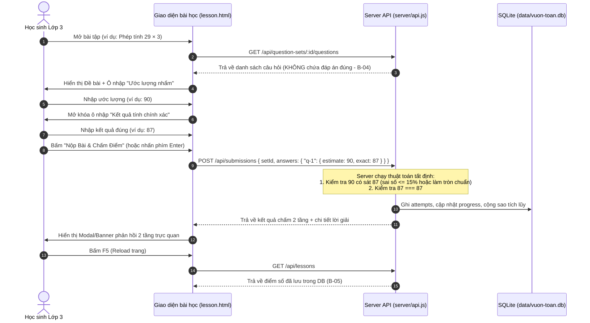

# 📋 TÀI LIỆU ĐẶC TẢ YÊU CẦU PHẦN MỀM (SOFTWARE REQUIREMENTS SPECIFICATION)
> **Dự án:** Vườn Toán Lớp 3 — Trường Tiểu học Hoàng Mai  
> **Gói tính năng:** Thêm dạng bài *"Ước lượng trước khi tính đúng"* (Track 2 / Track B)  
> **Mã đề thi:** `KTPMUD-BKT-2026-PILOT` | **Mã nhóm:** `173820_n04`  
> **Thành viên:** Bùi Tiến Đạt (BA/Tester), Võ Tấn Đạt (Backend/Arch), Nguyễn Minh Quang (Frontend/UX)  
> **Giai đoạn:** M1 — Hoàn thiện yêu cầu & chuẩn bị Checkpoint 1 (08/11/2026)  

---

## 1. Giới thiệu tổng quan & Bối cảnh Brownfield

### 1.1. Bối cảnh hệ thống hiện tại
Hệ thống *Vườn Toán Lớp 3* là một ứng dụng web giáo dục brownfield phục vụ học sinh tiểu học (lớp 3).
- **Kiến trúc công nghệ hiện hành:** Node.js (Express) + SQLite (`better-sqlite3`, truy vấn đồng bộ không ORM) + Frontend tĩnh HTML/CSS (TailwindCSS) / Vanilla JavaScript.
- **Dữ liệu hiện tại:** Bảng `questions` hiện tại chỉ hỗ trợ 4 dạng bài tập:
  1. `multiple-choice`: Trắc nghiệm 4 lựa chọn (A, B, C, D).
  2. `input`: Điền kết quả số chính xác.
  3. `compare`: So sánh biểu thức với dấu `>`, `<`, `=`.
  4. `paint`: Tô màu theo giá trị tương ứng của phép tính.
- **Hạn chế của hệ thống cũ:**
  - Logic chấm điểm tại `server/api.js` (`POST /api/submissions`) hiện so sánh chuỗi tuyệt đối: `given === String(q.correct_answer).trim().toLowerCase()`.
  - Chưa hỗ trợ cơ chế câu hỏi đa bước (multi-step / phased interaction).
  - Chưa hỗ trợ chấm điểm gần đúng, ước lượng hoặc chặn khoảng (range-bounding).

### 1.2. Mục tiêu kinh doanh & Giá trị sư phạm của tính năng mới
Trong chương trình Toán Tiểu học lớp 3 mới (Chương trình GDPT 2018), kỹ năng **ước lượng kết quả (Estimation Skill)** đóng vai trò tối quan trọng:
- Giúp học sinh hình thành tư duy cảm nhận số lượng (Number Sense), phát hiện nhanh các lỗi tính toán sai lệch lớn.
- Khuyến khích học sinh làm tròn số nhẩm nhanh trong đầu trước khi đặt tính viết ra giấy.
- Mục tiêu của tính năng: Bổ sung dạng bài tập **"Ước lượng trước khi tính đúng"** trên các phép toán nhân và chia trong phạm vi 1.000, cung cấp phản hồi 2 tầng độc lập giúp học sinh nhận biết cả độ hợp lý của ước lượng lẫn độ chính xác của phép tính.

---

## 2. Phạm vi dự án (Project Scope) & Ranh giới an toàn

### 2.1. Phạm vi thực hiện (In-Scope)
1. **Dạng câu hỏi mới `estimate`:**
   - Mở rộng mô hình câu hỏi hỗ trợ `type = 'estimate'`.
   - Lưu trữ đầy đủ: đề bài phép tính, kết quả chính xác, khoảng ước lượng hợp lý và giải thích sư phạm.
2. **Thuật toán chấm điểm ước lượng tất định (Deterministic Scoring Engine):**
   - Đánh giá ước lượng của học sinh dựa trên các quy tắc toán học xác định (sai số tương đối $\le \pm 15\%$ và làm tròn tròn chục chuẩn sư phạm).
   - Đánh giá kết quả tính chính xác (so sánh bằng số học tuyệt đối).
   - Không phụ thuộc vào LLM/AI lúc runtime, đảm bảo kiểm thử tự động 100%.
3. **Phản hồi người dùng 2 tầng (Two-Tier Feedback UX):**
   - Tầng 1: Đánh giá ước lượng (*"Ước lượng hợp lý 🎉"* hoặc *"Ước lượng chưa sát, hãy thử làm tròn đến hàng chục nhé 🌱"*).
   - Tầng 2: Đánh giá phép tính (*"Kết quả tính chính xác 👏"* hoặc *"Kết quả tính chưa đúng, hãy kiểm tra lại phép tính nhé ✏️"*).
4. **Tích hợp liền mạch vào hệ thống có sẵn:**
   - Hoạt động trực tiếp trên trang làm bài chung `public/lesson.html` và phiếu luyện tập `public/exercise.html` (thỏa mãn B-01).
   - Lưu điểm, số sao và số câu đúng vào bảng `attempts` và `progress` trên SQLite; tải lại trang (F5) không mất điểm (B-05).
5. **Bộ 12 câu hỏi mẫu synthetic:** Bổ sung vào `data/seed.json` phục vụ luyện tập và kiểm thử.
6. **Bộ kiểm thử tự động & CI:** Unit tests, Integration tests chạy bằng lệnh `npm test` và quy trình GitHub Actions CI.

### 2.2. Ranh giới bất khả xâm phạm (Out-of-Scope / Non-goals / Boundary - Tiêu chí B-07 & B-11)
- ❌ **CẤM SỬA:** Toàn bộ file `server/auth.js` (cơ chế xác thực, session token, băm mật khẩu bcrypt).
- ❌ **CẤM SỬA:** Các route `/api/auth/*`, `/api/teacher/*`, `/api/admin/*`.
- ❌ **CẤM DÙNG:** Không kết nối đến CSDL thật bên ngoài hoặc các dịch vụ production.
- ❌ **CẤM DÙNG:** Không dùng dữ liệu thật của học sinh/giáo viên; chỉ dùng 99 tài khoản synthetic `hocsinh01`..`hocsinh99` và `giaovien01`.
- ❌ **CẤM RUNTIME AI:** Tuyệt đối không gọi API của LLM (OpenAI, Gemini...) trong server để sinh kết quả hoặc chấm bài lúc người dùng nộp bài.

---

## 3. Chân dung người dùng & Hành trình người dùng (User Personas & User Journey)

### 3.1. Chân dung người dùng
- **Học sinh Lớp 3 (8–9 tuổi):** Tiếp cận bài tập một cách trực quan, cần giao diện sinh động, phản hồi khích lệ, thao tác bàn phím đơn giản, thông báo dễ hiểu, không dùng từ ngữ kỹ thuật phức tạp.
- **Giáo viên Tiểu học:** Cần hệ thống chấm điểm minh bạch, có giải thích sư phạm rõ ràng tại sao ước lượng của học sinh được xem là hợp lý hoặc chưa hợp lý.

### 3.2. Hành trình làm bài của học sinh (User Journey)


---

## 4. Ma trận 12 Tiêu chí Acceptance Criteria (B-01 đến B-12) & BDD Scenarios

| Mã tiêu chí | Tên tiêu chí | Mô tả tóm tắt | Mức độ ưu tiên | Trạng thái thiết kế |
|:---:|:---|:---|:---:|:---:|
| **B-01** | Tích hợp luồng học có sẵn | Làm trực tiếp trên `lesson.html` / `exercise.html`, không tạo trang tách rời | Bắt buộc | ✅ Đã thiết kế kiến trúc |
| **B-02** | Bộ fixture 12 câu hỏi | Tối thiểu 12 câu synthetic nhân/chia lớp 3 trong `data/seed.json` | Bắt buộc | ✅ Đã soạn thảo đầy đủ |
| **B-03** | Thuật toán ước lượng tất định | Đặc tả toán học chính xác, deterministic, test được | Bắt buộc | ✅ Đã chốt công thức |
| **B-04** | Bảo mật đáp án phía server | `GET .../questions` không trả về `correct_answer` hay khoảng ước lượng | Bắt buộc | ✅ Đã thiết kế API contract |
| **B-05** | Lưu trữ trạng thái bền vững | Lưu vào `attempts` & `progress`; F5 không mất điểm | Bắt buộc | ✅ Đã thiết kế DB transaction |
| **B-06** | Phản hồi UX 2 tầng | Hiển thị độc lập: Ước lượng hợp lý và Kết quả chính xác | Bắt buộc | ✅ Đã thiết kế Component UX |
| **B-07** | Tuân thủ ranh giới bảo mật | Không sửa `server/auth.js`, route admin/teacher, session | Bắt buộc | ✅ Đã khoanh vùng cấm sửa |
| **B-08** | Bộ kiểm thử tự động toàn diện | Bao phủ Normal, Boundary, Invalid inputs | Bắt buộc | ✅ Đã lập Test Matrix |
| **B-09** | Script `npm test` chuẩn | Chạy 100% pass từ clean checkout | Bắt buộc | ✅ Cấu hình Jest runner |
| **B-10** | Cấu hình GitHub Actions CI | Tự động chạy `npm ci` và `npm test` trên PR | Bắt buộc | ✅ Soạn thảo CI workflow |
| **B-11** | An toàn dữ liệu & Bí mật | Không lộ secret, API key, PII; chỉ dùng tài khoản mẫu | Bắt buộc | ✅ Đã rà soát bảo mật |
| **B-12** | Khả năng tiếp cận & Sư phạm | Điều hướng bằng bàn phím (Tab, Enter), thông điệp tiếng Việt thân thiện | Bắt buộc | ✅ Đã thiết kế A11y & Copy |

---

### Chi tiết kịch bản kiểm thử hành vi (Gherkin BDD Scenarios)

#### Kịch bản B-03 & B-06: Chấm điểm 2 tầng & Phản hồi sư phạm
```gherkin
Scenario: Học sinh ước lượng hợp lý và tính đúng kết quả
  Given Đề bài là "29 × 3" với kết quả đúng là 87 và khoảng ước lượng hợp lý là [75, 100]
  When Học sinh nhập ước lượng "90"
  And Học sinh nhập kết quả tính chính xác "87"
  And Học sinh bấm nộp bài
  Then Hệ thống đánh giá tầng 1: "Ước lượng hợp lý" (được điểm phần ước lượng)
  And Hệ thống đánh giá tầng 2: "Kết quả chính xác" (được điểm phần tính đúng)
  And Hệ thống hiển thị lời khen: "Em ước lượng rất nhanh và tính toán chuẩn xác! 🎉"
```

```gherkin
Scenario: Học sinh ước lượng chưa hợp lý nhưng tính đúng kết quả
  Given Đề bài là "29 × 3" với kết quả đúng là 87
  When Học sinh nhập ước lượng "40" (sai số vượt quá 15% và xa số tròn chục)
  And Học sinh nhập kết quả tính chính xác "87"
  And Học sinh bấm nộp bài
  Then Hệ thống đánh giá tầng 1: "Ước lượng chưa sát" kèm lời khuyên "Em nên làm tròn 29 thành 30 để nhẩm 30 × 3 = 90 nhé!"
  And Hệ thống đánh giá tầng 2: "Kết quả chính xác"
  And Học sinh nhận điểm thành phần của phần tính đúng
```

```gherkin
Scenario: Học sinh ước lượng hợp lý nhưng tính nhầm kết quả
  Given Đề bài là "48 : 6" với kết quả đúng là 8
  When Học sinh nhập ước lượng "8" (hoặc nhẩm gần 50:6 ≈ 8)
  And Học sinh nhập kết quả tính "7"
  And Học sinh bấm nộp bài
  Then Hệ thống đánh giá tầng 1: "Ước lượng hợp lý"
  And Hệ thống đánh giá tầng 2: "Kết quả chưa chính xác" kèm lời giải: "48 : 6 = 8"
  And Học sinh nhận điểm thành phần của phần ước lượng
```

#### Kịch bản B-04: Bảo mật đề thi trên Client
```gherkin
Scenario: Client gọi API lấy danh sách câu hỏi
  Given Học sinh đã đăng nhập vào hệ thống
  When Client gửi GET request tới "/api/question-sets/uoc-luong-nhan-chia-lop-3/questions"
  Then Mã phản hồi trả về là 200 OK
  And Payload JSON trả về chứa id, type, prompt, points
  And Payload JSON TUYỆT ĐỐI KHÔNG chứa trường "correct_answer", "exact", "estimate_min", "estimate_max"
```

#### Kịch bản B-05: Lưu trữ và phục hồi trạng thái sau Reload
```gherkin
Scenario: Học sinh nộp bài và tải lại trang
  Given Học sinh hoàn thành bộ đề ước lượng với điểm số 80%
  When Học sinh bấm phím F5 để tải lại trang
  Then Giao diện hiển thị điểm số cao nhất của bài học là 80%
  And Số sao thưởng đã nhận không bị trừ hoặc tính trùng lặp
```

#### Kịch bản B-12: Khả năng tiếp cận bằng bàn phím
```gherkin
Scenario: Học sinh không dùng chuột, chỉ dùng bàn phím để làm bài
  Given Học sinh đang ở ô nhập "Ước lượng" của câu hỏi số 1
  When Học sinh gõ "50" và nhấn phím Tab
  Then Con trỏ tự động chuyển tiêu điểm (focus) sang ô nhập "Kết quả chính xác"
  When Học sinh gõ "48" và nhấn phím Enter
  Then Hệ thống kích hoạt nút nộp bài mà không cần di chuột
```

---

## 5. Ma trận truy vết yêu cầu (Traceability Matrix)

| Yêu cầu nghiệp vụ | Acceptance Criteria | Thành phần thiết kế trong DECISIONS.md | Module mã nguồn chịu trách nhiệm | Test Suite kiểm chứng |
|:---|:---:|:---|:---|:---|
| Không tách riêng trang demo | **B-01** | ADR-04 (UX Integration) | `public/lesson.html`, `public/assets/js/pages/lesson.js` | Integration Test: UI Flow |
| Dữ liệu đề thi mẫu chuẩn | **B-02** | ADR-02 (Schema & Seed) | `data/seed.json`, `server/db.js` | Unit Test: Seed Integrity Test |
| Thuật toán ước lượng tất định | **B-03** | ADR-01 (Algorithm) | `server/scoring.js` (module tính điểm tách biệt) | Unit Test: `scoring.test.js` (Normal & Boundary) |
| Chống lộ đáp án lúc làm bài | **B-04** | ADR-03 (API Redaction) | `server/api.js` (`GET .../questions`) | Integration Test: Security Scan API |
| Bền vững CSDL & Tiến độ | **B-05** | ADR-03 (Persistence) | `server/db.js`, `server/api.js` (`attempts`, `progress`) | Integration Test: `submissions.test.js` |
| Phản hồi trực quan 2 tầng | **B-06** | ADR-04 (2-Tier UX) | `public/assets/js/pages/lesson.js`, `server/api.js` | Integration Test: Submissions Detail |
| Ranh giới code nguyên vẹn | **B-07** | ADR-03 (Boundaries) | Giữ nguyên `server/auth.js` | Git Diff Audit & Security Checklist |
| Kiểm thử ca biên & đầu vào xấu | **B-08** | ADR-05 (Test Strategy) | `tests/unit/`, `tests/integration/` | Automated Jest Test Suite |
| Lệnh `npm test` độc lập | **B-09** | ADR-05 (Test Runner) | `package.json` | Clean Checkout Runner Test |
| CI tự động trên GitHub | **B-10** | ADR-05 (CI Pipeline) | `.github/workflows/ci.yml` | GitHub Actions Runner |
| Không lộ PII / Secret | **B-11** | ADR-03 (Secret Hygiene) | Toàn bộ repo, `.gitignore` | `SECURITY_PRIVACY_CHECKLIST.md` |
| Hỗ trợ phím Tab/Enter & Tiếng Việt | **B-12** | ADR-04 (Accessibility) | `public/assets/js/pages/lesson.js` | Accessibility Test & Manual Walkthrough |

---

## 6. Phân tích sư phạm Toán Lớp 3 cho 12 câu hỏi mẫu

Dựa trên chuẩn kiến thức kỹ năng Toán 3 (Bộ sách Kết nối tri thức & Cánh diều):
1. **Phép nhân:**
   - Nhân số có hai chữ số với số có một chữ số (có nhớ và không nhớ): Ví dụ $29 \times 3$, $48 \times 4$, $82 \times 5$, $19 \times 6$, $71 \times 7$, $98 \times 9$.
   - Kỹ thuật ước lượng: Làm tròn thừa số thứ nhất đến hàng chục gần nhất, sau đó nhân nhẩm với thừa số thứ hai.
2. **Phép chia:**
   - Chia số có hai, ba chữ số cho số có một chữ số (chia hết và chia có dư): Ví dụ $48 : 6$, $84 : 4$, $178 : 6$, $245 : 8$, $356 : 5$, $492 : 7$.
   - Kỹ thuật ước lượng: Tìm bội số tròn chục gần nhất của số chia hoặc làm tròn số bị chia về hàng chục/trăm dễ chia nhẩm.

Bảng chi tiết 12 câu hỏi đã được kiểm chứng tính sư phạm và sẽ nạp vào CSDL được trình bày chi tiết trong `artifacts/DECISIONS.md`.
