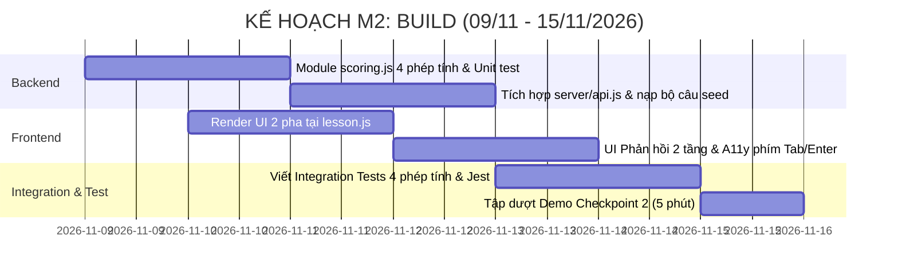

# 🚩 BÁO CÁO DUYỆT PHẠM VI CHECKPOINT 1 (SCOPE GATE REPORT)
> **Môn học:** Kỹ thuật Phần mềm Ứng dụng (KTPMUD) — Hackathon Marathon 2026  
> **Bài kiểm tra:** Bài kiểm tra 1 (BKT-1 — Tuần 10)  
> **Thời điểm nộp:** Cuối ngày 08/11/2026 (Hạn chót M1)  
> **Mã đề thi:** `KTPMUD-BKT-2026-PILOT` | **Mã nhóm:** `173820_n04`  
> **Đề tài:** Track 2 (Track B) — Vườn Toán Lớp 3: Thêm dạng bài *"Ước lượng trước khi tính đúng"*  
> **Phạm vi toán học:** Mở rộng toàn diện cho CẢ 4 PHÉP TÍNH: Phép cộng 2 chữ số, Phép trừ 2 chữ số, Phép nhân và Phép chia (Theo SGK Toán 3 Kết nối tri thức với cuộc sống)  

---

## 👥 1. Thông tin Nhóm thực hiện & Phân công vai trò

| Họ và tên | Mã sinh viên | Vai trò chính | Trách nhiệm cụ thể trong dự án |
|:---|:---:|:---|:---|
| **Bùi Tiến Đạt** *(Nhóm trưởng)* | `202414018` | **BA & Lead Tester** | - Soạn thảo `REQUIREMENTS.md` & ma trận 12 Acceptance Criteria. - Thiết kế bộ fixtures chuẩn sư phạm cho cả 4 phép tính (+, -, ×, :) (`SEED_FIXTURES.md`). - Thiết kế & viết bộ automated tests (Jest/Supertest) bao phủ Normal, Boundary, Invalid cho 4 phép tính, lập `TEST_REPORT.md`. |
| **Võ Tấn Đạt** | `202414021` | **Backend & Architect** | - Thiết kế kiến trúc `DECISIONS.md` (ADR-01 đến ADR-05) tổng quát cho cả 4 phép tính. - Lập trình module tính điểm tất định `server/scoring.js`, mở rộng `server/api.js` & `server/db.js`. - Thiết lập GitHub Actions CI, kiểm soát ranh giới bảo mật & nhật ký `AI_USE.md`. |
| **Nguyễn Minh Quang** | `20233605` | **Frontend & UX Lead** | - Mở rộng giao diện thẻ tương tác 2 pha tại `public/assets/js/pages/lesson.js` cho cả 4 phép tính. - Cài đặt phản hồi 2 tầng trực quan (Ước lượng & Tính đúng - B-06). - Tối ưu phím bấm bàn phím (Tab, Enter - B-12), thiết kế slide thuyết trình demo. |

---

## 🏁 2. Kết quả hoàn thành Giai đoạn M1 (04/11 – 08/11/2026)

Nhóm đã hoàn thành 100% mục tiêu của Giai đoạn M1 theo đúng hướng dẫn:

- [x] **Môi trường & Codebase:**
  - Fork repo `fossbk-spec/ktpmud-bkt-vuontoan-starter` về GitHub nhóm.
  - Clone mã nguồn, kiểm tra commit gốc `aca3ea93...` pin đúng tag `bkt-2026-v1`.
  - Cài đặt môi trường chuẩn **Node.js 20 LTS** (`v20.20.2` & `npm 10.8.2`), chạy `npm install` thành công (173 packages).
  - Kiểm tra kết nối CSDL SQLite thành công (`node -e "require('./server/db.js')"` sinh DB và nạp dữ liệu từ seed).
- [x] **Hồ sơ phân tích & kiến trúc:**
  - `artifacts/REQUIREMENTS.md`: Bám sát 12 Acceptance Criteria (B-01 đến B-12), ma trận truy vết và kịch bản BDD Gherkin.
  - `artifacts/DECISIONS.md`: 5 bản ADR chi tiết (Thuật toán ước lượng tất định 4 phép tính, Schema DB phi phá vỡ lưu JSON, API Contract bảo mật, UX 2 tầng, Chiến lược Test/CI).
  - `tai-lieu-tham-khao/SEED_FIXTURES.md`: Bộ câu hỏi synthetic phủ đều 4 phép tính (cộng, trừ 2 chữ số, nhân, chia) kèm giải thích sư phạm rõ ràng.
  - `tai-lieu-tham-khao/AI_USE.md`: Nhật ký sử dụng AI có truy vết và kiểm chứng của từng thành viên.

---

## 🎯 3. Chốt phạm vi giải pháp mở rộng (Scope Gate Submission)

### 3.1. Các thành phần thuộc phạm vi (IN-SCOPE)
1. **Dạng câu hỏi mới `type = 'estimate'`:** Hỗ trợ bài toán 2 bước cho **cả 4 phép tính cơ bản của lớp 3**:
   - Phép cộng 2 chữ số (có nhớ và không nhớ trong phạm vi 100, ví dụ $38 + 47$).
   - Phép trừ 2 chữ số (có nhớ và không nhớ trong phạm vi 100, ví dụ $73 - 28$).
   - Phép nhân số 2 hoặc 3 chữ số với số 1 chữ số (trong phạm vi 1.000, ví dụ $29 \times 3$).
   - Phép chia số 2 hoặc 3 chữ số cho số 1 chữ số (trong phạm vi 1.000, ví dụ $178 : 6$).
   - Thao tác: Học sinh quan sát phép tính $\rightarrow$ Nhập ước lượng nhẩm $\rightarrow$ Nhập kết quả tính đúng sau khi đặt tính.
2. **Thuật toán chấm điểm ước lượng tất định (B-03):** Chạy mã nguồn Node.js thuần trên server (`server/scoring.js`):
   - Quy tắc làm tròn về hàng chục theo chuẩn SGK Toán 3 Kết nối tri thức.
   - Sai số tương đối $\le \pm 15\%$ kết hợp ngưỡng chênh lệch tuyệt đối tối thiểu $\Delta_{min}$:
     - Với phép cộng/trừ 2 chữ số: $\Delta_{min} = \max(3, \lceil 0.15 \times A \rceil)$.
     - Với phép nhân/chia: $\Delta_{min} = \max(2, \lceil 0.15 \times A \rceil)$.
   - Khoảng neo sư phạm $[E_{anchor} - \text{buffer}, E_{anchor} + \text{buffer}]$. Tuyệt đối không dùng AI lúc runtime.
3. **Phản hồi 2 tầng độc lập (B-06):** Client nhận chi tiết đánh giá riêng cho ước lượng và tính đúng kèm lời giải thích thân thiện cho từng phép tính.
4. **Bảo mật đề thi (B-04):** API `GET /api/question-sets/:id/questions` bóc tách loại bỏ hoàn toàn đáp án đúng, khoảng ước lượng và điểm neo trước khi gửi về client.
5. **Lưu trữ tiến độ bền vững (B-05):** Ghi nhận vào SQLite qua Transaction, người dùng F5 tải lại trang không bị mất điểm hoặc sao.
6. **Bộ kiểm thử & CI (B-08, B-09, B-10):** Cấu hình script `npm test` dùng Jest, bao phủ Normal, Boundary, Invalid input cho cả 4 phép tính và workflow GitHub Actions CI tự động.

### 3.2. Ranh giới bất khả xâm phạm (OUT-OF-SCOPE / BOUNDARY)
- **Cấm sửa:** File `server/auth.js` và các route quản trị/giáo viên.
- **Không dùng:** CSDL ngoài, API AI bên ngoài lúc runtime, dữ liệu thật của học sinh/trường học.

---

## 🗓️ 4. Kế hoạch hành động chi tiết Giai đoạn M2: Build (09/11 – 15/11/2026)

Hướng tới **Checkpoint 2 (15/11/2026 - Demo nội bộ 5 phút với TA/GV)**:

| Ngày | Mục tiêu công việc | Phụ trách chính | Đầu ra mong đợi |
|:---:|:---|:---:|:---|
| **09–10/11** | Cài đặt module `server/scoring.js` hỗ trợ 4 phép tính và Unit test thuật toán | Võ Tấn Đạt | File `server/scoring.js` pass 100% ca biên (+, -, ×, :) |
| **10–11/11** | Cập nhật `data/seed.json` nạp các câu hỏi mẫu 4 phép tính & mở rộng `server/api.js` | Võ Tấn Đạt | API chấm bài trả về detail 2 tầng cho cả 4 phép tính |
| **11–12/11** | Mở rộng UI trên `public/assets/js/pages/lesson.js` | Nguyễn Minh Quang | Giao diện thẻ 2 pha hiển thị rõ ràng cho từng phép tính |
| **12–13/11** | Cài đặt phản hồi 2 tầng trực quan & điều hướng phím Tab/Enter | Nguyễn Minh Quang | Phản hồi màu sắc sinh động, hỗ trợ trẻ lớp 3 thao tác bàn phím |
| **14–15/11** | Viết Integration tests (`tests/integration/`) & Cấu hình `npm test` | Bùi Tiến Đạt | Chạy `npm test` pass toàn bộ từ clean checkout |
| **Cuối 15/11**| **Demo nội bộ 5 phút với TA/GV (Checkpoint 2)** | Cả nhóm | Hoàn thành Checkpoint 2, nhận góp ý để tinh chỉnh |

---

## 📌 5. Đề xuất TA duyệt Scope Gate

Nhóm kính đề nghị Quý Thầy/Cô và Giảng viên trợ giảng (TA) xem xét và phê duyệt Scope Gate Checkpoint 1 với phạm vi mở rộng bao quát cả 4 phép tính căn bản của lớp 3 để nhóm chính thức bắt tay vào triển khai mã nguồn Giai đoạn M2 từ ngày 09/11/2026.