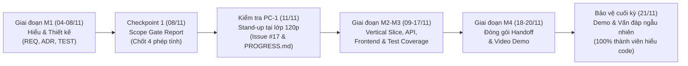

# 📚 THƯ VIỆN TÀI LIỆU THAM KHẢO & CẨM NANG DỰ ÁN
> **Dự án:** Vườn Toán Lớp 3 — Track 2 (Track B: Thêm dạng bài *"Ước lượng trước khi tính đúng"*)  
> **Mã đề thi:** `KTPMUD-BKT-2026-PILOT` | **Mã nhóm:** `173820_n04`  
> **Đơn vị:** Bộ môn Kỹ thuật Phần mềm — Trường CNTT&TT (SoICT), ĐHBK Hà Nội  
> **Thành viên:**  
> - 🧑‍💻 **Bùi Tiến Đạt** (`202414018`) — *Nhóm trưởng, BA & Lead Tester*  
> - 🧑‍💻 **Võ Tấn Đạt** (`202414021`) — *Backend & Architect Lead*  
> - 🧑‍💻 **Nguyễn Minh Quang** (`20233605`) — *Frontend & UX Lead*  

---

## 📌 1. Giới thiệu thư mục `tai-lieu-tham-khao/` & Tóm tắt thiết kế nâng cấp mới

Thư mục **`tai-lieu-tham-khao/`** được tổ chức nhằm tập hợp toàn bộ cẩm nang hướng dẫn thi, hồ sơ các mốc tiến độ, bộ dữ liệu mẫu (fixtures) và nhật ký AI. Thư mục này giúp các thành viên trong nhóm dễ dàng tra cứu, chuẩn bị nội dung báo cáo và trả lời vấn đáp với Giảng viên/Trợ giảng.

> [!IMPORTANT]
> **TÓM TẮT THIẾT KẾ NÂNG CẤP MỚI ĐÃ THỐNG NHẤT:**
> 1. **Cơ chế đếm ngược thời gian thích ứng (Adaptive Phase Timer):** Tối đa **60 giây** cho mỗi pha (Pha 1: Ước lượng nhẩm; Pha 2: Đặt tính đúng). Hoàn thành nhanh được thưởng điểm tốc độ; hết 60s hệ thống tự động khóa ô và chuyển pha an toàn, bảo toàn bài thi.
> 2. **Tỷ lệ phân bổ điểm mới (70 / 30):**
>    - **ƯỚC LƯỢNG LÀ TRỌNG TÂM CHIẾM 70% TỔNG ĐIỂM** (gồm **55% Base logic** + **15% Time Bonus**).
>    - **ĐẶT TÍNH ĐÚNG CHIẾM 30% TỔNG ĐIỂM** (gồm **25% Base logic** + **5% Time Bonus**).
> 3. **Phân cấp logic sư phạm 5 bậc cho đáp án ước lượng:**
>    - 🥇 **Điểm neo Vàng (Gold Anchor - 100% Base, tức 55% tổng điểm):** Làm tròn chuẩn SGK cả hai toán hạng.
>    - 🥈 **Điểm neo Bạc (Silver Anchors - 75% Base, tức 41.25% tổng điểm):** Làm tròn 1 toán hạng hoặc chiến lược hợp lệ.
>    - ⚠️ **Nhập đáp án tính đúng vào ô ước lượng (50% Base, tức 27.5% tổng điểm):** Đi kèm lời nhắc nhở sư phạm không tính trước rồi điền vào ô ước lượng.
>    - 💡 **Trong khoảng nhưng gõ bừa / không theo quy tắc (35% Base, tức 19.25% tổng điểm):** Đi kèm lời khuyên và gợi ý phương pháp làm tròn.
>    - ❌ **Ngoài khoảng (0% điểm):** Hiển thị hướng dẫn làm tròn nhẩm chi tiết.

> [!NOTE]  
> **Quy chuẩn tách biệt cấu trúc thư mục của dự án:**  
> - **`artifacts/`**: Chứa duy nhất 3 file tài liệu kỹ thuật cốt lõi theo quy định của ban tổ chức:  
>   1. [`TEST_PLAN.md`](../artifacts/TEST_PLAN.md) — Kế hoạch kiểm thử tự động toàn diện.  
>   2. [`DECISIONS.md`](../artifacts/DECISIONS.md) — 5 bản ghi quyết định kiến trúc (ADR-01 đến ADR-05).  
>   3. [`REQUIREMENTS.md`](../artifacts/REQUIREMENTS.md) — Đặc tả yêu cầu & ma trận 12 Acceptance Criteria (B-01 đến B-12).  
> - **`tai-lieu-tham-khao/`**: Nơi lưu trữ tài liệu phục vụ ôn tập, tra cứu nội bộ, hướng dẫn quy trình và bằng chứng tiến độ.  
> - **`progress/PROGRESS.md`**: File cập nhật tiến độ chính thức dùng cho buổi kiểm tra PC-1 tại lớp.

---

## 📑 2. Danh mục tài liệu trong thư mục

| STT | Tên tài liệu | Mô tả tóm tắt nội dung | Người đọc & Phụ trách chính | Mục đích sử dụng |
|:---:|:---|:---|:---|:---|
| **1** | [**`HUONG_DAN_KIEM_TRA_TIEN_DO_PC1_11_11.md`**](./HUONG_DAN_KIEM_TRA_TIEN_DO_PC1_11_11.md) | **Cẩm nang chi tiết cho buổi PC-1 (11/11/2026)**: - Timeline 120 phút tại lớp (9:30 - 11:30). - Hướng dẫn cấu trúc nộp `progress/PROGRESS.md`. - Quy tắc đăng comment Issue #17. - Kịch bản Stand-up 4-5 phút với Giảng viên. | **Cả nhóm** *(Bùi Tiến Đạt, Võ Tấn Đạt, Nguyễn Minh Quang)* | Ôn tập trước giờ lên lớp, sẵn sàng trả lời stand-up ngẫu nhiên. |
| **2** | [**`KTPMUD_Hack_Marathon_2026_Track2_Huong_Dan.md`**](./KTPMUD_Hack_Marathon_2026_Track2_Huong_Dan.md) | **Đặc tả tổng quan toàn diện Hackathon Marathon Track B**: - 12 Acceptance Criteria (B-01 đến B-12). - Rubric thang điểm 100 & các điều kiện chặn trần điểm. - Lịch trình 18 ngày (M0 $\rightarrow$ M4). - Triết lý *"Ưu tiên thiết kế hơn MVP"*. | **Cả nhóm** *(Trọng tâm: Bùi Tiến Đạt & Võ Tấn Đạt)* | Tra cứu gốc thể lệ cuộc thi, tiêu chí chấm điểm và phạm vi dự án. |
| **3** | [**`CHECKPOINT_1_REPORT.md`**](./CHECKPOINT_1_REPORT.md) | **Báo cáo duyệt phạm vi Checkpoint 1 (Scope Gate - M1)**: - Biên bản chốt phạm vi mở rộng CẢ 4 PHÉP TÍNH (+, -, ×, :). - Tóm tắt kết quả hoàn thành giai đoạn M1. - Bảng phân công vai trò 3 thành viên và quản trị rủi ro. | **Cả nhóm** | Bằng chứng duyệt phạm vi M1; đối chiếu cho phần Sửa đổi bắt buộc. |
| **4** | [**`SEED_FIXTURES.md`**](./SEED_FIXTURES.md) | **Bộ dữ liệu câu hỏi mẫu synthetic 4 phép tính**: - Cấu trúc JSON chuẩn cho `type = 'estimate'` có `gold_anchor` và `silver_anchors`. - 16 câu hỏi mẫu (4 cộng, 4 trừ, 4 nhân, 4 chia). - 5 bậc phân cấp sư phạm và cơ chế Time Bonus đếm ngược 60s. | **Bùi Tiến Đạt** *(BA/Tester)* & **Võ Tấn Đạt** *(Backend)* | Nạp seed DB (`data/seed.json`), đối chiếu ca kiểm thử Jest. |
| **5** | [**`AI_USE.md`**](./AI_USE.md) | **Nhật ký sử dụng AI có trách nhiệm (AI Use Log)**: - Bảng truy vết từng prompt, ngữ cảnh, file áp dụng. - Bằng chứng con người tự tay kiểm chứng toán học & code. - Cam kết không dùng LLM runtime, không rò rỉ secret/PII. | **Võ Tấn Đạt** *(Backend/CI)* & **Cả nhóm** | Bảo vệ điểm AI policy (tối đa 15% rubric), trả lời phỏng vấn Viva. |

---

## 🧭 3. Bản đồ các mốc đánh giá quan trọng (Milestones)

---

## 💡 4. Gợi ý trả lời vấn đáp & Stand-up nhanh cho từng thành viên

### 🧑‍💻 Bùi Tiến Đạt (BA & Lead Tester)
- **Chủ đề thường được hỏi:**
  - Vì sao chọn tỷ lệ phân bổ điểm 70% Ước lượng và 30% Đặt tính đúng?  
    *(Đáp: Tham khảo tài liệu [`REQUIREMENTS.md`](../artifacts/REQUIREMENTS.md) Mục 1.2 & 2.1. Ước lượng là hạt nhân rèn tư duy số học và phản xạ nhẩm trước khi tính. Tỷ lệ 70% gồm 55% Base + 15% Time Bonus giúp khích lệ học sinh dám làm tròn nhẩm nhanh, còn 30% kiểm tra kỹ năng đặt tính chính xác).*
  - Phân cấp 5 bậc sư phạm cho ước lượng hoạt động ra sao?  
    *(Đáp: Điểm neo Vàng 100% khi làm tròn chuẩn SGK cả hai toán hạng; Điểm neo Bạc 75% khi làm tròn 1 toán hạng hợp lệ; Nhập kết quả đúng vào ô ước lượng chỉ nhận 50% kèm nhắc nhở không tính trước; Trong khoảng nhưng gõ bừa nhận 35% kèm gợi ý làm tròn; Ngoài khoảng 0%).*
  - Cấu trúc test suites gồm những gì?  
    *(Đáp: Đọc [`TEST_PLAN.md`](../artifacts/TEST_PLAN.md). Gồm Unit test scoring phân cấp 5 bậc, Integration test API submit có time bonus, Edge cases timeout 60s, số âm/chia cho 0, và E2E flow).*

### 🧑‍💻 Võ Tấn Đạt (Backend & Architect)
- **Chủ đề thường được hỏi:**
  - Tại sao lưu dữ liệu đáp án dạng JSON string trong cột `correct_answer` thay vì thêm cột SQL mới?  
    *(Đáp: Tham khảo [`DECISIONS.md`](../artifacts/DECISIONS.md) ADR-02. Tránh breaking change schema bảng `questions`, giữ tương thích 100% với 4 loại câu hỏi cũ, đồng thời mở rộng lưu trữ `gold_anchor` và `silver_anchors` dễ dàng).*
  - Logic chấm điểm bảo mật và tính thưởng thời gian ở đâu?  
    *(Đáp: Tham khảo [`DECISIONS.md`](../artifacts/DECISIONS.md) ADR-01, ADR-03 & tiêu chí B-07. Toàn bộ logic chạy tất định tại `server/scoring.js`. API `GET /questions` loại bỏ hoàn toàn `correct_answer`, `gold_anchor`, `silver_anchors` và khoảng ước lượng về client).*

### 🧑‍💻 Nguyễn Minh Quang (Frontend & UX Lead)
- **Chủ đề thường được hỏi:**
  - Trải nghiệm 2 pha và đồng hồ đếm ngược 60 giây được cài đặt như thế nào?  
    *(Đáp: Tham khảo [`DECISIONS.md`](../artifacts/DECISIONS.md) ADR-04 và [`REQUIREMENTS.md`](../artifacts/REQUIREMENTS.md). Thẻ 2 pha hiển thị Pha 1 (Ước lượng) với đồng hồ đếm ngược từ 60s. Khi còn dưới 10s, thanh tiến trình chuyển màu cam nhẹ nhàng. Hết 60s tự khóa ô và tự động kích hoạt Pha 2 (Đặt tính đúng)).*
  - Khả năng tiếp cận bằng bàn phím (A11y / Keyboard Accessibility)?  
    *(Đáp: Hỗ trợ chuyển ô bằng phím `Tab`, nộp bài/chuyển pha bằng phím `Enter`, hiển thị focus ring rõ ràng, phù hợp tiêu chí B-12).*

---

> 🤝 **Chúc cả nhóm phối hợp nhịp nhàng, hoàn thành xuất sắc buổi kiểm tra tiến độ PC-1 và bảo vệ thành công dự án!**
