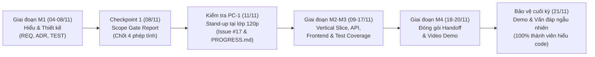

# 📚 THƯ VIỆN TÀI LIỆU THAM KHẢO & CẨM NANG DỰ ÁN
> **Dự án:** Vườn Toán Lớp 3 — Track 2 (Track B: Thêm dạng bài *"Ước lượng trước khi tính đúng"*)  
> **Mã đề thi:** `KTPMUD-BKT-2026-PILOT` | **Mã nhóm:** `173820_n04`  
> **Đơn vị:** Bộ môn Kỹ thuật Phần mềm — Trường CNTT&TT (SoICT), ĐHBK Hà Nội  
> **Thành viên:**  
> - 🧑‍💻 **Bùi Tiến Đạt** (`202414018`) — *Nhóm trưởng, BA & Lead Tester*  
> - 🧑‍💻 **Võ Tấn Đạt** (`202414021`) — *Backend & Architect Lead*  
> - 🧑‍💻 **Nguyễn Minh Quang** (`20233605`) — *Frontend & UX Lead*  

---

## 📌 1. Giới thiệu thư mục `tai-lieu-tham-khao/`

Thư mục **`tai-lieu-tham-khao/`** được tổ chức nhằm tập hợp toàn bộ cẩm nang hướng dẫn thi, hồ sơ các mốc tiến độ, bộ dữ liệu mẫu (fixtures) và nhật ký AI. Thư mục này giúp các thành viên trong nhóm dễ dàng tra cứu, chuẩn bị nội dung báo cáo và trả lời vấn đáp với Giảng viên/Trợ giảng.

> [!NOTE]  
> **Quy chuẩn tách biệt cấu trúc thư mục của dự án:**  
> - **`artifacts/`**: Chứa duy nhất 3 file tài liệu kỹ thuật cốt lõi theo quy định của ban tổ chức:  
>   1. [`TEST_PLAN.md`](../artifacts/TEST_PLAN.md) — Kế hoạch kiểm thử tự động toàn diện.  
>   2. [`DECISIONS.md`](../artifacts/DECISIONS.md) — 5 bản ghi quyết định kiến trúc (ADR-01 đến ADR-05).  
>   3. [`REQUIREMENTS.md`](../artifacts/REQUIREMENTS.md) — Đặc tả yêu cầu & ma trận 12 Acceptance Criteria (B-01 đến B-12).  
> - **`tai-lieu-tham-khao/`**: Nơi lưu trữ tài liệu phục vụ ôn tập, tra cứu nội bộ, hướng dẫn quy trình và bằng chứng tiến độ.  
> - **`progress/PROGRESS.md`**: File cập nhật tiến độ chính thức dùng cho buổi kiểm tra PC-1 tại lớp.

---

## 📑 2. Danh mục tài liệu trong thư mục

| STT | Tên tài liệu | Mô tả tóm tắt nội dung | Người đọc & Phụ trách chính | Mục đích sử dụng |
|:---:|:---|:---|:---|:---|
| **1** | [**`HUONG_DAN_KIEM_TRA_TIEN_DO_PC1_11_11.md`**](./HUONG_DAN_KIEM_TRA_TIEN_DO_PC1_11_11.md) | **Cẩm nang chi tiết cho buổi PC-1 (11/11/2026)**: - Timeline 120 phút tại lớp (9:30 - 11:30). - Hướng dẫn cấu trúc nộp `progress/PROGRESS.md`. - Quy tắc đăng comment Issue #17. - Kịch bản Stand-up 4-5 phút với Giảng viên. | **Cả nhóm** *(Bùi Tiến Đạt, Võ Tấn Đạt, Nguyễn Minh Quang)* | Ôn tập trước giờ lên lớp, sẵn sàng trả lời stand-up ngẫu nhiên. |
| **2** | [**`KTPMUD_Hack_Marathon_2026_Track2_Huong_Dan.md`**](./KTPMUD_Hack_Marathon_2026_Track2_Huong_Dan.md) | **Đặc tả tổng quan toàn diện Hackathon Marathon Track B**: - 12 Acceptance Criteria (B-01 đến B-12). - Rubric thang điểm 100 & các điều kiện chặn trần điểm. - Lịch trình 18 ngày (M0 $\rightarrow$ M4). - Triết lý *"Ưu tiên thiết kế hơn MVP"*. | **Cả nhóm** *(Trọng tâm: Bùi Tiến Đạt & Võ Tấn Đạt)* | Tra cứu gốc thể lệ cuộc thi, tiêu chí chấm điểm và phạm vi dự án. |
| **3** | [**`CHECKPOINT_1_REPORT.md`**](./CHECKPOINT_1_REPORT.md) | **Báo cáo duyệt phạm vi Checkpoint 1 (Scope Gate - M1)**: - Biên bản chốt phạm vi mở rộng CẢ 4 PHÉP TÍNH (+, -, ×, :). - Tóm tắt kết quả hoàn thành giai đoạn M1. - Bảng phân công vai trò 3 thành viên và quản trị rủi ro. | **Cả nhóm** | Bằng chứng duyệt phạm vi M1; đối chiếu cho phần Sửa đổi bắt buộc. |
| **4** | [**`SEED_FIXTURES.md`**](./SEED_FIXTURES.md) | **Bộ dữ liệu câu hỏi mẫu synthetic 4 phép tính**: - Cấu trúc JSON chuẩn cho `type = 'estimate'`. - 16 câu hỏi mẫu (4 cộng, 4 trừ, 4 nhân, 4 chia). - Phân tích dung sai ước lượng và lời giải thích sư phạm. | **Bùi Tiến Đạt** *(BA/Tester)* & **Võ Tấn Đạt** *(Backend)* | Nạp seed DB (`data/seed.json`), đối chiếu ca kiểm thử Jest. |
| **5** | [**`AI_USE.md`**](./AI_USE.md) | **Nhật ký sử dụng AI có trách nhiệm (AI Use Log)**: - Bảng truy vết từng prompt, ngữ cảnh, file áp dụng. - Bằng chứng con người tự tay kiểm chứng toán học & code. - Cam kết không dùng LLM runtime, không rò rỉ secret/PII. | **Võ Tấn Đạt** *(Backend/CI)* & **Cả nhóm** | Bảo vệ điểm AI policy (tối đa 15% rubric), trả lời phỏng vấn Viva. |

---

## 🧭 3. Bản đồ các mốc đánh giá quan trọng (Milestones)

---

## 💡 4. Gợi ý trả lời vấn đáp & Stand-up nhanh cho từng thành viên

### 🧑‍💻 Bùi Tiến Đạt (BA & Lead Tester)
- **Chủ đề thường được hỏi:**
  - Vì sao chọn quy tắc dung sai $\pm 15\%$ kết hợp $\Delta_{min} = \max(3, \lceil 0.15 \times A \rceil)$ cho phép cộng/trừ 2 chữ số?  
    *(Đáp: Tham khảo tài liệu [`DECISIONS.md`](../artifacts/DECISIONS.md) ADR-01 và [`SEED_FIXTURES.md`](./SEED_FIXTURES.md). Với các phép toán có kết quả nhỏ, dung sai phần trăm thuần túy sẽ quá ngặt nghèo với trẻ lớp 3).*
  - Cấu trúc test suites gồm những gì?  
    *(Đáp: Đọc [`TEST_PLAN.md`](../artifacts/TEST_PLAN.md). Gồm Unit test scoring, Integration test API submit, Edge cases số âm/chia cho 0, và E2E flow).*

### 🧑‍💻 Võ Tấn Đạt (Backend & Architect)
- **Chủ đề thường được hỏi:**
  - Tại sao lưu dữ liệu đáp án dạng JSON string trong cột `correct_answer` thay vì thêm cột SQL mới?  
    *(Đáp: Tham khảo [`DECISIONS.md`](../artifacts/DECISIONS.md) ADR-02. Tránh breaking change schema bảng `questions`, giữ tương thích 100% với 4 loại câu hỏi cũ).*
  - Logic chấm điểm bảo mật ở đâu?  
    *(Đáp: Tham khảo [`DECISIONS.md`](../artifacts/DECISIONS.md) ADR-03 & tiêu chí B-07. API `/api/lessons/:id/questions` không trả về `correct_answer`, `tolerance`, `min_acceptable` về client để tránh gian lận F12).*

### 🧑‍💻 Nguyễn Minh Quang (Frontend & UX Lead)
- **Chủ đề thường được hỏi:**
  - Trải nghiệm 2 pha được cài đặt như thế nào để phục vụ trẻ lớp 3?  
    *(Đáp: Tham khảo [`DECISIONS.md`](../artifacts/DECISIONS.md) ADR-04. Học sinh chỉ thấy ô nhập Ước lượng trước; sau khi nộp ước lượng mới mở khóa ô Tính đúng).*
  - Khả năng tiếp cận bằng bàn phím (A11y / Keyboard Accessibility)?  
    *(Đáp: Hỗ trợ chuyển ô bằng phím `Tab`, nộp bài bằng phím `Enter`, hiển thị focus ring rõ ràng, phù hợp tiêu chí B-12).*

---

> 🤝 **Chúc cả nhóm phối hợp nhịp nhàng, hoàn thành xuất sắc buổi kiểm tra tiến độ PC-1 và bảo vệ thành công dự án!**
